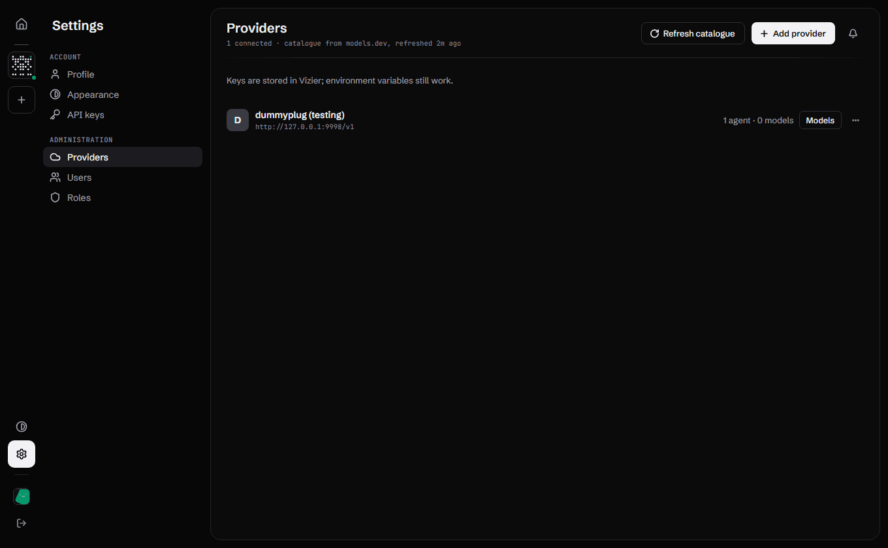

# Configuration Overview

Vizier keeps file-based configuration deliberately small. Almost everything (providers, users, agents, tools, channels) is set at runtime in the **WebUI** (or the HTTP API) and stored in the workspace's database. What is left is process-level settings, which differ by edition.

| | Server edition | Desktop app edition |
|---|---|---|
| Process settings | `.vizier.yaml` (optional), CLI flags, environment variables | **Settings → Desktop** in the app |
| Everything else | The WebUI / HTTP API | The WebUI |

The pages in this section marked **Server edition** (Main Configuration, CLI, Storage & Shell, Observability, Build Flavours, Kubernetes) do not apply to the app. Pages without a mark apply to both.

## Where each setting lives

| Setting | Where |
|---------|-------|
| Port, JWT secret, worker threads, catalogue refresh *(server)* | `.vizier.yaml`, flags, env. See [Main Configuration](./main-config.md) and [CLI](./cli.md) |
| Database and file storage *(server)* | `.vizier.yaml`, env. See [Storage & Shell](./storage-shell.md) |
| Providers and API keys | **Settings → Providers**, or the provider's environment variable. See [Providers](./providers.md) |
| Users, roles, API keys *(server; web access in the app)* | **Settings → Users / Roles / API keys** |
| Color theme | **Settings → Appearance**. See [Color Themes](./themes.md) |
| Everything about an agent (model, prompt, sharing, dreams, voice, embedding) | The agent's **Config** page. See [Agents](./agents.md) and [Voice, Images & Embeddings](./tools-embedding.md) |
| Shell, HTTP, Brave Search, Office | The agent's **Addons** (agent menu → Connections) page ([Agents](./agents.md#addons), [Storage & Shell](./storage-shell.md#shell)) |
| MCP servers | **MCP** (agent menu → Connections). See [MCP Servers](./mcp.md) |
| Discord and Telegram bots | **Channels** (agent menu → Connections). See [Channels](./channels.md) |
| Memory and Core | The agent's **Memory** page. See [Memory](./memory.md) |
| Skills and Functions | The agent's **Skills** and **Functions** pages. See [Skills](./skills.md) and [Functions](./custom-tools.md) |
| Secrets | The agent's **Secrets** page. See [Agent Secrets](./secrets.md) |



Seed settings are read once at startup. An agent is **never** defined in YAML; create it in the WebUI.

## Config-less mode (server)

`vizier run` works with no config file. The file is looked up in this order:

1. `-c/--config <path>`
2. `$VIZIER_CONFIG`
3. `./.vizier.yaml` in the current directory
4. Built-in defaults

With no file, the defaults are SQLite storage, HTTP on port `9999` with `jwt_secret: "${VIZIER_JWT_SECRET}"`, and 4 worker threads. The workspace is `$VIZIER_DATA_DIR` if set, otherwise `$HOME/.vizier`. When a config file **is** used, the workspace is `<config dir>/.vizier/`.

> **`VIZIER_JWT_SECRET` is required in config-less mode.** An unset variable is a load error. The Docker image sets a placeholder secret; override it in production.

## Workspace layout

```
<workspace>/
  agents/<agent_id>/
    memory/<bundle>/        # markdown memory concepts + index.md + log.md
    skills/<slug>/          # per-agent skills
  skills/<slug>/            # global skills
  artifacts/<agent_id>/<artifact_id>/  # permanent artifacts (content.v<n>)
  uploads/<file_id>/        # transient session files
  .runtime/
    vizier.db               # SQLite database (agents, sessions, history, users, memory index…)
    .vizier.sock            # command socket used by `vizier shutdown` / `agent ps`
    logs/                   # stdout/stderr when running detached
```

## Environment variables

`.vizier.yaml` supports `${VAR}` expansion anywhere (via `shellexpand`):

```yaml
vizier:
  channels:
    http:
      jwt_secret: "${VIZIER_JWT_SECRET}"
```

Variables used by the defaults and the Docker entrypoint:

| Variable | Used for |
|----------|----------|
| `VIZIER_CONFIG` | Config file path (when `-c` isn't given) |
| `VIZIER_DATA_DIR` / `VIZIER_WORKSPACE` | Workspace directory in config-less mode / Docker |
| `VIZIER_JWT_SECRET` | Referenced by the default `channels.http.jwt_secret` |
| `VIZIER_PORT`, `VIZIER_STORAGE`, `VIZIER_WORKERS`, `VIZIER_WS_IDLE_TIMEOUT`, `VIZIER_EXTRA_ARGS` | Docker entrypoint → CLI flags |
| `VIZIER_CATALOGUE_REFRESH`, `VIZIER_CATALOGUE_TTL` | `catalogue.refresh` / `catalogue.ttl` |
| `RUST_LOG` | Tracing filter (e.g. `vizier=debug`) |
| `OPENAI_API_KEY`, `ANTHROPIC_API_KEY`, `GEMINI_API_KEY`, `GROQ_API_KEY`, … | Provider keys, picked up without any configuration — see [Providers](./providers.md) |


## Sections

- **Getting started:** [Choose an Edition](../getting-started/editions.md), [Your First Agent](../getting-started/first-agent.md)
- **Server edition:** [Main Configuration](./main-config.md), [CLI](./cli.md), [Storage & Shell](./storage-shell.md), [Observability](./observability.md), [Build Flavours](./build-flavours.md), [Encryption at Rest](./encryption.md)
- **Desktop app:** [Install](../app/installation.md), [Web Access](../app/web-access.md)
- **Using agents:** [Providers](./providers.md), [Agents](./agents.md), [Channels](./channels.md), [Voice, Images & Embeddings](./tools-embedding.md), [MCP Servers](./mcp.md), [Skills](./skills.md), [Memory](./memory.md)
- **More:** [Agent Secrets](./secrets.md), [Artifacts](./artifacts.md), [Office addon](./office-addon.md), [Consultations](./consultations.md), [Live Voice](./live-voice.md), [Functions](./custom-tools.md), [Questions](./questions.md), [Time](./time.md), [Color Themes](./themes.md)
- **Experimental:** [Projects](./projects.md), [Fleet](../fleet/bus-contract.md)
