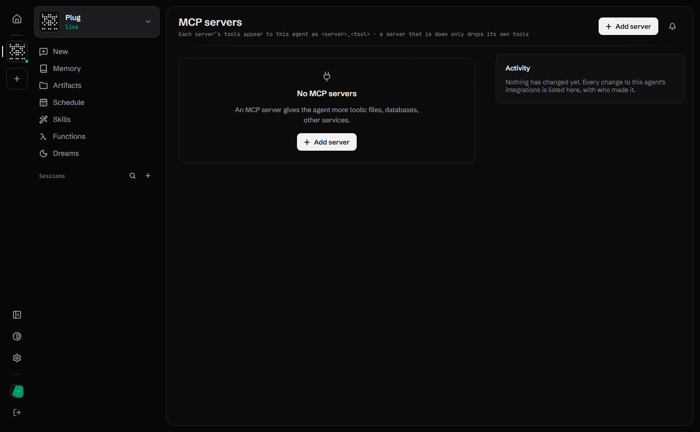

# MCP Servers



[MCP (Model Context Protocol)](https://modelcontextprotocol.io/) lets an agent use tools exposed by external servers (GitHub, a filesystem, a database, your own service). MCP servers belong to **one agent**: each agent runs its own connections, and there is no global registry.

## Adding a server

Open the agent's **MCP** (agent menu → Connections) page and choose to add a server. Give it a name, choose the transport and fill in its settings. Adding, changing or removing a server takes effect from the agent's next turn and never restarts the agent or interrupts a conversation.

The same thing over the API is an integration of kind `mcp`:

```http
POST /api/v1/agents/{id}/integrations
Content-Type: application/json

{
  "kind": "mcp",
  "name": "github",
  "settings": {
    "transport": "local",
    "command": "npx",
    "args": ["-y", "@modelcontextprotocol/server-github"],
    "env": { "GITHUB_PERSONAL_ACCESS_TOKEN": "ghp_…" }
  }
}
```

The **name** is 1 to 48 lowercase letters, digits, `_` or `-`, and it becomes part of every tool name. Names are unique per agent, not across the install.

### Local server (stdio)

`"transport": "local"` (the default) starts a subprocess on the machine running Vizier and talks to it over stdin/stdout.

| Setting | Required | Description |
|---------|----------|-------------|
| `command` | yes | Executable to spawn |
| `args` | no | Arguments |
| `env` | no | Extra environment variables for the subprocess |

> [!WARNING]
> A local server runs commands on the Vizier host with Vizier's permissions. Add only servers you trust. By default an agent cannot add MCP servers to itself; that is the **MCP servers** switch under **Addons → Self-management**.

### Remote server (Streamable HTTP)

`"transport": "http"` connects to a server over the network.

| Setting | Required | Description |
|---------|----------|-------------|
| `uri` | yes | The MCP endpoint URL |
| `headers` | no | Headers sent with every request, for example `{"Authorization": "Bearer <token>"}` |

A header the transport sets itself (`Accept`, `Content-Type`, `Mcp-Session-Id`, `Mcp-Protocol-Version`, `Last-Event-ID`) or a malformed name or value is refused when you save. A server that answers `401` shows as failed with "the server requires authentication".

OAuth sign-in (the flow where the server sends you to a login page) is not supported yet. Use a personal access token if the server offers one, or put a proxy in front.

## What the agent gets

Each tool the server advertises appears on the agent as `<server>_<tool>`, grouped under the server's name (for example `github_create_issue` in the `github` group). If that clashes with a built-in tool or group, Vizier adds a suffix (`_mcp`, `_2`, …) so nothing is overwritten. Tool arguments are passed through unchanged, and calls are bound by the agent's tool timeout.

## Health and reconnecting

Servers connect in the background, so a slow or broken one never delays a turn. The list of tools is cached for five minutes (or until the server says it changed). A server that crashes or hangs is reconnected with a backoff, and while it is down only its own tools are missing; the agent carries on without them. Each server shows its state on the Integrations page.

## Secrets

Every value in a server's `env` and `headers` is encrypted at rest and shown masked (`••••a91c`) in the WebUI and API. The command, arguments, transport, URL and header names stay readable. See [Encryption at Rest](./encryption.md) for the key and backup rules.
