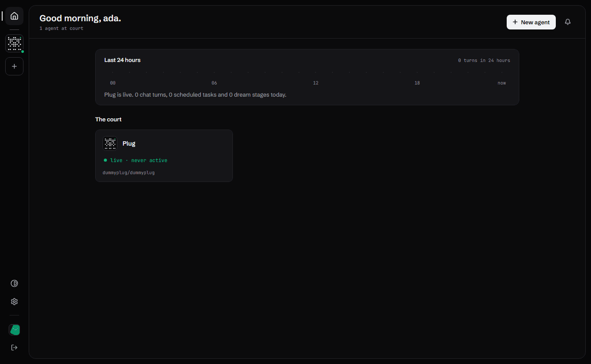
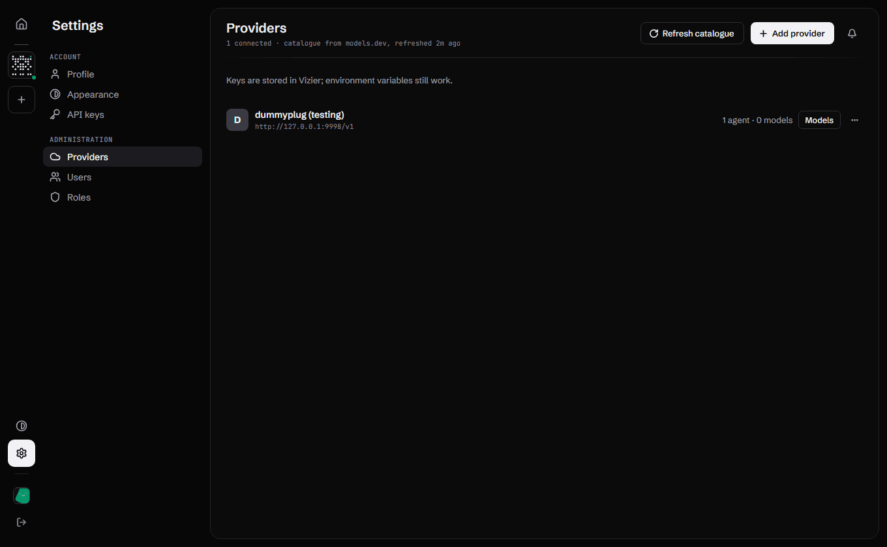
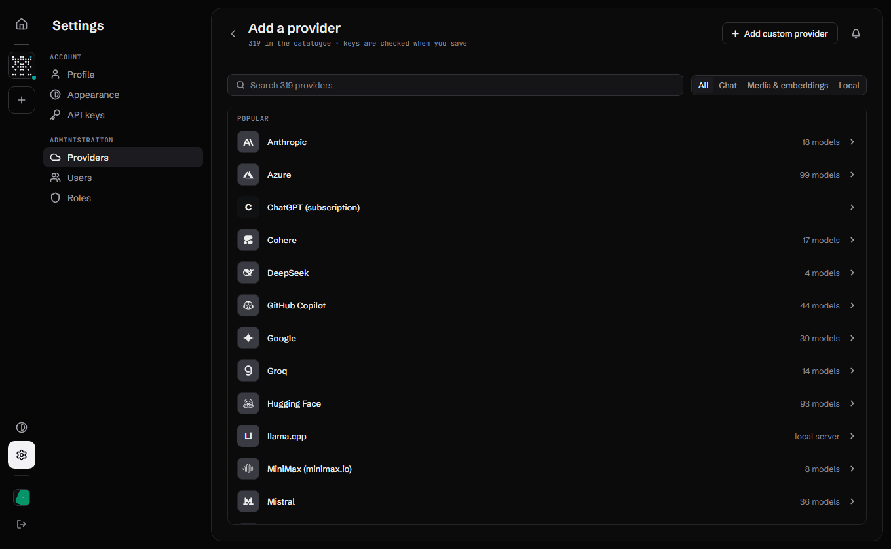
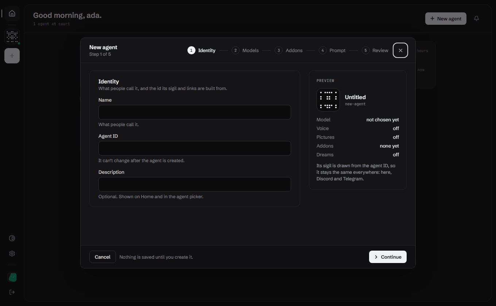
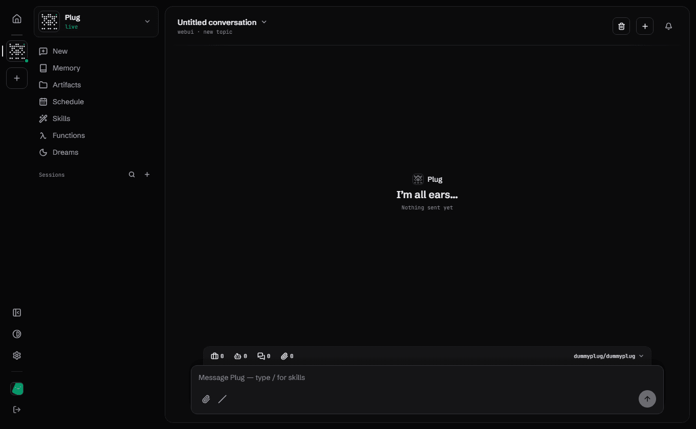
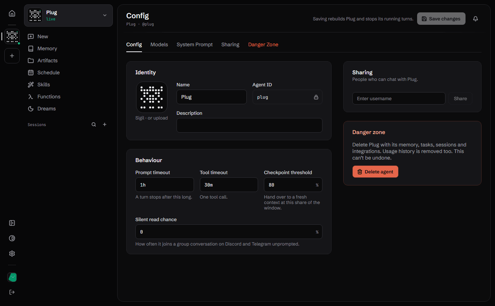
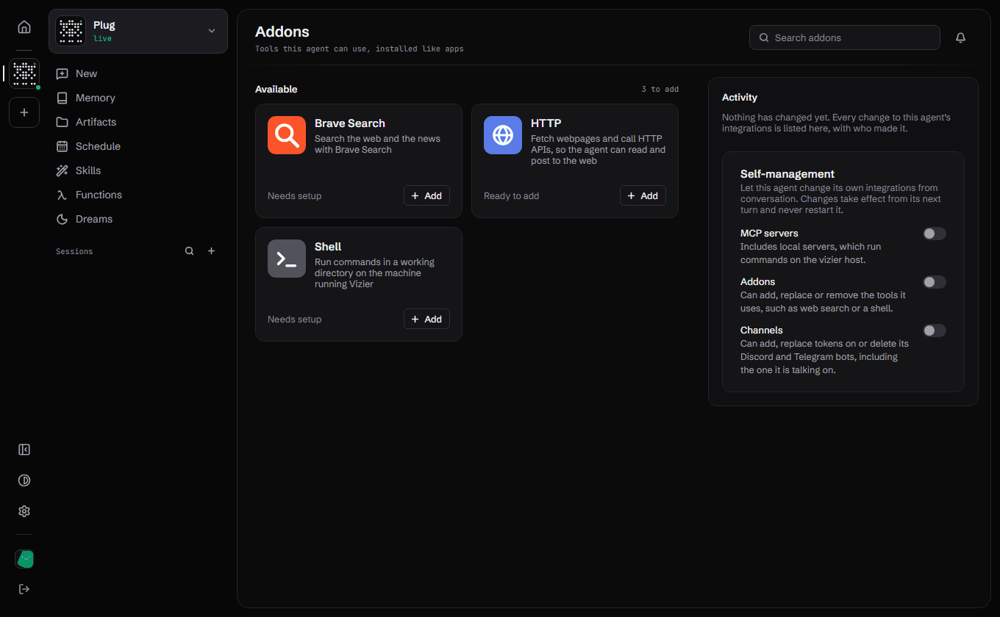
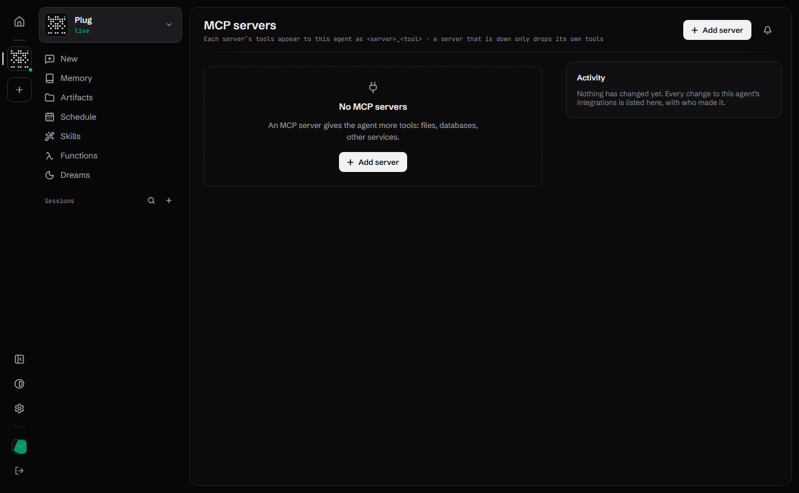
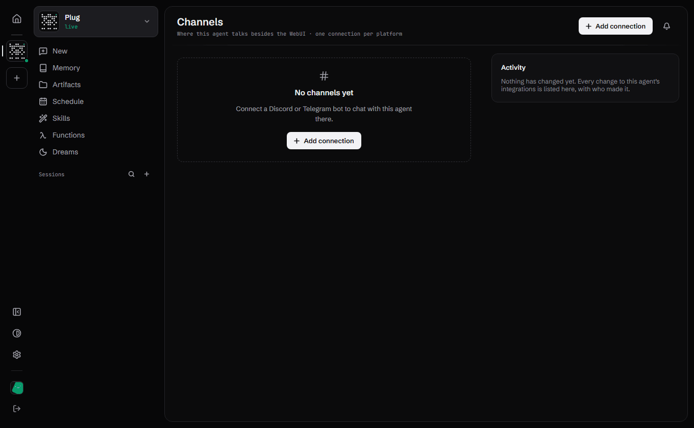
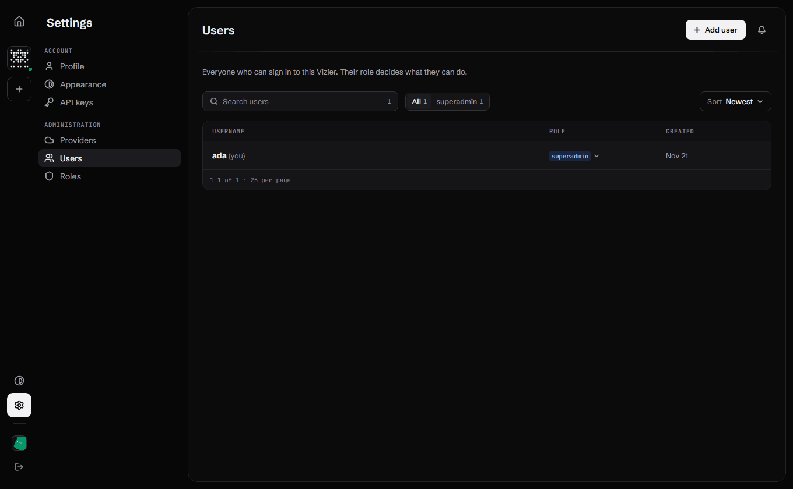

# Your First Agent

This guide is the same in both editions once Vizier is running: connect a model provider, create an agent, talk to it, then give it tools and a channel. Screenshots are from the WebUI in its dark theme.

If Vizier is not running yet, start with the [server quick start](../server/quick-start.md) or the [desktop app quick start](../app/quick-start.md).

## 1. Connect a provider

An agent needs a model, and a model needs a provider. Open **Settings → Providers** (the gear at the bottom of the left rail).

Choose **Add provider**, pick one from the catalogue (OpenAI, Anthropic, Google, OpenRouter, Ollama and many more) and paste its API key. Ollama and llama.cpp on their default local addresses need no key at all. **Test connection** checks the credentials before you save.

A key can also come from the provider's usual environment variable (for example `ANTHROPIC_API_KEY`), which is handy on a server. See [Providers](../configuration/providers.md) for the full list, custom providers and the setup notes for each.

## 2. Create the agent

On Home choose **New agent**. A five-step wizard asks for:

1. **Identity**: a name, an agent ID (fixed once created; its sigil and links are built from it) and an optional description.
2. **Models**: the provider and model for chat, plus optional voice, image and embedding settings.
3. **Addons**: tools to start with (Shell, HTTP, Brave Search). You can add them later.
4. **Prompt**: an optional system prompt.
5. **Review**: nothing is saved until you create it.

The agent starts immediately. Its page has the pages you will use most: **Memory**, **Artifacts**, **Schedule**, **Skills**, **Functions** and **Dreams**, and a list of its conversations.

## 3. Talk to it

Choose **New** in the agent's column to start a conversation. Type `/` to run a skill, attach files with the paperclip, and use the strip above the composer for what the agent is doing right now (background work, subagents, files).

## 4. Shape the agent

The agent's **Config** page holds its identity, behaviour (timeouts, when it checkpoints a long conversation, how often it joins group chats unprompted), its models, system prompt, sharing and the danger zone.

Behind the scenes every agent has:

- **Core**, its identity document, kept as a memory at `core/soul` and read on every turn.
- **Memory**, a graph of markdown documents it reads and writes, which you can browse and edit. See [Memory](../configuration/memory.md).
- **Skills** and **Functions**, reusable instructions and saved scripts. See [Skills](../configuration/skills.md) and [Custom Tools](../configuration/custom-tools.md).
- **Dreams**, an optional scheduled reflection pass.

## 5. Give it tools

Open the agent card's menu at the top of its column: **Connections** holds **Addons**, **Channels** and **MCP**, and **Running it** holds **Usage**, **Secrets** and **Config**. Start with **Addons**. Addons are tools that belong to one agent, installed like small apps: **Shell** (run commands on the host), **HTTP** (fetch pages and call APIs), **Brave Search**, **Office** (Word, Excel, PDF). The page also has the **self-management** switches that let the agent add its own MCP servers, addons or channels.

For tools from other software, add an [MCP server](../configuration/mcp.md).

## 6. Put it on Discord or Telegram

Open **Channels** (agent menu → Connections) and choose **Add connection**. Each agent owns its bot token (one connection per platform), so every agent appears as its own bot. Setup steps for each platform are in [Channels](../configuration/channels.md).

> [!NOTE]
> In the desktop app, Discord and Telegram bots only run while the app is running.

## 7. Share it

Create more users and decide what they may do under **Settings → Users** and **Roles**; people reach an agent by owning it or by having it shared with them from its **Config → Sharing**. Roles and API keys are described in [Agents](../configuration/agents.md#ownership-and-sharing).

> The desktop app has a single local owner, so Users and Roles matter there only if you turn on [web access](../app/web-access.md).

## Next steps

- [Agents](../configuration/agents.md): every field, the dream cycle, checkpoints, tasks
- [Memory](../configuration/memory.md), [Skills](../configuration/skills.md), [Tools & Embedding](../configuration/tools-embedding.md)
- [Color Themes](../configuration/themes.md) and the rest of **Settings**
- [REST API](../api-integration/rest-api.md) to drive Vizier from your own code
