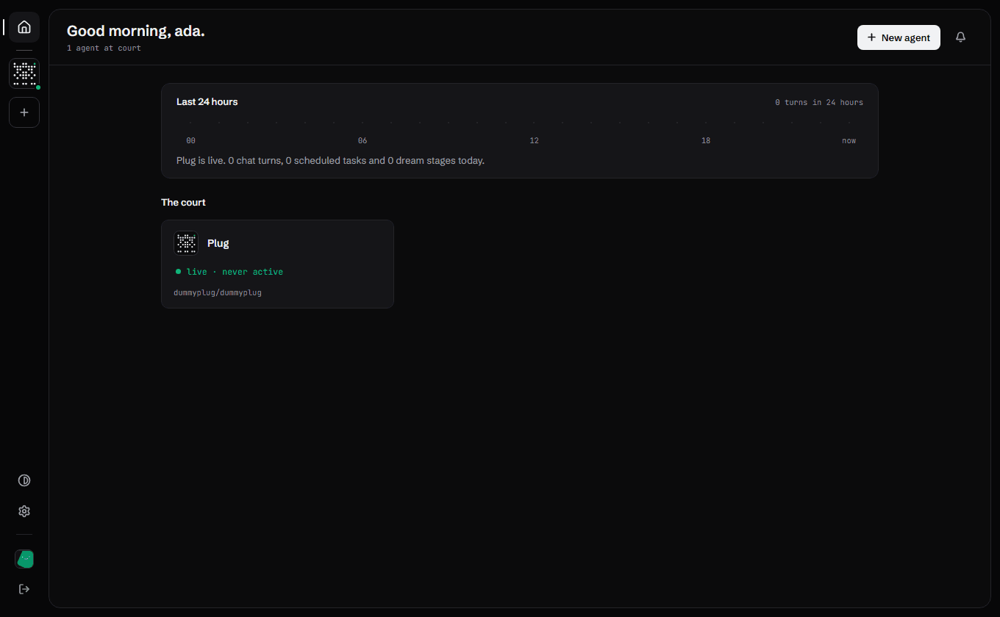

# Introduction

> **A digital steward for Your Majesty.**\
> AI agents that remember who they are, and who you are. Hosted by you.

Vizier is an AI agent framework written in Rust. One Vizier runs many agents at once, each with its own model provider, tools, memory and identity, and reaches them over the WebUI, Discord, Telegram and an HTTP API. Everything is stored in an embedded SQLite database and plain markdown files, so there is nothing else to run.

It comes in two editions that share one engine and one WebUI:

- **[Server edition](./server/installation.md)**: a single binary or container you host. Many users, Discord/Telegram bots, REST and WebSocket API, Docker and Kubernetes.
- **[Desktop app edition](./app/installation.md)**: a native app for macOS, Linux and Windows with no setup and no open port. Just you and your agents.

Not sure which? See [Choose an Edition](./getting-started/editions.md).



## What you get

- **Agents that remember.** Long-term memory is plain markdown you can read and edit, organised into bundles with a link graph and semantic search. An agent's identity (its Core) is one of those documents. See [Memory](./configuration/memory.md).
- **Any model.** Providers come from the models.dev catalogue (OpenAI, Anthropic, Google, OpenRouter, Ollama, Bedrock and many more), plus any OpenAI- or Anthropic-compatible endpoint. See [Providers](./configuration/providers.md).
- **Where you already talk.** The WebUI, Discord and Telegram. Each agent has its own bot. See [Channels](./configuration/channels.md).
- **Tools you choose.** Shell, HTTP, web search, Office files and any [MCP server](./configuration/mcp.md), added per agent. Reusable [skills](./configuration/skills.md) and saved [functions](./configuration/custom-tools.md).
- **Initiative.** Scheduled tasks, background work, subagents, [consulting other agents](./configuration/consultations.md), and a nightly **dream cycle** that turns the day's conversations into durable memory.
- **Long conversations.** Automatic checkpoints hand a conversation over to a fresh context before it overflows.
- **Voice.** Speech in and out, and live voice calls. See [Live Voice](./configuration/live-voice.md).
- **Control.** Users, roles and permissions, sharing, API keys, encryption of secrets at rest, and a usage page showing what each agent spends.

## How it fits together

```
        WebUI          Discord          Telegram          REST / WebSocket
          └───────────────┴────────────────┴──────────────────┘
                                   │
                              Vizier engine
        ┌──────────────┬───────────┴───────────┬───────────────┐
     Agents         Scheduler              Providers         Storage
 (memory, tools,   (tasks, dreams)     (chat, voice,       (SQLite or PostgreSQL,
  skills, MCP)                          images, embeddings)  markdown files)
```

## Start here

1. [Choose an edition](./getting-started/editions.md) and install it: [server](./server/installation.md) or [desktop app](./app/installation.md).
2. Follow its quick start, then [Your First Agent](./getting-started/first-agent.md).
3. Browse [Using Vizier](./configuration/index.md) for each feature.
4. Build on it with the [REST API](./api-integration/rest-api.md).

## Project status

> [!WARNING]
> Vizier is under active, fast-moving development. Configuration shapes and APIs may change between minor versions.

**Projects** (agents working inside a folder on your computer) and **Fleet** (running Vizier as several cooperating processes) are **experimental**: they are still being built and are marked as such in these docs.
