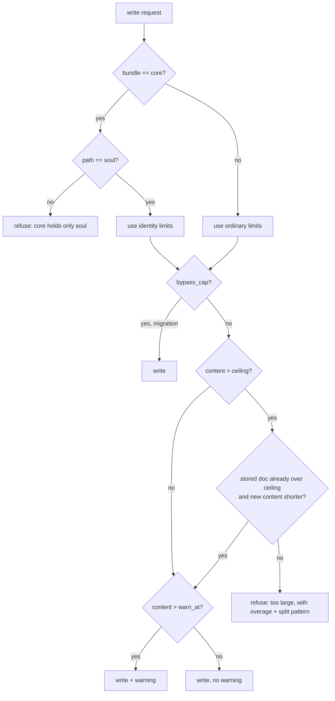

# Contract: storage behaviour

Everything below is enforced in **one** function — `BundleMemoryStore::write_memory_inner` — because every write path funnels through it (research Decision 1). These rules are stated as behaviour, so the tests can be written against them rather than against an implementation.

## Verification order

The checks run **before** anything is persisted, in this order. A refusal anywhere leaves the document, its passages, its revision rows and its bundle log byte-identical.

## Rules

1. **Reserved bundle.** Only `soul` may be written to `core`. The refusal names the accepted path.
2. **Bypass.** Only the migration sets it, and it skips rule 4 only — the bundle guard still applies.
3. **Limits selection.** The address decides which pair applies; there is no second config field.
4. **Ceiling.** `content.len() > ceiling` is refused unless rule 5 applies.
5. **Grandfathering.** If the stored content is already over the ceiling and the new content is shorter, the write is accepted (with a warning if it is still over the soft limit).
6. **Warning.** `content.len() > warn_at` yields a warning in the result; the write proceeds normally and nothing is truncated.
7. **No partial writes.** A refusal must not have written the document, replaced passages, recorded a revision, or appended to the bundle log.

## What stays untouched

| path | why |
|---|---|
| `delete_bundle` | already refuses a non-empty bundle; the reserved bundle needs its own refusal because `force` exists (FR-012) |
| `import_bundle` | refuses a destination of `core` (FR-014) |
| `delete_memory` | no identity special case — the document is removable (FR-009) |
| `rollback_memory` | goes through the same write path, so it inherits the cap; a restore of an over-cap historical revision is a *growing* write and is refused. Acceptable: the content is recoverable by editing. |
| `attach`/`detach` | unaffected; attachments are metadata, not content |

## Seed (migration) behaviour

1. Runs at agent spawn, beside the passage reconcile, as a detached task.
2. Marker per agent: a document present means done. Absent means pending.
3. Source order: `agent_core` → on-disk `CORE.md` → embedded template.
4. The seeded body is the source content verbatim, plus one appended provenance line.
5. Written with the bypass, once. Never rewritten.
6. A failure is logged at `warn` and retried on the next start; it never blocks the agent from serving.

## Error text contract

| situation | message begins with | mapped status |
|---|---|---|
| content too large | `memory too large:` | 422 |
| core bundle with a foreign path | `the core bundle holds only` | 422 |
| reserved bundle deletion | `bundle 'core' is reserved` | 409 |
| import into core | `the core bundle cannot receive` | 409 |
