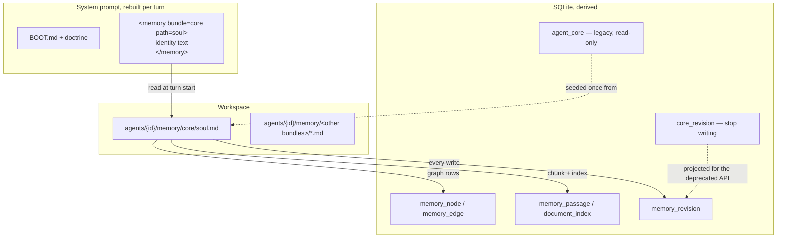

# Data Model: Unify Core and Memory

## Where things live after this change



The document is the source of truth. Everything else is derived or legacy.

---

## Entity: memory document (extended)

| field | notes |
|---|---|
| `bundle` | **now may be `core`**, which is reserved (invariant 1) |
| `path` | within the bundle; `soul` is the only path `core` accepts |
| `title`, `tags`, `relations`, `attachments` | unchanged |
| `content` | **newly bounded**: `content.len()` against the agent's hard ceiling |

**Invariants**

1. **Reserved bundle.** `bundle == "core"` accepts exactly one path, `"soul"`. Any other write to `core` is refused with a message naming the accepted path (FR-013). Imports into `core` are refused (FR-014); exports are allowed.
2. **The identity document is not special elsewhere.** Listing, search, linking, revision history, deletion and rollback treat it as an ordinary document. In particular **deletion is allowed** (FR-009) and leaves a normal deletion revision (FR-015).
3. **Removal never removes the bundle.** Deleting `soul` leaves the `core` bundle present and reserved; deleting the `core` bundle itself is refused (FR-012).
4. **Size.** A write is refused when `content.len() > ceiling` and accepted otherwise; equality is accepted. The ceiling applies to `content` only, never to the serialised file (research Decision 2).
5. **Grandfathering.** A stored document already above the ceiling accepts a write only when the new content is shorter (FR-019, research Decision 3).
6. **Soft limit.** A write with `soft < content.len() <= ceiling` succeeds in full and yields a warning; `content.len() <= soft` yields none (FR-017).

---

## Entity: memory size limits

```rust
pub struct MemoryLimits {
    pub content_cap: usize, // hard ceiling, bytes of content
    pub warn_at: usize,     // soft limit, bytes of content
}
```

Sits on `AgentConfig` beside `chunking: ChunkLimits`, with the same `serde(default)` treatment so an existing saved agent config deserialises unchanged.

| document | `content_cap` | `warn_at` |
|---|---|---|
| ordinary memory | 8 192 | 4 096 |
| identity document | 4 096 | 1 536 |

**Rules**

7. `warn_at <= content_cap` MUST hold; a config where it does not is treated as `warn_at = content_cap` (no warning band) rather than an error, so a bad config degrades instead of breaking writes.
8. The identity pair is selected by address, not by a second config field: `(bundle, path) == (CORE_BUNDLE, SOUL_PATH)` uses the tighter pair (FR-021). One config surface, not two.
9. Changing either value takes effect on the next write and never invalidates a stored document.

---

## Entity: write outcome

```rust
pub struct WriteWarning {
    pub bytes: usize,
    pub limit: usize,
}
```

| situation | stored | result |
|---|---|---|
| `len <= warn_at` | yes | `Written { memory, warning: None }` |
| `warn_at < len <= content_cap` | yes, in full | `Written { memory, warning: Some(..) }` |
| `len > content_cap`, not grandfathered | **no change** | refusal carrying size, ceiling, overage and the split pattern |
| above `content_cap` but shorter than stored | yes | `Written`, with a warning |

**Rules**

10. A refusal MUST NOT modify the stored document, its passages, its revision history or its log (FR-017, SC-009). Validation happens before the document write, not after it.
11. The refusal message MUST contain the overage in bytes and a concrete split pattern: a sibling path in the same bundle plus the link syntax (FR-018).

---

## Entity: dream change (extended)

| field | change |
|---|---|
| `kind` | `Core` is assigned when the revision's **origin bundle** is the reserved bundle (FR-031), not when the row came from a different table |
| `bundle`, `path` | populated for identity changes (they were `None`); this is what lets the badge point at the right document |
| counts | identity changes are **excluded** from written/revised/removed (FR-032) and reported as their own count (FR-033) |

**Rules**

12. A revision of the identity document is an identity change and is not also a memory revision for counting purposes.
13. A night keeps `core: bool` (did identity move?) and gains `core_changes: u32` (how many times?). The strip's ring reads the flag; the summary reads the count.

---

## Entity: legacy identity source (read-only)

| store | after this change |
|---|---|
| `agent_core` | never written; read once to seed, and readable by the deprecated API when the document is missing |
| on-disk `CORE.md` (legacy filesystem backend) | read only as a seed source |
| `core_revision` | never written; projected as the deprecated API's history and rollback |

**Rules**

14. Seed order: document already present, do nothing; else `agent_core`; else on-disk `CORE.md`; else the embedded template (FR-002, FR-003).
15. The seeded document is the legacy content **verbatim** plus a provenance note appended to the body, written with the cap bypassed, in one write, and never touched again (FR-003, FR-025).
16. Re-running the seed on a workspace that already has the document changes nothing (idempotent).
