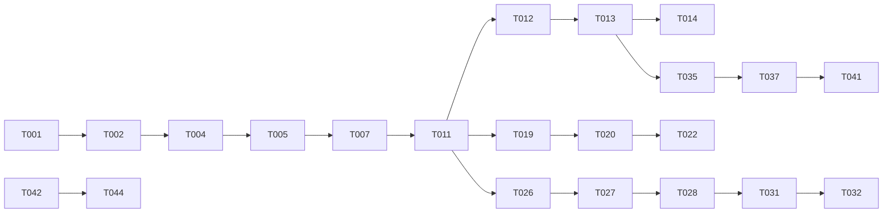

# Tasks: Unify Core and Memory

**Input**: Design documents from `specs/043-unify-core-and-memory/`

**Prerequisites**: plan.md, spec.md (35 FRs / 13 SCs), research.md (12 decisions), data-model.md, contracts/, quickstart.md

**Tests**: included. The repository has no separate TDD mandate, but every rule in this feature is a **refusal** — the thing most likely to be written and never exercised. Each refusal task carries a test that proves it fires, and each is checked to fail with the guard removed (repo convention).

**Organization**: by user story, in spec priority order, so each phase is a shippable increment.

## Format: `[ID] [P?] [Story] Description`

- **[P]**: can run in parallel (different file, no dependency on another unfinished task)
- **[Story]**: US1–US4, matching spec.md; absent in Setup, Foundational and Polish

## Path Conventions

Workspace root is the repository. Rust: `crates/vizier-core/src/…`, `crates/vizier-http/src/…`. WebUI is the `webui/` submodule, design system is `design/`.

---

## Phase 1: Setup (Shared Infrastructure)

**Purpose**: the branch exists everywhere this feature edits, and the baseline is green before anything moves.

- [x] T001 Create the feature branch in every submodule it touches with `just checkout 043-unify-core-and-memory` (workspace, `design/`, `webui/`, `landing/`, `dummyplug/`), then `just status` to confirm all report the same name — the constitution's matching-branch gate, a blocking item in `specs/043-unify-core-and-memory/plan.md`
- [x] T002 Record the pre-change baseline by running `cargo test -p vizier-core --lib` (expect exactly the two known Windows-only failures in `crates/vizier-core/src/projects/path.rs` and `crates/vizier-core/src/skill/scopes.rs`), `cargo clippy -p vizier-core -p vizier-http --all-targets`, then `cd webui && npm run typecheck && npm test` and `cd design && npx tsc --noEmit` — so a later failure can be attributed rather than investigated
- [ ] T003 [P] Copy one real workspace for later migration testing in `specs/043-unify-core-and-memory/fixtures/` notes only (do not commit agent data): pick an agent whose identity document is **over 4 KiB** and another whose is not; record both paths in quickstart step 1

---

## Phase 2: Foundational (Blocking Prerequisites)

**Purpose**: the shared vocabulary — constants and the limits struct — that every story reads. Nothing here is observable behaviour on its own.

**⚠️ CRITICAL**: US1–US4 all reference these; they must land first.

- [x] T004 Add the reserved-address constants to `crates/vizier-core/src/schema/storage.rs`: `CORE_BUNDLE: &str = "core"` and `SOUL_PATH: &str = "soul"` beside `DEFAULT_BUNDLE`, with a doc comment stating that the path segment is internal and the product-facing name does not change
- [x] T005 [P] Add `MemoryLimits { content_cap: usize, warn_at: usize }` to `crates/vizier-core/src/config/mod.rs` beside `ChunkLimits`, with `serde(default)` accessors, `Default` = `{ 8192, 4096 }` for ordinary memories and `identity()` = `{ 4096, 1536 }` for the identity document; document that it measures **content bytes only** (research Decision 2)
- [x] T006 [P] Add unit tests for `MemoryLimits` in `crates/vizier-core/src/config/mod.rs` covering the `warn_at > content_cap` degradation rule (data-model rule 7): a bad pairing behaves as "no warning band" instead of erroring
- [x] T007 Add `pub limits: MemoryLimits` to `AgentConfig` in `crates/vizier-core/src/schema/agent.rs` with `#[serde(default)]`, and update every struct literal that constructs `AgentConfig`: `crates/vizier-core/src/agents/agent/model/dummyplug.rs:432`, `crates/vizier-core/src/encryption/fields.rs:590`, `crates/vizier-core/src/notifications/mod.rs:453`, `crates/vizier-core/src/service/agents.rs:231`, `crates/vizier-core/src/tests_support.rs:43`, `crates/vizier-http/src/test_support.rs:24`, `crates/vizier-http/tests/conformance/main.rs`

**Checkpoint**: `cargo check -p vizier-core -p vizier-http --all-targets` is clean and nothing has changed behaviour yet.

---

## Phase 3: User Story 1 — One place to look: identity lives in memory (Priority: P1) 🎯 MVP

**Goal**: an agent's identity is the memory document `core/soul`, readable and writable through the memory tools, injected once per turn as an addressed block, and migrated from the old store on upgrade.

**Independent Test**: create a fresh agent, take a turn, then `memory_read(bundle="core", path="soul")` — the document exists, its content was in that turn's context, and writing it changes the next turn's context. Run quickstart steps 1–3.

### Tests for User Story 1

- [x] T008 [P] [US1] Write storage tests in `crates/vizier-core/src/storage/memory_bundle.rs` (test module) proving: writing `(core, soul)` succeeds and round-trips through `get_memory_detail`; the document appears in `list_bundles` with the reserved bundle present; a search over the corpus returns it like any other document
- [x] T009 [P] [US1] Write prompt-assembly tests in `crates/vizier-core/src/agents/agent/mod.rs` (test module) proving the identity block is present exactly once per turn, is addressed `<memory bundle="core" path="soul">`, and is **byte-identical across two consecutive calls to `prepare_system_prompts`** (FR-007)
- [x] T010 [P] [US1] Write the seed tests in `crates/vizier-core/src/agents/supervisor.rs` (test module): seeding from `agent_core`; from an on-disk `CORE.md`; from the embedded template when neither exists; and idempotency — a second run with the document already present changes nothing (data-model rule 16)

### Implementation for User Story 1

- [x] T011 [US1] Thread the limits to the write path (FR-022: one choke point, so tool writes, HTTP writes, imports and restores all get them): extend `MemoryStorage::write_memory` in `crates/vizier-core/src/storage/memory.rs` and `crates/vizier-core/src/storage/memory_bundle.rs::write_memory_inner` with a `&MemoryLimits` plus a `WritePolicy { limits, bypass_cap: bool }`, updating the four call sites (`agents/tools/vector_memory/mod.rs:458`, `agents/memory_ops.rs:53`, `storage/memory.rs:272`, `storage/memory_bundle.rs` rollback). This is the single choke point every rule lives in (research Decision 1)
- [x] T012 [US1] Implement the seed in `crates/vizier-core/src/agents/supervisor.rs` where `reconcile_agent_passages`. A brand-new agent with no legacy identity gets the embedded template (FR-002), so every agent has a document from its first turn and `reconcile_agent_artifact_references` already run: a detached task per agent that reads `agent_core` → on-disk `CORE.md` → `CORE_MD`, appends the provenance line to the body, and writes with `bypass_cap` (research Decision 7; carried so the ceiling cannot block an upgrade, FR-025)
- [x] T013 [US1] Render the addressed identity block in `crates/vizier-core/src/agents/agent/mod.rs::prepare_system_prompts` at the position the CORE string occupies today (line ~488): read `(CORE_BUNDLE, SOUL_PATH)` through the storage layer, wrap in `<memory bundle="core" path="soul">…</memory>`, and fall back to the embedded template plus a "this is missing, you can write it here" note when absent (research D6, D10; FR-006, FR-008)
- [x] T014 [US1] Keep the identity block's context cost unchanged beyond the fixed wrapper (SC-002), and replace the cached `core: String` field in `crates/vizier-core/src/agents/agent/mod.rs` (declared line 91, populated line 203-208, read line 488) with a read of the document, so a write to the identity document is reflected on the next turn without a restart
- [x] T015 [P] [US1] Re-point `get_agent_core`/`set_agent_core` in `crates/vizier-core/src/storage/agent.rs` and `crates/vizier-core/src/storage/sqlite/agent.rs:191` at the identity document through the memory write path, keeping the legacy table as a read source, and mark both deprecated in their doc comments
- [x] T016 [P] [US1] Mark the seed's identity step for removal before 1.0.0 in `specs/043-unify-core-and-memory/plan.md` and the pre-1.0 removal issue (#82): update the entry so it names the spawn-time seed, its marker and its legacy-source branches, not `migrate_agent_cores` — already corrected on the issue in the plan phase; re-verify the text matches the implementation before closing this task (FR-026)

**Checkpoint**: US1 is complete when quickstart steps 1–3 pass. Nothing about size limits or the WebUI has changed yet.

---

## Phase 4: User Story 2 — Permanent in practice, never a trap (Priority: P1)

**Goal**: the identity document can always be written and can be removed; the `core` bundle cannot be removed and accepts nothing but the identity document; a removed document leaves a well-formed default, never an empty block.

**Independent Test**: as agent and as person, write the document (succeeds), delete it (succeeds, agent still healthy with a default), delete the `core` bundle (refused), add a second document to `core` (refused). Run quickstart step 4.

### Tests for User Story 2

- [x] T017 [P] [US2] Write the guard tests in `crates/vizier-core/src/storage/memory_bundle.rs` (test module): a write to `(core, values)` is refused naming `soul` (FR-013); `delete_bundle("core", force=true)` is refused with a reserved message (FR-012); `import_bundle` into `core` is refused (FR-014); `delete_memory(core, soul)` **succeeds** and leaves a deletion revision (FR-009, FR-015); after deletion `list_bundles` still reports `core`
- [x] T018 [P] [US2] Write the default-identity tests in `crates/vizier-core/src/agents/agent/mod.rs` (test module): with the document absent, the injected block contains the template text and the "you can write it here" note, and is **never empty** (FR-008)

### Implementation for User Story 2

- [x] T019 [US2] Implement the reserved-bundle guard in `crates/vizier-core/src/storage/memory_bundle.rs::write_memory_inner`, before any persistence, refusing `bundle == CORE_BUNDLE` unless `path == SOUL_PATH` (data-model invariant 1)
- [x] T020 [US2] Implement the reserved-bundle refusal in `delete_bundle` (`crates/vizier-core/src/storage/memory_bundle.rs`, the `force` branch at the existing non-empty check) so `force` cannot bypass it, and in `import_bundle`'s destination check (data-model invariants 1, 3)
- [x] T021 [US2] Ensure no identity special case was accidentally added on the delete path: confirm `delete_memory` in `crates/vizier-core/src/storage/memory_bundle.rs` treats `(core, soul)` as ordinary, and that the existing link-guard still applies unchanged
- [x] T022 [US2] Prove each refusal with its guard reverted: temporarily remove the T019 and T020 guards from `crates/vizier-core/src/storage/memory_bundle.rs`, run the corresponding tests from T017, confirm each fails, then restore — the repo's bug-fix convention, applied to a refusal

**Checkpoint**: US1 and US2 both pass independently. The identity document is both reachable and protected in the right places.

---

## Phase 5: User Story 3 — Told when a memory stops being one thing (Priority: P2)

**Goal**: a write above the soft limit succeeds and returns a separate warning; a write above the ceiling is refused with the overage and a split pattern; identity is tighter; legacy over-cap documents stay readable and shrinkable; dream changes count identity by bundle membership.

**Independent Test**: write 2 KiB (clean), 6 KiB (warning), 11 KiB (refusal), then shorten the 11 KiB document (accepted). Run quickstart steps 5 and 7.

### Tests for User Story 3

- [x] T023 [P] [US3] Write the limit tests in `crates/vizier-core/src/storage/memory_bundle.rs` (test module): below the soft limit no warning; between soft and ceiling a warning carrying real values; above the ceiling refused with size, ceiling, overage and split pattern; exactly at the ceiling accepted; `bypass_cap` accepted; identity address uses the tighter pair (data-model rules 4–6, 8)
- [x] T024 [P] [US3] Write the grandfathering tests in `crates/vizier-core/src/storage/memory_bundle.rs` (test module): a stored over-cap document accepts a shorter write and refuses a longer one, and a refusal leaves the document's bytes, passages and revisions untouched (FR-019, FR-021, SC-009)
- [x] T025 [P] [US3] Write the classification tests in `crates/vizier-core/src/schema/dream_journal.rs` (test module): an identity change is `ChangeKind::Core` by origin bundle with `bundle`/`path` populated; it is excluded from the written/revised/removed counts and included in `core_changes` (FR-031, FR-032, FR-033)

### Implementation for User Story 3

- [x] T026 [US3] Implement the ceiling, soft limit, warning and grandfathering in `crates/vizier-core/src/storage/memory_bundle.rs::write_memory_inner`, in the order `contracts/storage-behaviour.md` specifies, and add `WriteWarning { bytes, limit }` to `crates/vizier-core/src/schema/commands.rs`
- [x] T027 [US3] Change `MemoryOpResponse::Memory` to `MemoryOpResponse::Written { memory: Memory, warning: Option<WriteWarning> }` in `crates/vizier-core/src/schema/commands.rs` and update every arm that constructs or matches it: `crates/vizier-core/src/agents/memory_ops.rs`, `crates/vizier-core/src/service/memory.rs`, `crates/vizier-core/src/storage/memory.rs`
- [x] T028 [US3] Return the warning from `memory_write` in `crates/vizier-core/src/agents/tools/vector_memory/mod.rs` as a **separate field**, leaving the success string unchanged and the output a plain string below the soft limit (contract `tool-surface.md`, FR-018)
- [x] T029 [P] [US3] Map the refusal to a status in `crates/vizier-core/src/service/memory.rs::op_error`: the stable prefix `memory too large:` → 422, and the reserved-bundle messages → 422/409 per `contracts/storage-behaviour.md` (research Decision 5)
- [x] T030 [P] [US3] Surface the warning on the HTTP path in `crates/vizier-core/src/service/memory.rs::create`/`update` as an optional `warning` field on the response structs (additive; `contracts/http-api.md`)
- [x] T031 [US3] Implement bundle-membership classification in `crates/vizier-core/src/storage/sqlite/dream_journal.rs::list_dream_revisions`: drop the separate `core_revision` query, mark rows whose bundle is the reserved bundle as `ChangeKind::Core`, and populate their `bundle`/`path` (research Decision 8)
- [x] T032 [US3] Add `core_changes: u32` beside the existing `core` flag in `crates/vizier-core/src/schema/dream_journal.rs` (`tally`, `DreamNight`) and exclude identity changes from the written/revised/removed counts (FR-032, FR-033)

**Checkpoint**: US3 passes independently of the WebUI. The engine now warns, refuses, and counts correctly.

---

## Phase 6: User Story 4 — Reviewed where every memory lives, and the separate area is gone (Priority: P3)

**Goal**: the dedicated Core page, editor, nav entry and menu group are deleted; identity is reached, reviewed and restored through the memory surfaces; dream surfaces point at the document.

**Independent Test**: the agent's menu offers no Core entry and `/…/core` does not resolve; from Memory alone, find the document, view its history, diff, restore, and get a stale-save refusal. Run quickstart steps 6 and 8.

### Tests for User Story 4

- [x] T033 [P] [US4] Update the WebUI route tests and delete assertions in `webui/app/routes/memory.tsx` and `webui/app/lib/dreams.test.ts`: the reserved bundle renders protected; identity changes are counted and reported separately from memories
- [x] T034 [P] [US4] Update the e2e expectations in `webui/e2e/pages.spec.ts` and `webui/e2e/a11y.spec.ts` that assert on `CORE saved`, `CORE changed while you were editing` and the Core page, replacing them with the memory-surface equivalents

### Implementation for User Story 4

- [x] T035 [P] [US4] Delete the Core page and editor: `webui/app/routes/agent-core.tsx`, `webui/app/routes/agent-core-edit.tsx`, and their two entries in `webui/app/routes.ts`; no redirect (contract `webui.md` rule 1)
- [x] T036 [P] [US4] Remove the page from navigation: `webui/app/screens/shell/pages.ts` (`PAGE_PATH.core` and the union member) and `design/src/components/Shell/ContextSidebar.tsx` (`MenuPage` member plus the `"The agent"` group, which held only Core)
- [x] T037 [US4] Render the reserved bundle as protected in the memory explorer: add `protected?: boolean` to `Bundle` in `webui/app/api/endpoints/memory.ts`, carry it through `bundleNode` in `webui/app/lib/memoryTree.ts`, and disable bundle deletion for it in `webui/app/routes/memory.tsx` (the document itself stays deletable)
- [x] T038 [P] [US4] Add `protected: true` to the reserved bundle in the bundles listing contract: `crates/vizier-core/src/schema/storage.rs::BundleSummary` and the list implementation in `crates/vizier-core/src/storage/memory_bundle.rs` (additive; `contracts/http-api.md`)
- [x] T039 [P] [US4] Point dream surfaces at the document: `webui/app/lib/dreams.ts` (`cycleSummary`, `nightHint`, and the change link) and `webui/app/routes/agent-dream.tsx` so an identity change opens `core/soul` in Memory, and the summary reports identity changes as their own count
- [x] T040 [P] [US4] Update the design components for identity changes: `design/src/components/NightStrip/NightStrip.tsx` (ring + `aria-label` wording), `design/src/components/DreamJournalEntry/DreamJournalEntry.tsx`, and the affected stories in `design/src/components/{NightStrip,DreamJournalEntry,RevisionRow,ListItem,MarkdownEditor}/*.stories.tsx`
- [x] T041 [US4] Confirm the behaviour removed with the page still exists through Memory (FR-028): stale-save refusal (`base_seq` → 409) on `crates/vizier-core/src/service/memory.rs::update`, revision diff and restore, verified by walking quickstart step 6 rather than assuming parity

**Checkpoint**: all four stories pass. The product has one place in which to look.

---

## Phase 7: Polish & Cross-Cutting Concerns

**Purpose**: the surfaces that name the old arrangement, the deprecated API's honesty, and the gates.

- [x] T042 [P] Delete `read_core` and `write_core` from `crates/vizier-core/src/agents/tools/workspace/mod.rs` and their registration in `crates/vizier-core/src/agents/tools/mod.rs` (the two entries near line 1744)
- [x] T043 [P] Remove the `identity` tool category from `crates/vizier-core/src/agents/tools/mod.rs`: the enum member (line 95), `ToolCategory::ALL` (line 123), `name()` (line 145), `description()` (line 168), the `ALL` length assertion at line 1956 (18 → 17) and the doc comment at line 1948
- [x] T044 [P] Update the tool-name allow-lists that would otherwise rot: `VizierTools::DREAM_TOOL_NAMES` in `crates/vizier-core/src/agents/tools/mod.rs:1118-1119`, the `&["read_core"]` list, the sandbox docs allow-list at `crates/vizier-core/src/sandbox/docs.rs:367`, and the progress labels `"write_core"`/`"read_core"` in `crates/vizier-core/src/utils/mod.rs:146-147`
- [x] T045 [P] Rewrite the doctrine in `crates/vizier-core/src/agents/agent/system_prompt/boot.rs`: the "Where things go" CORE line becomes the Core-as-memory paragraph naming the address and the memory tools; add no size figure (contract `tool-surface.md`, FR-010, FR-024)
- [x] T046 [P] Update the dream prompt in `crates/vizier-core/src/scheduler/dream/prompts.rs`: `write_core` becomes `memory_write` to the identity address in the action-item table, and add the preference for several small memories over one large one
- [x] T047 [P] Mark the deprecated API in `crates/vizier-http/src/api/v1/agents/core.rs`: all four operations carry a deprecation note in their OpenAPI description naming the memory endpoint that replaces them, with response shapes unchanged (FR-034)
- [x] T048 Reimplement `crates/vizier-core/src/service/core.rs` as a projection over the identity document and its memory revisions so the deprecated API and the memory surfaces can never disagree (FR-035, SC-013)
- [ ] T049 [P] Retire the unreachable documents router: delete `crates/vizier-http/src/api/v1/agents/documents.rs` (SOUL/IDENTITY/HEARTBEAT), which is unmounted and referenced by nothing
- [ ] T050 [P] Rename `crates/vizier-core/templates/CORE.md` usage so the template name matches the document it seeds, updating `crates/vizier-core/src/constant.rs`; keep the product-facing term Core (spec assumption 1)
- [x] T051 [P] Update the templates a new agent is seeded from: `crates/vizier-core/templates/agent.template.md` (four CORE references, "Check CORE and memory", "Auto-update CORE")
- [x] T052 Run the full gate: `cargo clippy -p vizier-core -p vizier-http --all-targets`, `cargo test -p vizier-core --lib`, `cd webui && npm run typecheck && npm test`, `cd design && npx tsc --noEmit` — only the two pre-existing Windows-only failures in `crates/vizier-core/src/projects/path.rs` and `crates/vizier-core/src/skill/scopes.rs` may remain
- [x] T053 Run the dummyplug end-to-end pass (constitution gate): `specs/043-unify-core-and-memory/quickstart.md` steps 2, 3, 4, 5 and 7 against a running binary, recording the message sent and the expected reply or stored state for each
- [x] T054 Update the documentation of record in the same feature: `CLAUDE.md` (the memory tool list, the identity section, the now-stale category count at line 141) and `docs/src/configuration/{agents,memory,tools-embedding}.md` where they describe where identity lives — the copy sweep runs as its own commit, and no public term changes
- [x] T055 Update the pre-1.0 removal issue (#82) with anything this implementation added beyond `specs/043-unify-core-and-memory/plan.md`: confirm the `core`-bundle exemption, the cap bypass, the `core_revision` reader retirement and the seed step are all listed with what depends on them

---

## Requirement coverage

Every requirement is carried by at least one task. Compact map, so `/speckit-analyze` does not have to reconstruct it.

| Requirements | tasks | Requirements | tasks |
|---|---|---|---|
| FR-001–FR-003 | T012, T013, T008 | FR-018–FR-020 | T026, T028, T024 |
| FR-004, FR-005 | T015, T008 | FR-021–FR-023 | T026, T007 (limits on `AgentConfig`) |
| FR-006–FR-008 | T013, T009, T018 | FR-024 | T045 |
| FR-009, FR-010 | T013, T016, T045 | FR-025 | T012, T024 |
| FR-011, FR-012 | T017, T019, T020 | FR-026 | T016, T055 |
| FR-013–FR-015 | T019, T020, T017 | FR-027–FR-029 | T037–T041 (US4: page gone, behaviour reachable) |
| FR-016 | T023, T026 | FR-030 | T042–T047, T051 |
| FR-017 | T026 | FR-031–FR-033 | T025, T031, T032 |
| FR-034, FR-035 | T047, T048 | | |

| Criterion | tasks |
|---|---|
| SC-001–SC-003 | T012, T009, T018 (seed + default identity + stability) |
| SC-004 | T042–T044 (the identity-only operations) |
| SC-005, SC-012 | T035–T041 (page gone, behaviour reachable) |
| SC-006, SC-008, SC-009 | T023, T024, T026 |
| SC-007, SC-010 | T028 (the warning exists and is countable; retry behaviour is a measured follow-up) |
| SC-011 | T025, T031, T032 |
| SC-013 | T048, T033 |

**SC-007 cannot be closed by a task**: it measures real agents' writes after release (spec Success Criteria). T028 is what makes it measurable at all.

## Dependencies & Execution Order

### Phase dependencies

- **Setup (T001–T003)**: no dependencies. T001 blocks everything that builds in a submodule.
- **Foundational (T004–T007)**: blocks all stories. T007 touches every `AgentConfig` literal, so it must be one pass or the crate will not compile in between.
- **US1 (T008–T016)**: needs Foundational. Produces the document and the prompt block.
- **US2 (T017–T022)**: needs US1's write path (T011). Independent of US3 and US4.
- **US3 (T023–T032)**: needs T011 (the write path signature). Independent of US2 and US4.
- **US4 (T033–T041)**: needs US1's document to exist for the explorer to show, and T038's listing flag; independent of US2 and US3.
- **Polish (T042–T055)**: T042–T043 unblock nothing but must not land before T044, or the dream list names tools that no longer exist between commits.

### Critical path

### Parallel opportunities

- **Foundational**: T005/T006 are one file (`config/mod.rs`) and can run beside T004 (`schema/storage.rs`).
- **US1**: T015 (storage projections) and T016 (issue text) touch different files from T012–T014.
- **US2**: T017 and T018 are different test modules; T019, T020 and T021 are the same file and must be sequential.
- **US3**: T023/T024 (storage tests) and T025 (journal tests) are parallel; T029 and T030 are different functions in one file — sequential with each other.
- **US4**: T035, T036, T038, T039, T040 are five different files and genuinely parallel; T037 depends on T038's field.
- **Polish**: T042–T047 and T049–T051 are nine different files, all parallel; T048 depends on T035's decision about the service.

---

## Implementation Strategy

**MVP = Phase 3 (US1) alone.** An agent whose identity is a memory it can read and write is the whole point of the feature and is shippable by itself: nothing else in the spec is required for that to work, and the old tools can keep working until Polish removes them if the migration lands first.

**Incremental order**: US1 → US2 (protection has nothing to protect until US1 exists) → US3 (limits are independent of the UI, and are the second-most valuable half) → US4 (deletion of the page, which is only honest once identity truly lives in Memory).

**Two sequencing constraints worth stating explicitly**:
1. **T041 before T035 is not optional.** The page may only be deleted once the stale-save refusal, diff and restore are confirmed reachable through Memory — deleting first and verifying later is how a feature loses behaviour silently.
2. **T031 before T032.** Classification must exist before the count that depends on it, or the count is tested against a kind nothing produces.

---

## Status at implementation

52 of 55 tasks are complete and committed on `043-unify-core-and-memory`. Three are not, and the reasons are decisions rather than omissions.

| task | state | why |
|---|---|---|
| **T003** | not done | The migration fixture is a **manual** step: copy a real workspace whose identity is over 4 KiB and record the paths. Nothing in the repository can supply one, and committing agent data is not acceptable. quickstart step 1 still needs it before the upgrade path can be called verified. |
| **T049** | **deferred by the owner** | The dead `documents.rs` router stays. Its removal is recorded on issue #82 instead. |
| **T050** | **superseded** | `templates/CORE.md` keeps its name: the owner settled that **Core is the only product-facing term**, so renaming the template to a soul-named file would introduce a second public name for the same thing. The path segment `soul` is internal. |

### What the implementation changed about the plan

- **T012 — the seed runs from `start_memory_maintenance`, not inside `start_memory_ops`.** The planned home was beside the passage reconcile, which returns early when an agent has no indexer. The dummyplug e2e caught the consequence: an agent with no embedding config was created with **no identity at all**. The seed now runs for every agent, writing through a no-op indexer when there is none (the same posture `dependencies.rs` takes), and passage conversion still requires the real one. There is **no `core_bundle_seeded` marker** — the document's own presence is the idempotency marker.
- **T019 — the guard refuses creation, not maintenance.** `core` was an ordinary bundle name before it was reserved, so an install may already hold documents there. Refusing every write made them readable but permanently un-editable. FR-013 refuses *creation*; the guard now reads the stored document first and only refuses when nothing is there.
- **T027 — a `Tally` struct replaced `tally`'s six-tuple**, so adding the identity count did not mean a seventh positional element.
- **T041 found a defect the ordering was written to catch.** The stale-save guard existed only on the deprecated `/core` API; the memory `PUT` had none, so deleting the Core page would have deleted the protection rather than moved it. `UpdateMemoryRequest` gained an optional `base_seq` answering `409 stale_revision`, and the memory editor gained the Reload theirs / Keep mine dialog. **This is an addition to the plan, recorded on #82.**
- **T022 — every refusal was proven by reverting its guard**: the write guard, the delete-bundle refusal, the import refusal, the ceiling (5 tests) and the warning (2 tests) each fail without the code they test, and all 45 pass restored.
- **T054 — the copy sweep also fixed pre-existing drift**: `docs/configuration/memory.md` listed `memory_read` twice, one row really describing `memory_search` (stale since spec 037, not this feature).

### Verification actually run

`cargo test -p vizier-core --lib` 1106 passed, 2 failed — the two known Windows-only failures (`projects::path`, `skill::scopes`), which are not this feature's · `cargo clippy -p vizier-core -p vizier-http --all-targets` exit 0 · `cargo test -p vizier-core --test dummyplug_e2e` 4/4 · `cargo test -p vizier-http` all pass · `webui` typecheck 0 and 702 unit tests · `design` `tsc --noEmit` 0 · every relative link and anchor in the changed docs resolves.

**Not run, and therefore not claimed:** the Playwright e2e (`pages.spec.ts`, `a11y.spec.ts`) and the a11y sweep were rewritten for the memory surfaces but need a live server; nobody has clicked through the editor's new conflict dialog; and `mdbook` is not installed here, so the docs were link-checked but never built.
