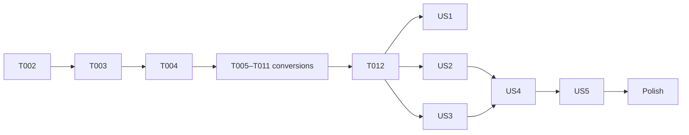

# Tasks: Pluggable Storage

**Input**: `specs/045-pluggable-storage/` (spec.md, plan.md, research.md, data-model.md, contracts/, quickstart.md)

**Tests**: The spec requires a cross-backend storage suite (FR-023), so the existing storage tests are parametrised over backends; no other new tests unless an edge is uncertain.

## Format: `[ID] [P?] [Story] Description`

---

## Phase 1: Setup

- [ ] T001 Add `postgres`, `r2d2`, `r2d2_postgres`, `tokio-postgres-rustls` to root `Cargo.toml` `[workspace.dependencies]` and `crates/vizier-core/Cargo.toml`; drop the unused `rusqlite` dependency from `crates/vizier-http/Cargo.toml`

## Phase 2: Foundational (shared SQL layer)

- [ ] T002 Create `crates/vizier-core/src/storage/sql/mod.rs`: `SqlValue`, `ToSqlValue`/`FromSqlValue` (ints, bool, f64, strings, bytes, Option, `DateTime<Utc>`), `Row`, `sql_params!`, object-safe `SqlConn`, `SqlStore` (`with_conn`, `transaction`), `Dialect`, `Backend`, `is_unique_violation`
- [ ] T003 Implement `SqliteConn`/`SqlitePool` over `Arc<Mutex<rusqlite::Connection>>` and `SqliteDialect` in `crates/vizier-core/src/storage/sql/sqlite.rs`, with unit tests for value round trips, transactions (commit/rollback/savepoint) and placeholders
- [ ] T004 Rename `SqliteStorage` → `SqlStorage` holding `SqlStore` in `crates/vizier-core/src/storage/sqlite/mod.rs`; keep `init_schema` for SQLite; add `SqlStorage::sqlite`, `sqlite_in_memory`
- [ ] T005 [P] Convert `storage/sqlite/{agent,core_revision,catalogue,media_catalogue,global_config,state,task,provider}.rs` to `SqlConn`
- [ ] T006 [P] Convert `storage/sqlite/{history,session,session_file,reaction,scratch,turn,client_call}.rs` to `SqlConn`
- [ ] T007 [P] Convert `storage/sqlite/{artifact,background_job,task_run,dream_journal,usage,notification}.rs` to `SqlConn`
- [ ] T008 [P] Convert `storage/sqlite/{integration,secret,user,project,question,memory,memory_revision}.rs` to `SqlConn`
- [ ] T009 Convert `crates/vizier-core/src/storage/memory_bundle.rs` to `SqlStore`
- [ ] T010 Convert `crates/vizier-core/src/indexer/sqlite.rs` to take `SqlStore` (sqlite-only through `as_sqlite`)
- [ ] T011 Replace `VizierDependencies.sqlite_conn` with `sql: SqlStore` in `crates/vizier-core/src/dependencies.rs`; gate SQLite-only one-shot migrations (`dependencies.rs`, `provider_migration.rs`, `projects/migrate.rs`, `encryption/{key,migrate}.rs`) on `as_sqlite()`; update every test harness that opened `rusqlite::Connection` directly
- [ ] T012 Verify: `cargo test --workspace`, `cargo clippy --workspace --all-targets`, quickstart §2 on SQLite

**Checkpoint**: SQLite behavior unchanged; every storage method runs through `SqlConn`.

---

## Phase 3: User Story 1 – Embedded default stays (P1) 🎯 MVP

**Independent Test**: quickstart §2.

- [ ] T013 [US1] Add `StorageConfig::Postgres` and `ObjectsConfig::{Local, S3}` with defaults Sqlite/Local and redacting `Debug` in `crates/vizier-core/src/config/storage.rs` and `config/mod.rs`
- [ ] T014 [US1] Add `--storage postgres`, `--objects`, `VIZIER_STORAGE`/`VIZIER_OBJECTS`/`VIZIER_S3_*` overrides in `crates/vizier/src/cli/run.rs`
- [ ] T015 [US1] Pin `Sqlite` + `Local` in `app/src-tauri/src/engine.rs`
- [ ] T016 [US1] Run quickstart §2 and record the result

---

## Phase 4: User Story 2 – PostgreSQL backend (P1)

**Independent Test**: quickstart §3 database steps and §4.

- [ ] T017 [US2] Implement `PgConn`/`PgPool` (`r2d2_postgres`, rustls TLS, `block_in_place`, `?N`→`$N` rewrite with cache, value mapping, savepoints) and `PgDialect` in `crates/vizier-core/src/storage/sql/postgres.rs`
- [ ] T018 [US2] Write `crates/vizier-core/src/storage/sql/postgres/migrations/0001_initial.sql` equivalent to the SQLite schema (identity ids, identity `session_history.seq`, `memory.search_tsv` + GIN, partial indexes) and the migration runner with advisory lock and `vizier_schema_migrations`
- [ ] T019 [US2] Replace remaining SQLite-only statements with portable forms or `Dialect` calls (INSERT OR REPLACE/IGNORE, json_extract, json_array_length, last_insert_rowid, rowid, `date()`, FTS) across `storage/sqlite/*.rs` and `memory_bundle.rs`
- [ ] T020 [US2] Implement `PgIndexer` (pgvector, dimension check, HNSW) in `crates/vizier-core/src/indexer/postgres.rs` and select it per backend in `agents/supervisor.rs`
- [ ] T021 [US2] Build the backend from config in `crates/vizier-core/src/dependencies.rs` with the startup validation messages from `contracts/configuration-and-cli.md`
- [ ] T022 [US2] Parametrise storage tests over backends via `tests_support::storages()` (`VIZIER_TEST_DATABASE_URL`, per-test schema) in `crates/vizier-core/src/tests_support.rs`
- [ ] T023 [US2] Add the concurrency test (history seq, guarded transition) in `crates/vizier-core/src/storage/sql/tests.rs`
- [ ] T024 [US2] Run quickstart §1 (PostgreSQL), §3 DB steps, §4 DB rows, §6

---

## Phase 5: User Story 3 – Object storage (P1)

**Independent Test**: quickstart §3 file steps and §4 S3 rows.

- [ ] T025 [P] [US3] Create `BlobStore`, `BlobKey`, `BlobMeta`, `ByteStream` in `crates/vizier-core/src/storage/blob/mod.rs` and `LocalBlobStore` in `storage/blob/local.rs`
- [ ] T026 [P] [US3] Implement `S3BlobStore` (SigV4 service `s3`, put/get/range/head/delete/list/multipart, startup probe) in `crates/vizier-core/src/storage/blob/s3.rs`
- [ ] T027 [US3] Re-implement `DocumentStore` over `BlobStore` in `crates/vizier-core/src/storage/document/mod.rs`
- [ ] T028 [US3] Move uploads in `crates/vizier-core/src/file_manager/mod.rs` and `session_files/mod.rs` onto `BlobStore`
- [ ] T029 [US3] Move artifact versions in `crates/vizier-core/src/artifacts/{paths,mod}.rs` onto `BlobStore`; remove sync `ArtifactStorage::artifact_content_file`
- [ ] T030 [US3] Stream `/files/{id}` and artifact content via `get_range` in `crates/vizier-core/src/service/files.rs`, `crates/vizier-http/src/api/v1/files.rs`, `crates/vizier-http/src/api/v1/agents/artifacts.rs`
- [ ] T031 [US3] Parametrise blob tests over local and MinIO (`VIZIER_TEST_S3_ENDPOINT`)
- [ ] T032 [US3] Run quickstart §3 file steps and §4 S3 rows

---

## Phase 6: User Story 4 – Migration (P2)

- [ ] T033 [US4] Implement `crates/vizier-core/src/storage/migrate/mod.rs` (lock check, legacy migrations first, schema, FK-ordered table copy with cursors, vectors, blobs with SHA-256 verify, `storage_migration`, report)
- [ ] T034 [US4] Add `vizier storage migrate` in `crates/vizier/src/cli/storage.rs` with exit codes 0/1/2
- [ ] T035 [US4] Add #82 checklist entries (migration command, `storage_migration`, `as_sqlite()` legacy gate)
- [ ] T036 [US4] Run quickstart §5

---

## Phase 7: User Story 5 – Conformance in CI (P2)

- [ ] T037 [US5] Add a CI job with `pgvector/pgvector:pg17` and `minio/minio` services running the parametrised suites in `.github/workflows/ci.yml`

---

## Phase 8: Polish

- [ ] T038 [P] Write `docs/src/configuration/storage.md` (backends, prerequisites, topology, backups, migration) and link it in `docs/src/SUMMARY.md`; update `docs/src/configuration/cli.md`
- [ ] T039 Update `AGENTS.md` Storage section (shared SQL layer, BlobStore, PostgreSQL/S3) and the constitution's Distribution note if wording now misleads
- [ ] T040 Final: `cargo test --workspace`, clippy CI gate, quickstart §1–§6

## Dependencies

T005–T008 run in parallel after T004. US2 (database) and US3 (files) are independent of each other.

## Implementation strategy

MVP = Phases 1–3 (pure refactor, no behavior change). Then US2 and US3 in parallel, then migration, CI and docs.
