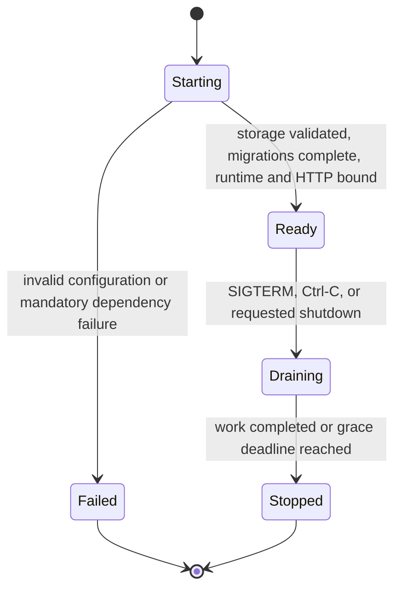

# Data Model: Kubernetes Deployment

This feature adds deployment configuration and process-health state. It does not add an application database entity.

## DeploymentRelease

A versioned Helm package tied to one Vizier release.

| Field | Type | Invariant |
|---|---|---|
| `chartVersion` | semantic version | Equals the supported Vizier application release version. |
| `appVersion` | semantic version | Equals the default image tag. |
| `image.repository` | OCI image repository | Defaults to the official GHCR image. |
| `image.tag` | immutable tag or digest | Never defaults to `latest`. |
| `kubeVersion` | semver range | Covers the documented supported cluster minors. |

## Installation

One Helm release in one namespace.

| Field | Type | Invariant |
|---|---|---|
| `name` | DNS label | Identifies namespaced resources. |
| `namespace` | Kubernetes namespace | No cluster-scoped resource is owned by the chart. |
| `replicaCount` | integer | Must equal `1`. |
| `storage.profile` | `embedded` or `managed` | Exactly one profile is active. |
| `shutdown.gracePeriodSeconds` | positive integer | Less than `terminationGracePeriodSeconds`. |
| `service` | ClusterIP configuration | Enabled by default. |
| `ingress` | optional route configuration | Disabled by default. |

## StorageProfile

### Embedded

| Field | Type | Rules |
|---|---|---|
| `persistence.enabled` | boolean | Must be `true` for a supported embedded install. |
| `persistence.existingClaim` | optional PVC name | Mutually exclusive with chart-created storage sizing. |
| `persistence.storageClass` | optional class name | Empty means cluster default. |
| `persistence.accessModes` | list | Defaults to `ReadWriteOnce`. |
| `persistence.size` | Kubernetes quantity | Required for chart-created PVC. |
| `persistence.annotations` | map | Applied only to a chart-created PVC. |

Durable state: SQLite database, local object/document bytes, workspace files, generated encryption key.

### Managed

| Field | Type | Rules |
|---|---|---|
| `database.secretRef` | `SecretKeyRef` | Required; resolves the PostgreSQL URL. |
| `objects.endpoint` | URL | Required. |
| `objects.bucket` | string | Required. |
| `objects.region` | optional string | Passed to the S3 backend. |
| `objects.accessKeyRef` | `SecretKeyRef` | Required. |
| `objects.secretKeyRef` | `SecretKeyRef` | Required. |
| `objects.sessionTokenRef` | optional `SecretKeyRef` | Optional temporary credential. |
| `encryptionKey.secretRef` | `SecretKeyRef` | Required; must survive pod replacement. |

Durable state: PostgreSQL database, S3-compatible object/document bytes, operator-managed encryption key. `/data` and `/tmp` are ephemeral.

## SecretKeyRef

A reference only; the chart never reads or copies its value.

| Field | Type | Invariant |
|---|---|---|
| `name` | Kubernetes Secret name | Non-empty when the parent setting is enabled. |
| `key` | Secret data key | Non-empty when the parent setting is enabled. |
| `optional` | boolean | False for every mandatory runtime secret. |

Independent references are supported for JWT, encryption, PostgreSQL, S3 access key, S3 secret key, S3 session token, provider credentials, and channel credentials.

## WorkloadHealth

In-memory process state, never persisted.

| Field | Type | Initial | Transition |
|---|---|---|---|
| `started` | atomic boolean | `false` | `true` after storage validation, migrations, runtime startup, and HTTP bind. Never returns to false. |
| `ready` | atomic boolean | `false` | `true` with `started`; `false` before shutdown admission closes. |

Derived signal rules:
- Startup succeeds iff `started` is true.
- Readiness succeeds iff `ready` is true.
- Liveness succeeds whenever the serving process can answer the request.

## PersistentStateSet

The recovery unit differs by profile:

| Component | Embedded | Managed |
|---|---|---|
| Entity/configuration database | Workspace PVC | PostgreSQL backup |
| Object/document bytes | Workspace PVC | S3 bucket/versioning backup |
| Encryption key | Workspace PVC | Kubernetes/external Secret backup |
| Helm values without secrets | Helm release/config backup | Helm release/config backup |

A restore is valid only when all profile components come from a mutually compatible point in time and use the matching encryption key.

## State Transitions

The Deployment controller may create a replacement only after the prior pod is gone because the rollout strategy is `Recreate`.
