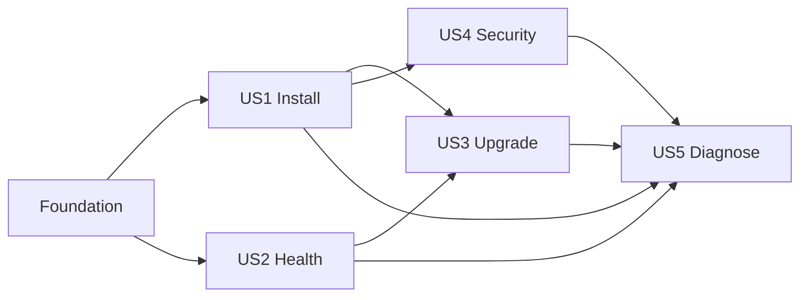

# Tasks: Kubernetes Deployment

**Input**: Design documents from `/specs/046-kubernetes-deployment/`

**Prerequisites**: `plan.md`, `spec.md`, `research.md`, `data-model.md`, `contracts/`, `quickstart.md`

**Tests**: Required by FR-032 and the constitution because this changes process startup, Docker packaging, and the HTTP/WebSocket surface.

**Organization**: Tasks are grouped by user story. Complete tasks in order unless marked `[P]` and their dependencies are already satisfied.

## Format: `[ID] [P?] [Story] Description`

- **[P]**: Can run in parallel because it modifies different files and has no incomplete dependency.
- **[Story]**: Maps the task to a user story in `spec.md`.
- Every task names its implementation or verification path.

## Phase 1: Setup (Shared Infrastructure)

**Purpose**: Establish package and validation locations without changing behavior.

- [X] T001 Create the Helm application-chart skeleton and version metadata in `charts/vizier/Chart.yaml`, `charts/vizier/values.yaml`, and `charts/vizier/templates/_helpers.tpl`
- [X] T002 [P] Create reusable chart contract and cluster smoke entry points in `scripts/kubernetes-chart-contracts.sh` and `scripts/kubernetes-smoke.sh`
- [X] T003 [P] Create the Kubernetes validation workflow skeleton in `.github/workflows/kubernetes.yml`

---

## Phase 2: Foundational (Blocking Prerequisites)

**Purpose**: Add shared process and package primitives required by every install/lifecycle story.

**⚠️ CRITICAL**: User-story work depends on these primitives.

- [X] T004 Define atomic startup/readiness state and minimal response types in `crates/vizier-http/src/health.rs`
- [X] T005 Integrate workload health routes and a graceful-shutdown-capable serving API without breaking existing `router`/`serve` callers in `crates/vizier-http/src/lib.rs`
- [X] T006 Add configurable shutdown-grace CLI/environment plumbing in `crates/vizier/src/cli/run.rs` and `docker-entrypoint.sh`
- [X] T007 Implement cross-platform Ctrl-C and Unix SIGTERM selection plus bounded HTTP/runtime shutdown in `crates/vizier/src/cli/server.rs`
- [X] T008 Make the release image run as fixed non-root UID/GID 10001 with a writable home in `Dockerfile`
- [X] T009 Define value types, enums, ranges, replica constancy, and secret-reference shapes in `charts/vizier/values.schema.json`
- [X] T010 Implement cross-field profile, secret, ingress, and grace-period validation in `charts/vizier/templates/_validate.tpl`

**Checkpoint**: Health/lifecycle primitives, secure image identity, and chart validation are ready.

---

## Phase 3: User Story 1 - Install Vizier on a Cluster (Priority: P1) 🎯 MVP

**Goal**: Install one namespaced Vizier instance in embedded or managed-storage mode using Secret references and an internal Service.

**Independent Test**: Render and install each profile in an empty namespace; embedded becomes ready on a PVC, managed renders only external PostgreSQL/S3 references, and no plaintext secret is present in non-Secret resources.

### Tests for User Story 1

- [X] T011 [P] [US1] Add positive embedded/managed render cases and negative missing-setting/plaintext scans to `scripts/kubernetes-chart-contracts.sh`
- [X] T012 [P] [US1] Add chart default/value documentation assertions to `charts/vizier/README.md`

### Implementation for User Story 1

- [X] T013 [P] [US1] Render the namespaced ServiceAccount with token automount disabled in `charts/vizier/templates/serviceaccount.yaml`
- [X] T014 [P] [US1] Render the default ClusterIP Service with named HTTP port in `charts/vizier/templates/service.yaml`
- [X] T015 [P] [US1] Render retained embedded storage or an existing PVC reference in `charts/vizier/templates/pvc.yaml`
- [X] T016 [US1] Render the single Vizier Deployment with embedded and managed environment/volume profiles plus independent SecretKeyRefs in `charts/vizier/templates/deployment.yaml`
- [X] T017 [P] [US1] Render an optional generic WebSocket-compatible TLS Ingress in `charts/vizier/templates/ingress.yaml`
- [X] T018 [US1] Add install access and profile-specific guidance in `charts/vizier/templates/NOTES.txt`
- [X] T019 [US1] Complete the embedded and managed installation path in `scripts/kubernetes-smoke.sh`

**Checkpoint**: Both storage profiles install from one chart; embedded mode is the standalone MVP.

---

## Phase 4: User Story 2 - Operate a Healthy Single Instance (Priority: P1)

**Goal**: Give Kubernetes correct startup/readiness/liveness semantics and graceful bounded termination.

**Independent Test**: Run the binary and a chart-installed pod, observe all probe states, send SIGTERM during an accepted request, see readiness fail before admission closes, and observe exit within the configured outer grace period.

### Tests for User Story 2

- [X] T020 [P] [US2] Add endpoint status/body/disclosure and readiness-transition tests in `crates/vizier-http/src/health.rs`
- [X] T021 [P] [US2] Add shutdown-grace parsing and ordering tests in `crates/vizier/src/cli/run.rs`
- [X] T022 [P] [US2] Add probe and termination lifecycle checks to `scripts/kubernetes-smoke.sh`

### Implementation for User Story 2

- [X] T023 [US2] Wire startup, readiness, and liveness probes plus termination grace settings into `charts/vizier/templates/deployment.yaml`
- [X] T024 [US2] Ensure readiness flips before HTTP admission closes and runtime shutdown releases the workspace lock in `crates/vizier/src/cli/server.rs`
- [X] T025 [US2] Add credential-safe startup/shutdown lifecycle logs in `crates/vizier/src/cli/server.rs` and `crates/vizier-http/src/lib.rs`

**Checkpoint**: Kubernetes can start, route to, drain, and restart Vizier without coupling liveness to optional dependencies.

---

## Phase 5: User Story 3 - Upgrade and Roll Back Safely (Priority: P2)

**Goal**: Upgrade versioned releases without overlapping processes and retain the full recovery set.

**Independent Test**: Install a prior chart, create data, upgrade, observe `Recreate` with at most one Vizier pod, confirm data/key persistence, and perform the documented pre-write rollback.

### Tests for User Story 3

- [X] T026 [P] [US3] Add contract failures for `replicaCount != 1`, mutable default tags, and invalid grace ordering to `scripts/kubernetes-chart-contracts.sh`
- [X] T027 [P] [US3] Add pod-count, PVC reuse, state persistence, upgrade, and rollback checks to `scripts/kubernetes-smoke.sh`

### Implementation for User Story 3

- [X] T028 [US3] Set one replica, `Recreate`, immutable chart-version image defaults, and retained state mounts in `charts/vizier/templates/deployment.yaml` and `charts/vizier/templates/pvc.yaml`
- [X] T029 [US3] Package and publish a version-matched OCI Helm chart after the multi-architecture image in `.github/workflows/docker-publish.yml`
- [X] T030 [US3] Add Helm package/version validation and upgrade lifecycle jobs to `.github/workflows/kubernetes.yml`

**Checkpoint**: Release upgrades are no-overlap, traceable, and recoverable within the documented compatibility boundary.

---

## Phase 6: User Story 4 - Fit Cluster Security and Operations (Priority: P2)

**Goal**: Run under restricted workload security and expose standard cluster placement, resources, networking, CA, registry, and telemetry controls.

**Independent Test**: Render with every operations override, install under restricted admission, verify no root/privilege/host/API-token requirement, and verify custom CA/OTEL/image-pull inputs reach the pod.

### Tests for User Story 4

- [X] T031 [P] [US4] Add restricted-security, no-cluster-scope, no-hostPath, resource, placement, CA, telemetry, and image-pull render assertions to `scripts/kubernetes-chart-contracts.sh`
- [X] T032 [P] [US4] Add restricted namespace admission and writable-path checks to `scripts/kubernetes-smoke.sh`

### Implementation for User Story 4

- [X] T033 [US4] Apply restricted pod/container security contexts, read-only root, `/data` and `/tmp` writable mounts, resources, placement, pull secrets, CA volumes, and telemetry values in `charts/vizier/values.yaml` and `charts/vizier/templates/deployment.yaml`
- [X] T034 [P] [US4] Render an opt-in ingress-independent NetworkPolicy with operator-supplied ingress/egress rules in `charts/vizier/templates/networkpolicy.yaml`
- [X] T035 [US4] Validate non-root direct container startup and restricted chart admission in `.github/workflows/kubernetes.yml`

**Checkpoint**: The supported defaults satisfy Restricted Pod Security and standard production operations without a chart fork.

---

## Phase 7: User Story 5 - Diagnose and Recover the Deployment (Priority: P3)

**Goal**: Make install failures, backup boundaries, replacement, migration, recovery, and removal operable from published documentation and status signals.

**Independent Test**: Follow the documentation from a clean cluster through install, failure diagnosis, backup, pod loss, restore, and uninstall without reading repository source.

### Implementation for User Story 5

- [X] T036 [P] [US5] Write Kubernetes prerequisites, profiles, exposure/WebSockets, security, observability, troubleshooting, and secret handling in `docs/src/deployment/kubernetes.md`
- [X] T037 [P] [US5] Document upgrade, pre-write rollback, embedded/managed backup and restore, stopped-workspace migration, key rotation, pod loss, and explicit data deletion in `docs/src/deployment/kubernetes.md`
- [X] T038 [US5] Add the Kubernetes deployment guide to `docs/src/SUMMARY.md`
- [X] T039 [US5] Align chart operator guidance and failure messages with the published guide in `charts/vizier/README.md` and `charts/vizier/templates/NOTES.txt`

**Checkpoint**: An operator can diagnose and recover the supported topology using published documentation alone.

---

## Phase 8: Polish & Cross-Cutting Verification

**Purpose**: Prove the integrated binary, image, chart, docs, and release path.

- [X] T040 [P] Run Rust formatting, `cargo test --workspace`, `cargo clippy --workspace`, and `cargo test -p vizier-core --no-default-features` for changes under `crates/`
- [X] T041 [P] Run `helm lint`, all positive/negative contract renders, and package inspection through `scripts/kubernetes-chart-contracts.sh`
- [X] T042 Build and run the changed `Dockerfile`, verify UID 10001 and writable `/data`/`/tmp`, then send SIGTERM and observe bounded graceful exit
- [X] T043 Install the chart on a clean cluster and complete probes, authenticated HTTP, WebSocket dummyplug conversation, pod replacement, persistence, no-overlap upgrade, and uninstall checks through `scripts/kubernetes-smoke.sh`
- [X] T044 Review rendered manifests and logs for plaintext credentials, cluster-scoped resources, mutable tags, secret disclosure, and unsupported multiple replicas using `scripts/kubernetes-chart-contracts.sh`
- [X] T045 Re-run the `specs/046-kubernetes-deployment/quickstart.md` operator flow and reconcile any command or expectation drift in `specs/046-kubernetes-deployment/quickstart.md`

---

## Dependencies & Execution Order

### Phase Dependencies

- **Setup (Phase 1)**: No dependencies.
- **Foundational (Phase 2)**: Depends on Setup; blocks all stories.
- **US1 Install (Phase 3)**: Depends on Foundation; creates the runnable chart MVP.
- **US2 Health (Phase 4)**: Depends on Foundation and integrates into US1's Deployment.
- **US3 Upgrade (Phase 5)**: Depends on US1 and US2 lifecycle behavior.
- **US4 Security (Phase 6)**: Depends on US1's workload template; otherwise independent of US3.
- **US5 Operations (Phase 7)**: Depends on final US1–US4 contracts so documentation is exact.
- **Verification (Phase 8)**: Depends on all delivered stories.

### User Story Dependency Graph



### Parallel Opportunities

- T002 and T003 can proceed after T001's path convention is known.
- T013–T015 and T017 touch independent templates; T016 integrates them.
- Health tests T020, CLI tests T021, and cluster lifecycle additions T022 are independent.
- Upgrade contract tests T026 and cluster upgrade checks T027 are independent.
- Security render tests T031 and cluster security checks T032 are independent.
- Documentation sections T036 and T037 can be drafted independently and merged before T038/T039.
- Static Rust checks T040 and Helm checks T041 can run concurrently; behavioral smoke remains sequential.

## Parallel Example: User Story 1

```text
Task: T013 Render ServiceAccount in charts/vizier/templates/serviceaccount.yaml
Task: T014 Render Service in charts/vizier/templates/service.yaml
Task: T015 Render PVC in charts/vizier/templates/pvc.yaml
Task: T017 Render optional Ingress in charts/vizier/templates/ingress.yaml
```

## Parallel Example: User Story 4

```text
Task: T031 Add manifest security assertions to scripts/kubernetes-chart-contracts.sh
Task: T032 Add restricted-admission checks to scripts/kubernetes-smoke.sh
Task: T034 Render optional NetworkPolicy in charts/vizier/templates/networkpolicy.yaml
```

## Implementation Strategy

### MVP First

1. Complete Setup and Foundation.
2. Complete US1 with the embedded profile.
3. Run chart render tests and install to a clean namespace.
4. Add US2 probes/draining before calling the deployment production-safe.

### Incremental Delivery

1. Embedded and managed installation.
2. Correct workload health and shutdown.
3. Safe release/upgrade behavior.
4. Restricted security and operational controls.
5. Recovery-focused documentation and full lifecycle automation.

## Notes

- `[P]` means different files or independently executable checks, not permission to skip prerequisites.
- Tests for behavioral contracts must fail before their implementation is added.
- Do not modify user-owned dirty `design/` or `webui/` submodule worktrees.
- Use conventional commits for every logical group and PR title.
- Do not mark T043 complete without a real cluster and real dummyplug HTTP/WebSocket path.
