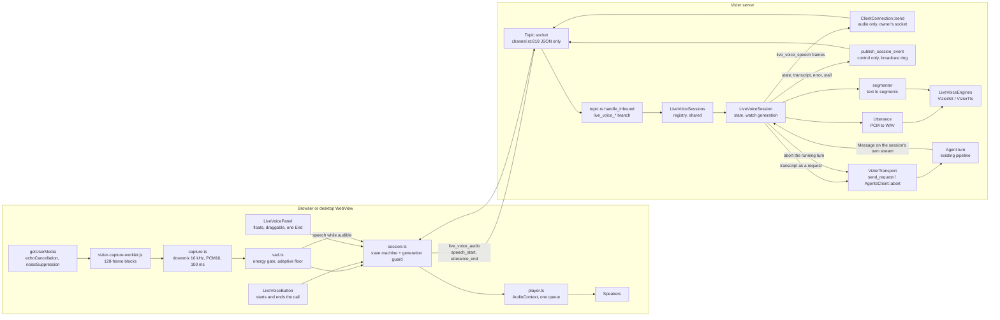
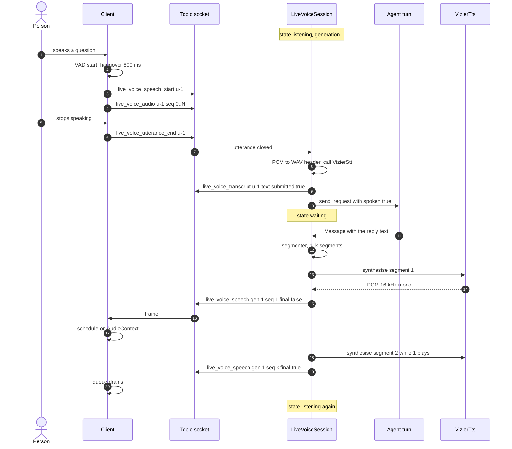
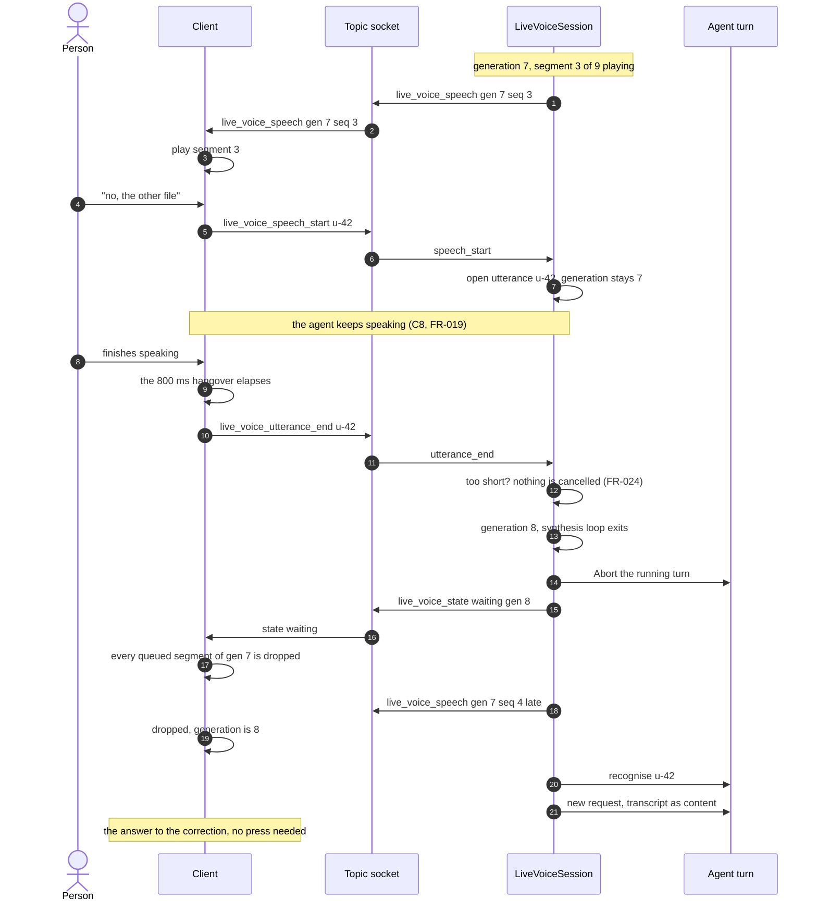
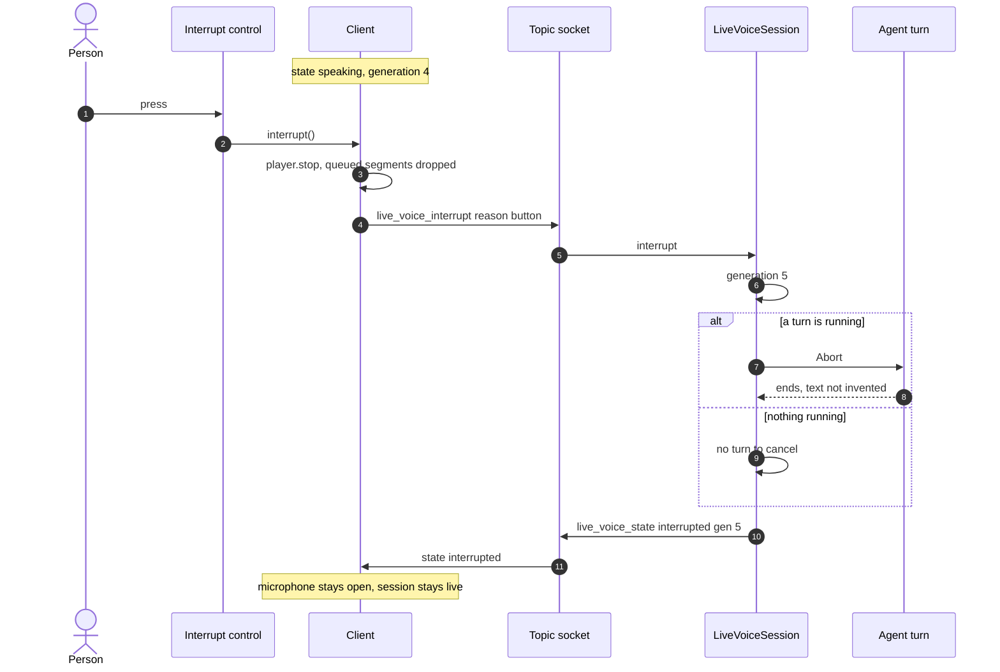

# Implementation Architecture: Live Voice Conversation

**Feature**: `specs/055-live-voice` | **Author**: `@mamang-lead-be` | **Date**: 2026-11-08
**Reads with**: [spec.md](./spec.md) (what), [plan.md](./plan.md) (phases), [review.md](./review.md)
(corrections that this document turns into code shape), [contracts/live-voice-frames.md](./contracts/live-voice-frames.md) (wire).

This is the document `@sepuh-be` implements from. It fixes the seams the plan left open: where each
piece of state lives, which existing function the session calls, what the frames look like after the
D3 correction, and the invariants QA can test. No code here.

---

## 1. Component map

| Component | File | Lives in | Responsibility |
|---|---|---|---|
| `LiveVoiceSessions` (registry) | `crates/vizier-core/src/live_voice/registry.rs` | shared services, beside `questions` | **one session per person, in total** (C10, FR-005): a second map runs `owner → Arc<LiveVoiceSession>`, and the `VizierSession` key stays for routing frames. Starting one elsewhere **moves** it (§13) |
| `LiveVoiceSession` | `.../live_voice/session.rs` | in the registry, `Arc<Mutex<…>>` | state machine (FR-006), generation `watch<u64>`, idle timer, end reason |
| `Utterance` | `.../live_voice/utterance.rs` | inside its session | accumulate PCM16, 60 s cap, 44-byte WAV header by hand, call `VizierStt` (D7) |
| `LiveVoiceEngines` (trait) + cascade impl | `.../live_voice/engines.rs` | built per session from agent config | `transcribe(utterance)`, `speak(segment) -> PCM16`; the only seam (FR-036a) |
| `segmenter` | `.../live_voice/segmenter.rs` | pure function + unit tests | reply text → ordered speakable segments (FR-013, FR-014) |
| wire types | `.../live_voice/frame.rs` | wire types | `LiveVoiceControl` (`state`, `transcript`, `error`, `stall`) and `LiveVoiceSpeech`, both `#[serde(tag = "type", rename_all = "snake_case")]` (D3). Two types, not one, so the lane is enforced by the compiler |
| `SessionFrame::LiveVoice(LiveVoiceControl)` | `crates/vizier-core/src/transport/mod.rs:58` | existing enum | additive variant, **control only** — audio has no path into the broadcast (§11); no existing variant touched |
| inbound dispatch | `crates/vizier-http/src/topic.rs:209` `handle_inbound` | per socket | `live_voice_*` branch **before** the `frame.to_string()` copy (D5) |
| outbound arm | `crates/vizier-http/src/topic.rs:535-600` | per socket | `SessionFrame::LiveVoice(f) => Some(json!({"live_voice": f}))` — control only, the match never sees audio (D4) |
| delivery (server → client) | `ClientConnection::send` (`crates/vizier-core/src/agents/client/connection.rs`) | per socket, bounded (64) | live voice frames go to the **owner's** socket, never the session-event broadcast (§11, D9); audio is dropped before control |
| audio chunking, VAD, player, state machine | `webui/app/lib/liveVoice/{capture,vad,player,session}.ts` | client | capture 100 ms PCM16, energy VAD, gapless playback, generation guard |
| the control and the floating panel | `webui/app/screens/chat/LiveVoiceButton.tsx` (starts/ends the call), `webui/app/screens/livevoice/LiveVoicePanel.tsx` (the call itself, FR-043, FR-048) | client | one control in the conversation, visually separate from the mic and the spoken-reply toggle (FR-001, FR-003); the panel **floats over** the conversation the person is already reading (C9, FR-049) and shows the agent, the FR-006 state word, FR-042's thinking indicator, the open microphone (FR-038) and **one** action, End (FR-045). **There is no interrupt control** — C7 moved it to the backlog |

`vizier-http` must build **with the feature off**: every reference to `live_voice` in that crate is
behind `#[cfg(feature = "provider-live-voice")]` (FR-041), and the inbound branch falls through to
today's behaviour when the flag is off.

## 2. Architecture



Reading it: one socket, one registry, one generation. The reply the session speaks is the reply of the
turn **it** submitted (§4), not "whatever appeared in the conversation", so a background report or a
second tab can never be spoken by mistake.

## 3. State, ownership and lifetime

* **Registry**: `Arc<LiveVoiceSessions>` created once per process and exposed on the same shared
  service struct that already carries `Questions` (`TopicConnection` receives
  `Arc<vizier_core::questions::Questions>` at `crates/vizier-http/src/topic.rs:79-81` — the live
  registry is handed over the same way). **Two indexes, one entry**: the `VizierSession` key routes a
  frame to a session, and an `owner → Arc<LiveVoiceSession>` index enforces FR-005's "at most one for
  this person" across conversations **and** agents (C10). Two sockets in two tabs on the *same*
  conversation therefore resolve to the same entry, which is what D6 and Q2's "refuse the second tab"
  need.
* **Owner**: the `Principal` of the connection that sent `live_voice_start`. A different principal gets
  `live_voice_error { kind: "session_active" }`. The same principal starting a call **elsewhere** is
  not refused — it moves (§13, FR-050).
* **Honest limit**: this index is per **process**. A fleet with more than one process needs the claim on
  the bus (one `agent…` subject per person), not a local map; until then "one session per person" holds
  per process, and the deployment's single-process default is what makes it true today. Recorded rather
  than claimed.
* **Generation**: `tokio::sync::watch<u64>` inside the session, starts at 1, `+1` on every
  interruption (barge-in, button, typed message). Every server audio frame carries it; the client
  drops anything below its current value; the synthesis loop re-reads it between segments and exits.
  No `CancellationToken`, no `tokio-util` (R3).
* **One task per session**: a `tokio::task` owns the synthesis loop; `live_voice_stop`, an end, or
  the last connection closing sets a stop flag and awaits the task. Nothing spawns per segment.
* **Lifetime ends** (FR-028, FR-029): the socket closing (`connection.close()` already exists),
  explicit `live_voice_stop`, 3 min without an utterance, agent config reload / agent restart (the
  session holds the config generation it started with and compares on each turn), the person starting a
  call **elsewhere** (`moved`, §13), the registry entry being dropped. Every path: stop audio → release
  microphone → write `live_voice_state{ended,reason}`.

## 4. The turn the session drives

`transport.send_request(session, req, Some(response_tx))`
(`crates/vizier-core/src/transport/mod.rs:467`) is the only submission path — the same one a typed
message uses. Because the session passes **its own** `ResponseSender`, the reply arrives on that
sender and nowhere else: it is provably the answer to the transcript. No broadcast subscription, no
"guess which Message frame is mine".

Interrupt → cancel: `AgentsClient::abort(agent_id, session)`
(`crates/vizier-core/src/agents_client.rs:205-207`, impl `:298-312`), which sends
`VizierRequestContent::Command("abort")` — the same thing the Composer's `/abort` sends. There is **no**
`AgentCommand::Abort` (`crates/vizier-core/src/schema/commands.rs:142`); `agents_client.rs:415` is
`FakeCall::Abort`, a test fake (`review.md` D12). Order is fixed: **stop the audio, then abort**
(FR-027), so no further words are heard while the turn unwinds.

**FR-023, two cases (D1)**: if the `Message` frame had already arrived, its text is saved and is kept,
marked interrupted; if the abort lands before any `Message`, the turn ends as `Abort`
(`schema/response.rs:156-166` — a turn that produced nothing) and the conversation shows the existing
"Stopped by you", with no invented partial text.

**FR-018 is withdrawn (User, 2026-11-08 17:27) — and §4's rule is the reason it could be.** The session
speaks only the turns it submitted. A typed message is not one of them: typing during a session sends
`live_voice_interrupt { reason: "typed" }` (the audio stops, FR-025) and then an ordinary chat request on
the same socket, answered as text. Making its reply audible would have meant a second submission path
into the session, which is more surface than the behaviour is worth — the User chose text only.

**FR-042 — the thinking indicator keeps §4's rule honest.** Since the session speaks only its own turns
and the model is not streaming, the gap between "request accepted" and "first segment" is real and can
be long (FR-017 lets the agent take that time). The session already emits `live_voice_state` with
`state: "waiting"` at turn start; FR-042 requires the panel to render that as **thinking** and to keep it
visually distinct from `reconnecting`. No new frame: `waiting` gains an obligation it did not have
before, which is why `contracts` documents it under the state word rather than as a new type.

**FR-011/FR-017 (D2)**: the request is an ordinary `VizierRequestContent::Chat(transcript)` with a new
`#[serde(default)] spoken: bool`. The spoken note for the agent is appended in the block that already
handles voice input (`crates/vizier-core/src/agents/agent/mod.rs:712-750`), gated on `spoken`, so no
typed turn changes.

## 5. Sequence — a spoken turn



Segment *n+1* is requested the moment *n*'s frame is written, not after it finishes playing: that is
the only thing keeping gaps between segments inaudible.

## 6. Sequence — barge-in (the person speaks over the agent)



**Who stops the audio, and when (C8, FR-019).** Not the client on the first voiced sample: the person
speaking does not silence the agent by itself. The session opens the utterance and lets the reply run on.
The stop comes from the **end** of that utterance — the 800 ms hangover of FR-010 — and it travels as a
generation bump, so three things happen in one order:

1. the session moves the generation (the synthesis loop exits between segments, and the caller sees
   `waiting` on the new generation),
2. the turn is cancelled on the existing stop path (`Command("abort")`, FR-027),
3. the client drops every queued segment whose generation is below the one it has seen (FR-022).

Nothing is heard from the interrupted reply after that, because nothing of the old generation is played
again — the client's queue is filtered by generation on arrival, not by a timer.

**Why the onset guard is retired (D15 → C8).** The ~250 ms voiced-energy guard existed to stop a cough
from cancelling a reply that the person had not heard. With the trigger at the *end* of speech that job
is done by FR-024 instead: an utterance too short to be a word cancels nothing and submits nothing, so a
cough costs neither the reply nor a message. Keeping both would mean a cough had to survive two
thresholds to be ignored.

**What C8 costs, stated plainly (FR-047, SC-008).** While the person talks, the agent talks — so the
microphone hears the agent. The hangover that ends the utterance can therefore never elapse, and the
agent can never be interrupted at all. `FR-047` requires the end of speech to be detected *while the
reply is audible*; the mechanisms are the browser's echo cancellation, a raised gate (or ducking the
playback's contribution to the microphone, not the volume the person hears), and SC-008 is the release
gate — a reply at 80 % volume, no headphones, ten minutes, no self-interruption.

## 7. Sequence — the interrupt control (deferred, C7)

**Out of scope for this release.** The User moved the interrupt control to the backlog on
2026-11-08 (Clarifications C7, `spec.md` US3 `Priority: backlog`, FR-020/FR-021 struck as deferred,
`tasks.md` T051–T057 `[BACKLOG]`). The sequence below is kept because the mechanism it uses is the one
barge-in already needs — `interrupt` moves the generation, cancels the turn, and ends no session — so
reinstating the control later is one more control on the panel and one more frame, not a new design. Nothing here is built now, and
no checkpoint waits on it.



The difference from §6 is only who started it and what follows: the button submits no message, so the
session returns to `listening` and waits. That is why it works where speaking over the agent cannot.

## 8. Client pieces, and why each is separate

| Piece | Does | Refuses to do |
|---|---|---|
| `capture.ts` | `getUserMedia({audio:{echoCancellation:true, noiseSuppression:true, autoGainControl:true}})`, tap via the shipped worklet, downmix to 16 kHz mono PCM16, emit 100 ms chunks | no `MediaRecorder`, no encoding, no upload of anything but PCM |
| `vad.ts` | energy gate on 20 ms windows, adaptive noise floor (rolling p10), start threshold, 800 ms hangover, playback guard (threshold +12 dB and 150 ms blind window while a segment is audible) | no model, no wasm, no network |
| `session.ts` | states of FR-006, generation guard, frame codec, `too_short` decision | no audio, no DOM; pure and unit-tested |
| `player.ts` | one `AudioContext` resumed on the control press, `AudioBufferSourceNode`s scheduled back to back on the context clock, `stop()` closes every source and drains the queue | never re-schedules a stale generation |
| `LiveVoicePanel.tsx` | renders the panel **over** the conversation (C9, FR-049): drag by the header, clamp so no edge leaves the window, re-clamp on resize, keep the position for the life of the call (FR-048), one End (FR-045) | no route of its own, no dimming overlay, no second control that ends the call, no session state — it reads the state word the session sends and calls one callback |

`stop()` must be synchronous with the click: `SC-003` (200 ms) is measured from the press to silence,
and a `Promise` chain that awaits the socket would blow it.

## 9. Latency budget

Same numbers as `plan.md`, with the stage this feature cannot shorten named separately. SC-001 was
restated in the spec during this review (p90 3.5 s gate, 2 s p50 stretch) precisely because the floor
below is 2.57 s before the model has produced anything.

| Hop | Budget p90 | Owner |
|---|---|---|
| end of speech → utterance closed | 800 ms | client hangover (tunable) |
| utterance → recogniser called | 80 ms | server (WAV header by hand) |
| recognition | 900 ms hosted | provider |
| turn start → `Message` frame | model latency | unchanged by this feature (see RK-1) |
| `Message` → first segment synthesised | 600 ms hosted | one short first segment |
| frame → audible | 50 ms | `AudioContext` already resumed |
| **the model produces the whole message** | not budgeted: the model's own latency | nothing can be spoken before the message exists (`llm/sse.rs:1-3`); the one stage this feature cannot shorten |
| **speech end → first word** | **floor 2.57 s + model latency**; gate p90 ≤ 3.5 s, p99 ≤ 5 s; stretch 2 s at p50 (SC-001 as restated) | 800 + 120 + 900 + 100 + 600 + 50 ms before the model answers |
| barge-in → silence | ≤ 50 ms client, ≤ 300 ms server (SC-002) | |
| interrupt press → silence | ≤ 200 ms (SC-003) | |

## 10. Invariants (QA turns these into tests)

* **I1** With `provider-live-voice` off: no `live_voice` frame is ever emitted, the capability reads
  false, and `cargo build -p vizier-http` has no reference to the module.
* **I2** Nothing reads `stt.enabled` / `tts.enabled` on the live path: only `.settings` (nit from
  `review.md` §4.1). Turning both tools off must not affect a session.
* **I3** No audio reaches disk or storage; the only new persisted thing is `spoken` on a request.
* **I4** Two sockets on one conversation: exactly one session; the second gets `session_active`.
* **I5** A frame whose `generation` is below the client's is dropped, always, in every state.
* **I6** After an interruption no `live_voice_speech` of the old generation is ever played (FR-022).
* **I7** Every terminal transition emits exactly one `live_voice_state` with a reason and releases
  the microphone track within 2 s (SC-007).
* **I8** A typed message during a session stops the audio exactly like the button (FR-025) and is
  answered **as text with nothing spoken** (FR-018 withdrawn, 2026-11-08): the session schedules no
  audio for a turn it did not submit.
* **I9** No `live_voice_speech` frame ever reaches `publish_session_event` (control frames do, by
  design); a backlogged socket loses speech frames only, never a `SessionFrame::Response`, and never a
  control frame (§11, D9).
* **I10** A move (section 13) leaves one session, not two: after `live_voice_start` on another conversation the
  registry holds **one** entry for that person, the old entry ends with `ended{moved}`, and the turn
  that was in flight is aborted once and never spoken into the new call (FR-050, FR-052, SC-011). The
  old conversation's transcript keeps the turns it already had — a move moves the microphone, not the
  history (FR-051, Q10).

## 11. Delivery path for server frames (`review.md` D9)

**Audio** (`live_voice_speech`) never goes through `publish_session_event`: it is written to the one
socket that owns the session. **Control** (`state`, `transcript`, `error`, `stall`) keeps the broadcast,
because it is a handful of frames per turn and it is how other sockets on the conversation learn that a
session is active (FR-005).

```text
LiveVoiceSession ──> Arc<ClientConnection> ──send()──> per-connection mpsc(64) ──> TopicOutbound ──> flume (socket)
                        (owner, core type)              bounded, try_send            depth check          writer
```

* **A second tab was receiving the audio.** The broadcast is filtered per **session**, not per socket
  (`crates/vizier-http/src/topic.rs:533` — `ev.session == self.session`), so every socket open on the
  conversation got every audio frame, including a tab that FR-005 says may not hold a session. Moving
  audio to the owner's connection closes that leak and the text-eviction risk in one change; the low
  volume control frames stay on the broadcast precisely so that tab can still be *told* a session is
  active, which is what FR-005 asks for.
* **Why audio must not use the broadcast.** `SessionEvent` travels a `broadcast::channel(1024)` shared by the whole
  process (`crates/vizier-core/src/transport/mod.rs:29,270`), and a subscriber that falls behind gets
  `Lagged` and loses **every** frame in between (`crates/vizier-http/src/topic.rs:609-613`). Audio at
  10 frames/s is far more traffic than text; in that ring it would evict text from the replay window of
  any behind subscriber and lose it all-or-nothing. A per-connection queue can drop audio alone.
* **The precedent is already in the repo.** `ClientConnection`'s own module doc says it: *"A call's
  frame is written straight to the socket, never through the session-event broadcast, which may drop
  frames when a subscriber lags"* (`crates/vizier-core/src/agents/client/connection.rs:1-6`). Live
  voice reuses that decision, not a new one.
* **The bound has to be where the queue actually grows.** The whole chain, each link verified in the
  tree:

  | Link | Fact |
  |---|---|
  | socket writer | `mpsc::channel::<Message>(64)` (`crates/vizier-http/src/api/v1/agents/channel.rs:780`) |
  | `handle_socket` | its `select!` arms `await` `write_tx.send(..)`; while the writer is behind, that arm waits and the loop stops draining `out_rx` (`:790-825`) |
  | `out_rx` | `flume::unbounded()` (`:374`) — no backpressure at all, so a stalled writer grows it without limit |
  | `TopicOutbound::run` | the only place that can see the depth: `self.out.len()` (flume 0.12 `Sender::len`) |

  So the gate is there: before writing a `live_voice_speech` frame, compare `self.out.len()` with
  `LIVE_VOICE_SOCKET_BACKLOG` (16). Above it, drop the audio frame; never drop `state`, `transcript`
  or `error`. That is what bounds this feature's memory: 16 × 4.3 KB ≈ 69 KB per socket, instead of a
  queue that would otherwise accept 43 KB/s forever.

  **One counter, one reporter.** The drop happens in the outbound loop, so the count lives there: the
  loop increments `backlog` when it discards a `speech` frame, resets it when the depth falls back
  below the gate, and emits exactly one control frame (`{ "type": "stall", "dropped": N }`) for the episode,
  through `publish_session_event` — the control lane it already has. The session does **not** keep a
  second counter; its `ClientConnection::send` returning `false` while the connection is open is a
  backstop that logs, because a healthy pair drains the 64-slot queue at flume speed and never fills it.
* **Known limitation, recorded rather than fixed.** `handle_socket`'s `select!` awaits
  `write_tx.send(..)`, so when the socket writer is stuck the same loop stops polling `reader.next()`:
  the person's **inbound** frames wait behind the outgoing jam. Barge-in stays instant where it is
  measured (the client stops its own audio before sending anything, SC-002's 50 ms) and the server's
  abort may arrive late on a socket that is already failing; FR-033's reconnect and the 16-frame gate
  (which caps audio queued ahead of any control frame at ~1.6 s) are the bounds. Fixing the shared
  `select!` is a transport change, not this feature's, and doing it here would widen the blast radius
  for no behaviour this spec promises.
* **What a stalled writer does *not* do.** It does not starve the broadcast: `events.recv()` runs in
  `TopicOutbound::run`, spawned as its own task (`crates/vizier-http/src/api/v1/agents/channel.rs:787`
  — `tokio::spawn(o.run())`), so the subscriber keeps draining and pushing into the flume. `Lagged` is
  therefore not the everyday consequence of a slow socket (the flume is); it remains a real risk for
  the *control* ring when a subscriber task is scheduled late or many conversations share it, which is
  exactly why the volume stayed off it.
* **Alternative considered and rejected (`@sepuh-be`'s proposal, 15:25).** A second
  `flume::bounded(20)` audio lane threaded through `TopicConnection::open` (two call sites:
  `crates/vizier-http/src/api/v1/agents/channel.rs:375` and `crates/vizier-http/src/embedded.rs:56`)
  plus a priority arm in `handle_socket`. It works, but it buys nothing this does not: a second queue
  whose depth must be kept in sync with the first, a signature change at two call sites including the
  desktop IPC path, and a priority arm that can put audio ahead of the `live_voice_state` that must
  reach the client *before* the speech it describes. `out.len()` measures the same depth at the same
  moment, with no new plumbing and no dependency. **Consequence for the task list: no task touches
  `channel.rs` or `embedded.rs`, and `TopicConnection::open` keeps its signature** — if a future
  measurement shows control frames queueing behind audio for longer than the 1.6 s this gate allows,
  the fix is a priority arm at that point, not a second queue guessed at now.
* **Signal, not timeout.** `ClientConnection::send` returns `false` once `close()` has taken the
  sender, so a closed tab ends the session with `page_closed` immediately; `false` while the queue is
  full is a stall, and a stall never ends a session.
* **The lane is re-bound on reconnect.** `TopicConnection::open` builds a **new** `ClientConnection`
  for every socket (`crates/vizier-http/src/topic.rs:144`), so a session holding the old `Arc` would
  be alive and mute after a drop and resume. Rule: a `live_voice_start` from the owner while their
  session is live is idempotent and adopts the caller's current connection; a session whose owner
  does not return inside FR-033's 30 s ends with `connection_lost` (task T067).
* **What changes, and what does not.** `SessionFrame` gains **one** variant,
  `LiveVoice(LiveVoiceControl)`, and the hand-written outbound match (`topic.rs:535-600`) gains **one**
  arm for it — that arm is live, not dead, because control frames really do travel the broadcast. What
  stays untouched is everything else: the ring's capacity (1024), every existing variant, and every
  existing consumer. Audio never touches either, and the type split in `frame.rs` is what guarantees it
  rather than a review rule (T009, T010).

**Honest note on the finding.** The report that prompted this section said a slow socket would hit
`Lagged` "far more quickly". Re-reading the code, that mechanism is weaker than stated: every arm of
the outbound match is synchronous (no `.await` inside), and `self.out` is an unbounded `flume`, so a
slow *network* grows the flume queue instead of lagging the broadcast subscriber. `Lagged` needs a
consumer 1024 events behind, which is possible (a subscriber task scheduled late, or a different
conversation sharing the ring) but not the everyday path. The decision above stands on the three
grounds that do hold — all-or-nothing loss, ring eviction cost, and the unbounded socket queue that
this feature would otherwise feed at 43 KB/s — and it costs no new dependency.

## 12. Test shape per layer

| Layer | Where | What proves it |
|---|---|---|
| core engine | `crates/vizier-core/src/live_voice/*.rs` `#[cfg(test)]` | segmenter boundaries and skip rules; utterance cap; generation stops the loop; WAV header bytes |
| transport/wire | `crates/vizier-http/tests/` (faked `VizierStt`/`VizierTts`) | one utterance → exactly one request with `spoken`; interrupt → `Abort` sent once; flag off → frames ignored, socket unaffected |
| client | `webui/app/lib/liveVoice/*.test.ts` | VAD fires on speech-over-playback and not on playback alone; stale generation dropped; `stop()` drains |
| e2e | `webui/e2e` Playwright, fake provider | both interruption paths end in silence with the session still live; tab close releases the track |

No live provider in CI; the manual pass is `quickstart.md`.

## 13. One session, and it moves

C10 makes the registry a single-entry-per-person map, so the interesting case is not the second start
being refused — it is the second start **winning**. FR-050, FR-051 and FR-052 are one mechanism seen
from three sides: the new call must be alone, the old conversation must say why, and no turn may cross
between them.

```text
live_voice_start (conversation B, same Principal)
    │
    ├─ 1. look up owner index ──> old session in conversation A (if any)
    ├─ 2. old.bump_generation()            ← nothing more is synthesised from now on (§3)
    ├─ 3. old.abort_turn(Moved)            ← FR-052: the same abort §4 already sends, once
    ├─ 4. old.end(reason: "moved")         ← stop audio, release the mic, state{ended,moved} on A
    ├─ 5. wait for old's task to be gone   ← the "one microphone open once" guarantee (SC-011)
    ├─ 6. insert new session under B       ← routing index (VizierSession) + owner index
    └─ 7. state{live, "listening"} on B    ← the panel opens here, FR-050
```

* **Three starts, three outcomes, one lookup each.** Same conversation from the owner's current socket →
  the FR-033 re-bind of §11 (idempotent, adopts the new `ClientConnection`, no ending frame). Same
  conversation from a **different** socket → `session_active`, refused (Q2). Different conversation, or
  different agent → the move above. Any other principal starting on that conversation is refused the
  same way and for a smaller reason: the routing entry for the conversation is already taken, so the
  answer is `session_active` whoever asks — a second microphone in one conversation is never what C10
  wants, and it is the one case where the new start loses.
* **The order is the invariant.** Steps 2–4 happen before 5, and 5 finishes before 6: there is never a
  moment with two registry entries, and never a moment with two open microphones on the server side.
  The client's old panel closes on step 4's frame; the new panel only exists after step 7, so the two
  panels are never both live either.
* **The turn is cancelled, not carried.** FR-052 is not a new path: it is §4's fixed order (stop the
  audio, then `AgentsClient::abort`) with the reason recorded as `moved` instead of `barge_in` or
  `button`. The partial `Message` is kept exactly as D1 keeps it, in conversation **A**, which is where
  the person left it. Nothing of A's turn is fed to B — B's session starts with an empty playback queue
  and its own generation `1`, so even a late frame from A carries a generation the new client never
  adopts (§10 I5, I6).
* **Transcripts do not move.** The session holds no history; A's transcript is A's, B's is B's, and the
  spoken turns of the old call stay in the conversation that heard them. This is what makes FR-051 a
  cheap promise: the reason is a notice on the closed panel (Q10 default), not an invented message, and
  the history it sits beside is untouched.
* **A refusal still exists, in exactly one place.** Q2: a second **tab on the same conversation** is
  refused (`session_active`), because there the microphone is already in that conversation and the
  question is which tab owns it, not which conversation. Compare the two cases side by side:
  same person + different conversation → move; same person + same conversation, different socket →
  refuse. Both rules are one lookup each in the registry, and §10 I4 still holds.
* **The reason vocabulary gains one value.** `ended` reasons are the existing set plus `moved`
  (`contracts/live-voice-frames.md`). `moved` never appears on the conversation a call is *taken to*,
  only on the one it leaves — which is why the client can tell "my call was taken" from "my call ended".

## 14. What would change the design (recorded, not built)

* Token streaming in the turn protocol → segmenter replaced by deltas, frames unchanged.
* A realtime speech-to-speech provider → implements `LiveVoiceEngines`; frames, controls and
  invariants unchanged (FR-036a).
* A wasm VAD → swaps `vad.ts` behind the same interface; needs the CSP change recorded in
  `research.md` §C, which is why it is not shipped now.

