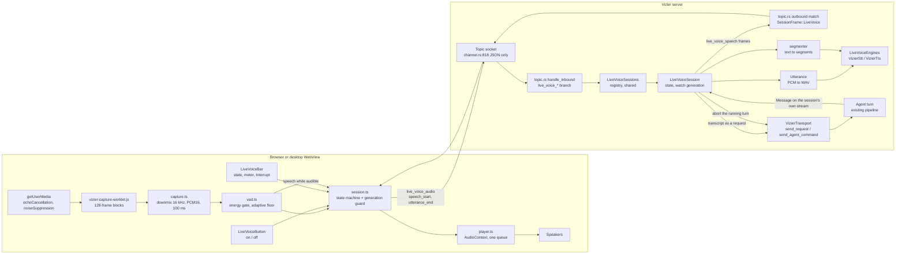
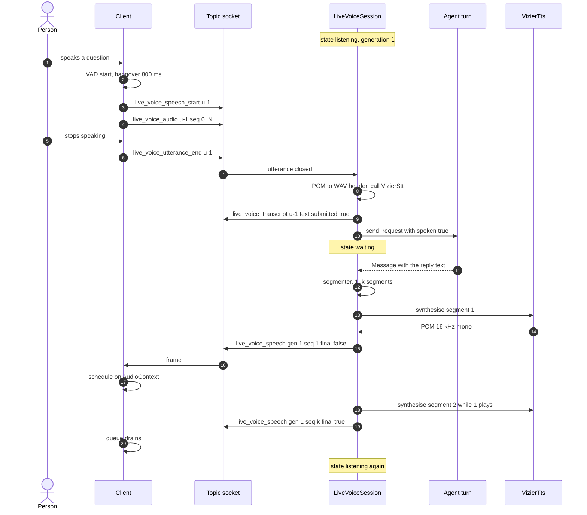
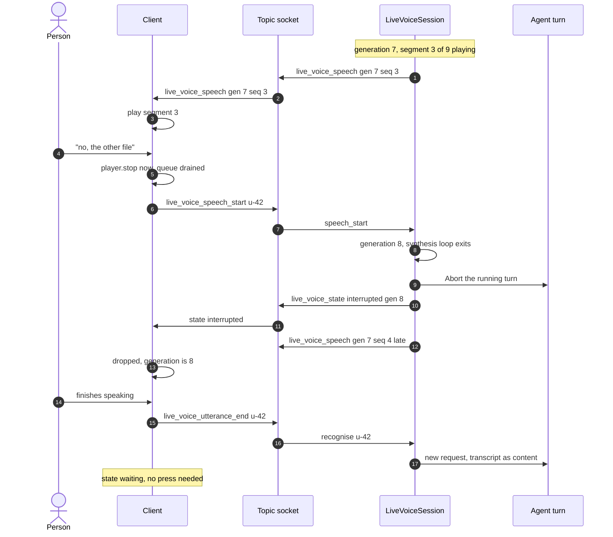
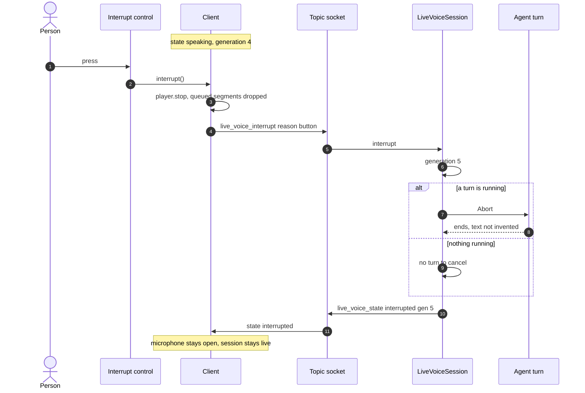

# Implementation Architecture: Live Voice Conversation

**Feature**: `specs/055-live-voice` | **Author**: `@mamang-lead-be` | **Date**: 2026-11-08
**Reads with**: [spec.md](./spec.md) (what), [plan.md](./plan.md) (phases), [review.md](./review.md)
(corrections that this document turns into code shape), [contracts/live-voice-frames.md](./contracts/live-voice-frames.md) (wire).

This is the document `@sepuh-be` implements from. It fixes the seams the plan left open: where each
piece of state lives, which existing function the session calls, what the frames look like after the
D3 correction, and the invariants QA can test. No code here.

---

## 1. Component map

| Component | File | Lives in | Responsibility |
|---|---|---|---|
| `LiveVoiceSessions` (registry) | `crates/vizier-core/src/live_voice/registry.rs` | shared services, beside `questions` | one session per (agent, conversation); owner = the principal that started it (FR-005) |
| `LiveVoiceSession` | `.../live_voice/session.rs` | in the registry, `Arc<Mutex<…>>` | state machine (FR-006), generation `watch<u64>`, idle timer, end reason |
| `Utterance` | `.../live_voice/utterance.rs` | inside its session | accumulate PCM16, 60 s cap, 44-byte WAV header by hand, call `VizierStt` (D7) |
| `LiveVoiceEngines` (trait) + cascade impl | `.../live_voice/engines.rs` | built per session from agent config | `transcribe(utterance)`, `speak(segment) -> PCM16`; the only seam (FR-036a) |
| `segmenter` | `.../live_voice/segmenter.rs` | pure function + unit tests | reply text → ordered speakable segments (FR-013, FR-014) |
| `LiveVoiceFrame` | `.../live_voice/frame.rs` | wire type | `#[serde(tag = "type", rename_all = "snake_case")]` (D3) |
| `SessionFrame::LiveVoice(..)` | `crates/vizier-core/src/transport/mod.rs:58` | existing enum | additive variant; **no** existing variant touched |
| inbound dispatch | `crates/vizier-http/src/topic.rs:209` `handle_inbound` | per socket | `live_voice_*` branch **before** the `frame.to_string()` copy (D5) |
| outbound arm | `crates/vizier-http/src/topic.rs:535-600` | per socket | `SessionFrame::LiveVoice(f) => Some(json!({"live_voice": f}))` (D4) |
| audio chunking, VAD, player, state machine | `webui/app/lib/liveVoice/{capture,vad,player,session}.ts` | client | capture 100 ms PCM16, energy VAD, gapless playback, generation guard |
| the two controls | `webui/app/screens/chat/LiveVoiceButton.tsx`, `LiveVoiceBar.tsx` | client | one on/off control, one always-visible interrupt control |

`vizier-http` must build **with the feature off**: every reference to `live_voice` in that crate is
behind `#[cfg(feature = "provider-live-voice")]` (FR-041), and the inbound branch falls through to
today's behaviour when the flag is off.

## 2. Architecture

Reading it: one socket, one registry, one generation. The reply the session speaks is the reply of the
turn **it** submitted (§4), not "whatever appeared in the conversation", so a background report or a
second tab can never be spoken by mistake.

## 3. State, ownership and lifetime

* **Registry**: `Arc<LiveVoiceSessions>` created once per process and exposed on the same shared
  service struct that already carries `Questions` (`TopicConnection` receives
  `Arc<vizier_core::questions::Questions>` at `crates/vizier-http/src/topic.rs:79-81` — the live
  registry is handed over the same way). Key: `(agent_id, session.0, session.1)`. Two sockets in two
  tabs therefore see the same entry, which is what FR-005 needs (D6).
* **Owner**: the `Principal` of the connection that sent `live_voice_start`. Any other principal gets
  `live_voice_error { kind: "session_active" }` and cannot start, interrupt or stop it.
* **Generation**: `tokio::sync::watch<u64>` inside the session, starts at 1, `+1` on every
  interruption (barge-in, button, typed message). Every server audio frame carries it; the client
  drops anything below its current value; the synthesis loop re-reads it between segments and exits.
  No `CancellationToken`, no `tokio-util` (R3).
* **One task per session**: a `tokio::task` owns the synthesis loop; `live_voice_stop`, an end, or
  the last connection closing sets a stop flag and awaits the task. Nothing spawns per segment.
* **Lifetime ends** (FR-028, FR-029): the socket closing (`connection.close()` already exists),
  explicit `live_voice_stop`, 3 min without an utterance, agent config reload / agent restart (the
  session holds the config generation it started with and compares on each turn), the registry entry
  being dropped. Every path: stop audio → release microphone → write `live_voice_state{ended,reason}`.

## 4. The turn the session drives

`transport.send_request(session, req, Some(response_tx))`
(`crates/vizier-core/src/transport/mod.rs:467`) is the only submission path — the same one a typed
message uses. Because the session passes **its own** `ResponseSender`, the reply arrives on that
sender and nowhere else: it is provably the answer to the transcript. No broadcast subscription, no
"guess which Message frame is mine".

Interrupt → cancel: `transport.send_agent_command(AgentCommand::Abort { agent_id, session })`
(`crates/vizier-core/src/agents_client.rs:415`), which is what `/abort` already becomes
(`agents_client.rs:305`). Order is fixed: **stop the audio, then abort** (FR-027), so no further words
are heard while the turn unwinds.

**FR-023, two cases (D1)**: if the `Message` frame had already arrived, its text is saved and is kept,
marked interrupted; if the abort lands before any `Message`, the turn ends as `Abort`
(`schema/response.rs:156-166` — a turn that produced nothing) and the conversation shows the existing
"Stopped by you", with no invented partial text.

**FR-011/FR-017 (D2)**: the request is an ordinary `VizierRequestContent::Chat(transcript)` with a new
`#[serde(default)] spoken: bool`. The spoken note for the agent is appended in the block that already
handles voice input (`crates/vizier-core/src/agents/agent/mod.rs:712-750`), gated on `spoken`, so no
typed turn changes.

## 5. Sequence — a spoken turn

Segment *n+1* is requested the moment *n*'s frame is written, not after it finishes playing: that is
the only thing keeping gaps between segments inaudible.

## 6. Sequence — barge-in (the person speaks over the agent)

Three guards make "no part heard later" true (FR-022): the client stops its sources synchronously,
the client refuses any frame below the generation it has seen, and the server's synthesis loop stops
before it can emit the next segment. FR-019's "before their words are transcribed" holds because
`player.stop()` and `live_voice_speech_start` are sent on the same tick the VAD fires — recognition
starts only at `utterance_end`, hundreds of milliseconds later.

## 7. Sequence — the interrupt control

The difference from §6 is only who started it and what follows: the button submits no message, so the
session returns to `listening` and waits. That is why it works where speaking over the agent cannot.

## 8. Client pieces, and why each is separate

| Piece | Does | Refuses to do |
|---|---|---|
| `capture.ts` | `getUserMedia({audio:{echoCancellation:true, noiseSuppression:true, autoGainControl:true}})`, tap via the shipped worklet, downmix to 16 kHz mono PCM16, emit 100 ms chunks | no `MediaRecorder`, no encoding, no upload of anything but PCM |
| `vad.ts` | energy gate on 20 ms windows, adaptive noise floor (rolling p10), start threshold, 800 ms hangover, playback guard (threshold +12 dB and 150 ms blind window while a segment is audible) | no model, no wasm, no network |
| `session.ts` | states of FR-006, generation guard, frame codec, `too_short` decision | no audio, no DOM; pure and unit-tested |
| `player.ts` | one `AudioContext` resumed on the control press, `AudioBufferSourceNode`s scheduled back to back on the context clock, `stop()` closes every source and drains the queue | never re-schedules a stale generation |

`stop()` must be synchronous with the click: `SC-003` (200 ms) is measured from the press to silence,
and a `Promise` chain that awaits the socket would blow it.

## 9. Latency budget (unchanged from plan, with the split made explicit)

| Hop | Budget p90 | Owner |
|---|---|---|
| end of speech → utterance closed | 800 ms | client hangover (tunable) |
| utterance → recogniser called | 80 ms | server (WAV header by hand) |
| recognition | 900 ms hosted | provider |
| turn start → `Message` frame | model latency | unchanged by this feature (R-1) |
| `Message` → first segment synthesised | 600 ms hosted | one short first segment |
| frame → audible | 50 ms | `AudioContext` already resumed |
| **speech end → first word** | **≤ 2.0 s** hosted (SC-001) | |
| barge-in → silence | ≤ 50 ms client, ≤ 300 ms server (SC-002) | |
| interrupt press → silence | ≤ 200 ms (SC-003) | |

## 10. Invariants (QA turns these into tests)

* **I1** With `provider-live-voice` off: no `live_voice` frame is ever emitted, the capability reads
  false, and `cargo build -p vizier-http` has no reference to the module.
* **I2** Nothing reads `stt.enabled` / `tts.enabled` on the live path: only `.settings` (nit from
  `review.md` §4.1). Turning both tools off must not affect a session.
* **I3** No audio reaches disk or storage; the only new persisted thing is `spoken` on a request.
* **I4** Two sockets on one conversation: exactly one session; the second gets `session_active`.
* **I5** A frame whose `generation` is below the client's is dropped, always, in every state.
* **I6** After an interruption no `live_voice_speech` of the old generation is ever played (FR-022).
* **I7** Every terminal transition emits exactly one `live_voice_state` with a reason and releases
  the microphone track within 2 s (SC-007).
* **I8** A typed message during a session stops the audio exactly like the button (FR-025) and is
  answered and spoken (FR-018).

## 11. Test shape per layer

| Layer | Where | What proves it |
|---|---|---|
| core engine | `crates/vizier-core/src/live_voice/*.rs` `#[cfg(test)]` | segmenter boundaries and skip rules; utterance cap; generation stops the loop; WAV header bytes |
| transport/wire | `crates/vizier-http/tests/` (faked `VizierStt`/`VizierTts`) | one utterance → exactly one request with `spoken`; interrupt → `Abort` sent once; flag off → frames ignored, socket unaffected |
| client | `webui/app/lib/liveVoice/*.test.ts` | VAD fires on speech-over-playback and not on playback alone; stale generation dropped; `stop()` drains |
| e2e | `webui/e2e` Playwright, fake provider | both interruption paths end in silence with the session still live; tab close releases the track |

No live provider in CI; the manual pass is `quickstart.md`.

## 12. What would change the design (recorded, not built)

* Token streaming in the turn protocol → segmenter replaced by deltas, frames unchanged.
* A realtime speech-to-speech provider → implements `LiveVoiceEngines`; frames, controls and
  invariants unchanged (FR-036a).
* A wasm VAD → swaps `vad.ts` behind the same interface; needs the CSP change recorded in
  `research.md` §C, which is why it is not shipped now.

