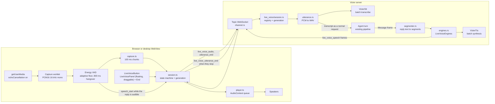
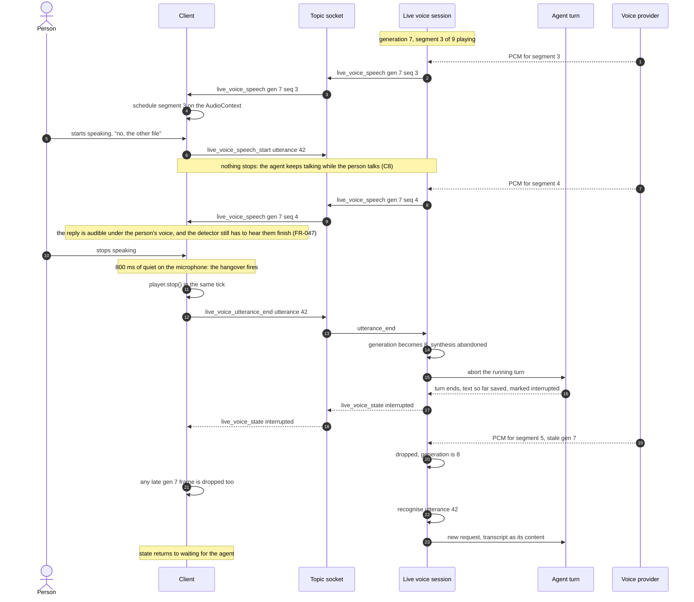
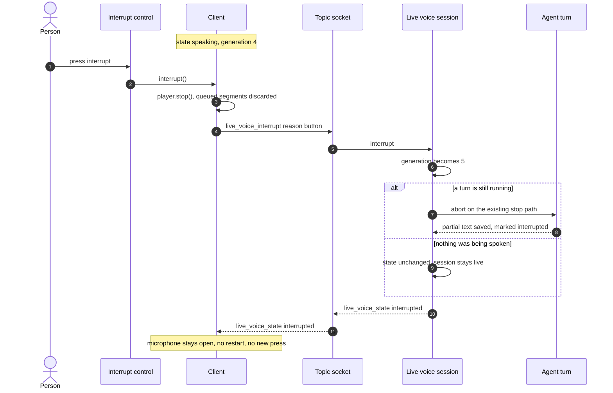
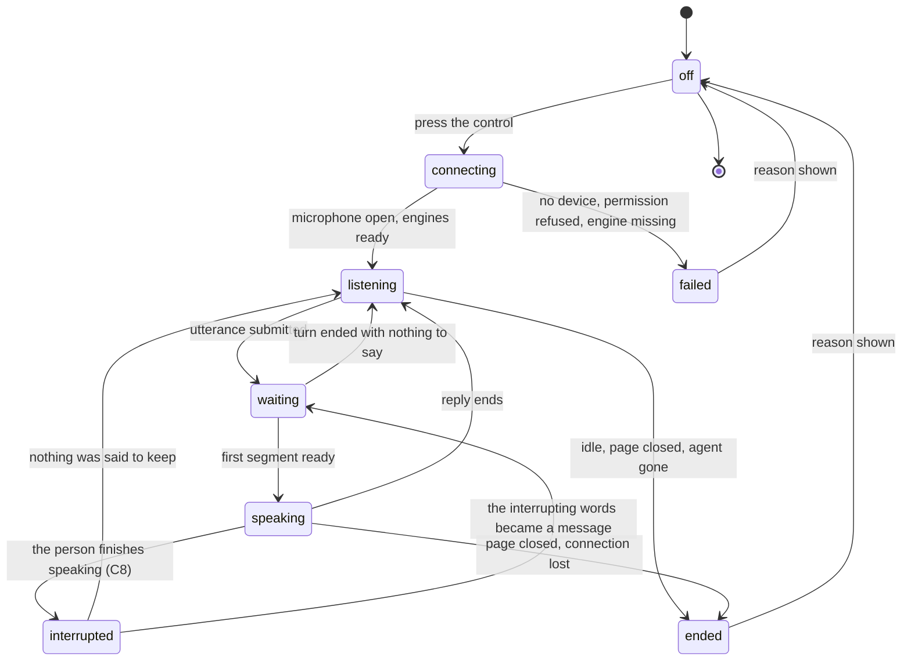

# Diagrams: Live Voice Conversation

**Feature**: `specs/055-live-voice` | **Date**: 2026-11-08

Three diagrams the specification and the plan refer to: the component architecture, the two
interruption sequences, and the session's states. The wireframe at the end is the "design before UI
code" gate (constitution, Development Workflow) — it is deliberately crude; it fixes placement and
state visibility, not styling.

## 1. Component architecture



Reading it: the person's audio never leaves the client un-chunked, the transcript enters the ordinary
turn path (so tools, memory, permissions and accounting are the same), and the reply's text is
segmented on the server before any synthesis. The generation counter, held in `session.rs`, is what
makes an interruption — now a single path, the end of the person's utterance (spec C8) — safe against
segments already in flight.

## 2. Sequence — barge-in (the person finishes speaking; spec C8)



The two places the audio dies, and they are now both at the **end** of the person's speech: on the
client in the tick the hangover fires (that is what the person experiences; SC-002's 300 ms is a
ceiling, not a target, measured from that tick), and on the server by generation, which is what stops
the next segment from ever being sent. Before that tick the audio deliberately plays on — that is C8,
not a bug.

## 3. Sequence — the interrupt control (deferred to the backlog, spec C7)



**None of this ships in this release.** There is no interrupt control (spec C7): the sequence is kept so
the backlog item does not have to rediscover it. When it lands, the button goes on the floating panel, and
the difference from barge-in stays as described: the control submits nothing, so the session returns to
`listening` and waits — which is why it is worth having in a loud room or on a bad microphone, where
speaking over the agent does not work.

## 4. Session states



Every arrow that leaves `listening` or `speaking` for `ended` releases the microphone (FR-028,
FR-034, SC-007). `interrupted` is a state, not an end: the session is still live and still listening.

## 5. Wireframe — the floating panel (design gate, spec C9)

The surface changed twice. On 2026-11-08 21:19 it stopped being a strip of chrome in the composer; on
2026-11-09 06:52 it stopped being a full screen as well. It is now a **draggable panel over the
conversation that is already on screen** — the manner of a desktop call window, not a route and not a
replacement. The composer-bar wireframe and the call-screen wireframe are both **archived with the
spec** (C6, C9); neither is a design for this panel.

```text
+---------------------------------------------------------------+
| Deploy notes                                        [agent ▾] |
+---------------------------------------------------------------+
|  +-----------------------------+                              |
|  | ⠿ Archivist        ●  2:14 |  <- drag by the header         |
|  |        listening            |     (⠿ = grip, FR-048)       |
|  |  the microphone is open  ●  |                              |
|  |  ~~~~~ level ~~~~~          |                              |
|  |       [  End call  ]        |                              |
|  +-----------------------------+                              |
|                                                               |
|   you   what is the disk usage on the build host?             |
|   agent It is 61 percent used, and the largest ...            |
|         (marked: interrupted at 14:32)                        |
|                                                               |
|   ... the conversation continues and scrolls behind the       |
|       panel, readable everywhere the panel does not cover     |
|                                                               |
+---------------------------------------------------------------+
| [ type a message...                              ] [mic][tts] |
+---------------------------------------------------------------+
```

States the panel must be able to show (FR-006), with the thinking state visibly different from the
reconnecting one (FR-042):

```text
connecting      connecting…
listening       listening                 ● microphone open
waiting         thinking                  ● microphone open      <- FR-042, never confused with the line below
speaking        speaking                  ● microphone open
interrupted     interrupted               ● microphone open
reconnecting    reconnecting…             ● microphone open      <- "gone", not "thinking"
ended           call ended · idle for 3 minutes                 <- reason stays, no timer, no buttons but End
failed          call failed · no voice configured
```

* The panel **floats over the conversation**, which stays mounted, readable and scrollable behind it; it
  is not a route and nothing navigates (FR-043, FR-049). The conversation gains exactly one thing: the
  entry control (FR-001).
* **The header is the drag target** (FR-048): pointer-drag moves the panel, no edge may leave the window,
  and a window resize re-clamps it rather than losing it. The conversation behind does not move.
* The **microphone indicator is never the element that gives way**, and the level meter is decorative
  (`aria-hidden`) — that rule survives from the archived bar because FR-038 requires it.
* There is **one action on this panel: End** (FR-045), and no second control that means the same thing.
  No interrupt button ships in this release (spec C7); the interruption is done by speaking, so the panel
  does not hint at a control that does not exist.
* `ended` and `failed` keep their reason on the panel with no 5-second timer and no action but End —
  carried over from the archived bar decision, because the commonest ending is the idle stop, when the
  person has already walked away.
* **One panel, one call.** Starting a call in another conversation moves it there: the panel closes with
  the reason `moved`, a reason is left in the conversation it left, and the running turn is cancelled
  rather than spoken into the new call (FR-050, FR-051, FR-052, SC-011).
