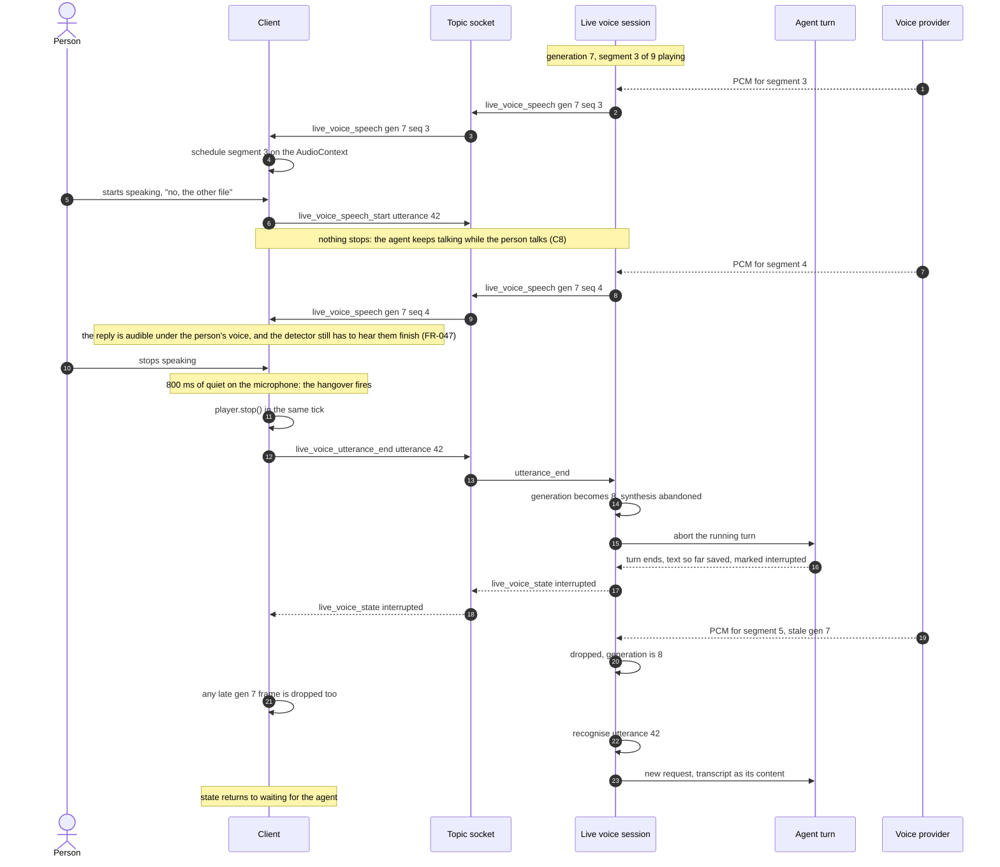
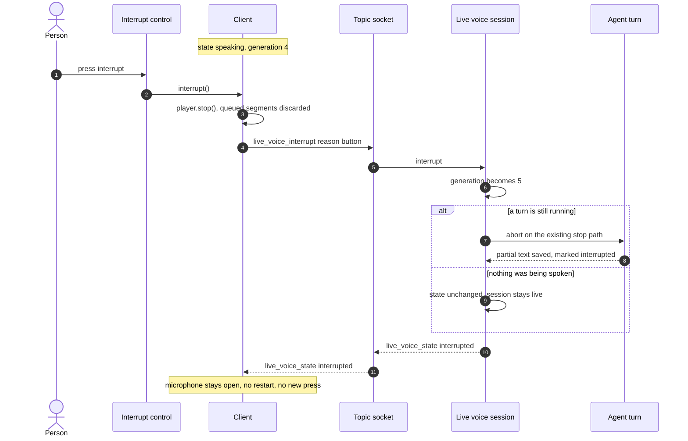
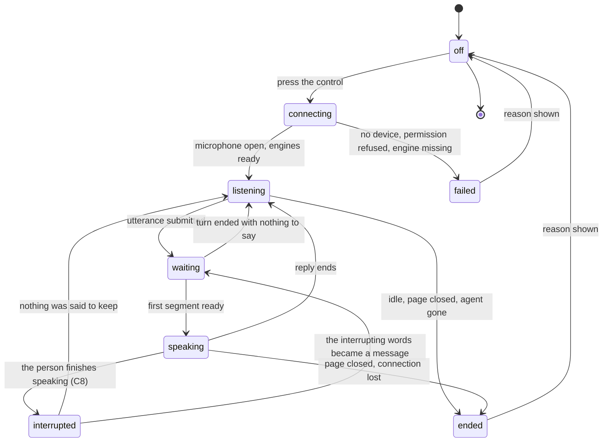

# Diagrams: Live Voice Conversation

**Feature**: `specs/055-live-voice` | **Date**: 2026-11-08

Three diagrams the specification and the plan refer to: the component architecture, the two
interruption sequences, and the session's states. The wireframe at the end is the "design before UI
code" gate (constitution, Development Workflow) — it is deliberately crude; it fixes placement and
state visibility, not styling.

## 1. Component architecture


Reading it: the person's audio never leaves the client un-chunked, the transcript enters the ordinary
turn path (so tools, memory, permissions and accounting are the same), and the reply's text is
segmented on the server before any synthesis. The generation counter, held in `session.rs`, is what
makes an interruption — now a single path, the end of the person's utterance (spec C8) — safe against
segments already in flight.

## 2. Sequence — barge-in (the person finishes speaking; spec C8)



The two places the audio dies, and they are now both at the **end** of the person's speech: on the
client in the tick the hangover fires (that is what the person experiences; SC-002's 300 ms is a
ceiling, not a target, measured from that tick), and on the server by generation, which is what stops
the next segment from ever being sent. Before that tick the audio deliberately plays on — that is C8,
not a bug.

## 3. Sequence — the interrupt control (deferred to the backlog, spec C7)



**None of this ships in this release.** There is no interrupt control (spec C7): the sequence is kept so
the backlog item does not have to rediscover it. When it lands, the button goes on the call screen, and
the difference from barge-in stays as described: the control submits nothing, so the session returns to
`listening` and waits — which is why it is worth having in a loud room or on a bad microphone, where
speaking over the agent does not work.

## 4. Session states



Every arrow that leaves `listening` or `speaking` for `ended` releases the microphone (FR-028,
FR-034, SC-007). `interrupted` is a state, not an end: the session is still live and still listening.

## 5. Wireframe — the call screen (design gate, spec C6)

The surface changed on 2026-11-08 21:19: the session is a **screen of its own**, in the manner of a
call, not a strip of chrome in the composer. The composer-bar wireframe of the earlier draft (and the
designed bar v2 with its 210 px floor and `transcript → level → elapsed → mic label` narrowing order)
is **archived with the spec** and is not a design for this screen.

```text
+--------------------------------------------------------------+
|  <- end                                   Deploy notes agent |
+--------------------------------------------------------------+
|                                                              |
|                      (  Archivist  )                         |
|                                                              |
|                        listening                             |
|                                                              |
|            the microphone is open  ●                         |
|                                                              |
|   you   what is the disk usage on the build host?            |
|   agent It is 61 percent used, and the largest ...           |
|         (marked: interrupted at 14:32)                       |
|                                                              |
|  ~~~~~~~~~~~~~~~~~~~~ level of your voice ~~~~~~~~~~~~~~~~~  |
|                                                              |
+--------------------------------------------------------------+
|                    [  End call  ]                            |
+--------------------------------------------------------------+
```

States the screen must be able to show (FR-006), with the thinking state visibly different from the
reconnecting one (FR-042):

```text
connecting      connecting…
listening       listening                 ● microphone open
waiting         thinking                  ● microphone open      <- FR-042, never confused with the line below
speaking        speaking                  ● microphone open
interrupted     interrupted               ● microphone open
reconnecting    reconnecting…             ● microphone open      <- "gone", not "thinking"
ended           call ended · idle for 3 minutes                 <- reason stays, no timer, no buttons but End
failed          call failed · no voice configured
```

* The screen **replaces the conversation view** while the call is live and gives it back unchanged when
  the call ends (FR-043, FR-046). The conversation gains exactly one thing: the entry control (FR-001).
* The **microphone indicator is never the element that gives way** at narrow widths, and the level meter
  is decorative (`aria-hidden`) — that rule survives from the archived bar because FR-038 requires it.
* There is **one control on this screen: End** (FR-045). No interrupt button ships in this release
  (spec C7); the interruption is done by speaking, and the screen therefore does not hint at a control
  that does not exist.
* `ended` and `failed` keep their reason on screen with no 5-second timer and no buttons but End —
  carried over from the archived bar decision, because the commonest ending is the idle stop, when the
  person has already walked away.
