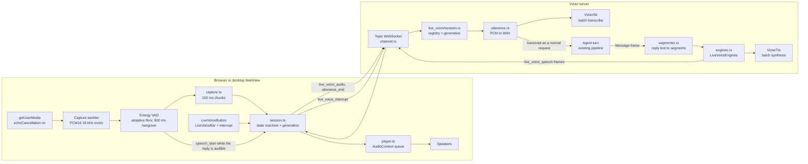
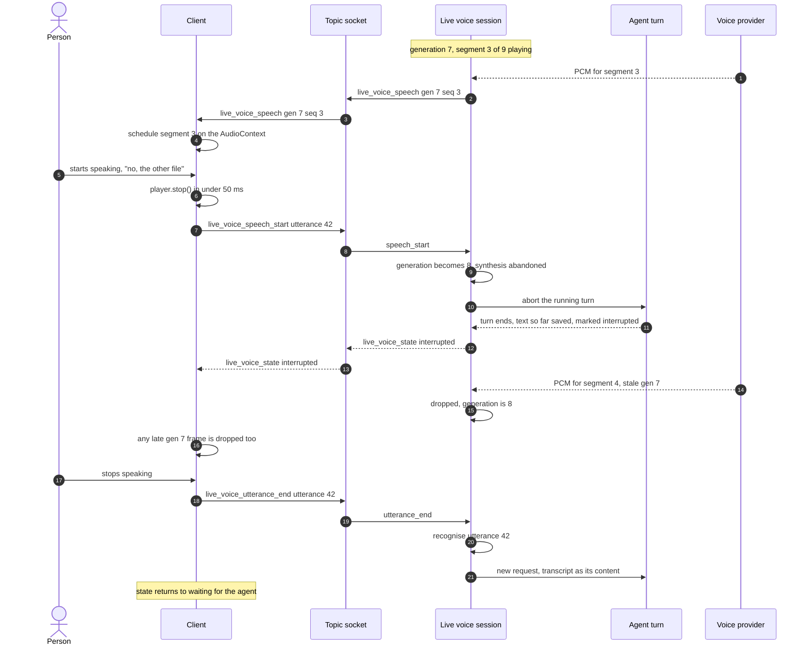
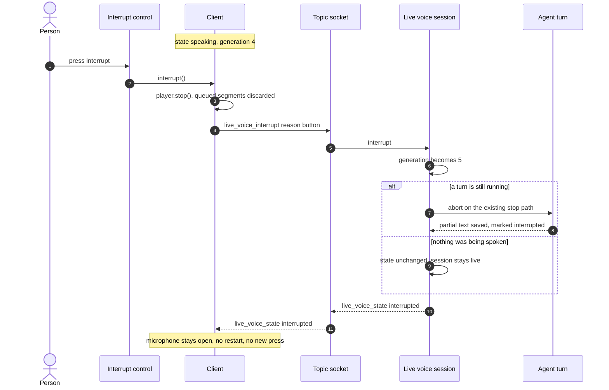

# Diagrams: Live Voice Conversation

**Feature**: `specs/055-live-voice` | **Date**: 2026-11-08

Three diagrams the specification and the plan refer to: the component architecture, the two
interruption sequences, and the session's states. The wireframe at the end is the "design before UI
code" gate (constitution, Development Workflow) — it is deliberately crude; it fixes placement and
state visibility, not styling.

## 1. Component architecture



Reading it: the person's audio never leaves the client un-chunked, the transcript enters the ordinary
turn path (so tools, memory, permissions and accounting are the same), and the reply's text is
segmented on the server before any synthesis. The generation counter, held in `session.rs`, is what
makes the two interruption paths converge on one mechanism.

## 2. Sequence — barge-in (the person speaks over the agent)



The two places the audio dies: on the client immediately (that is what the person experiences,
SC-002's 300 ms is a ceiling, not a target), and on the server by generation, which is what stops the
next segment from ever being sent.

## 3. Sequence — the interrupt control



The difference from barge-in is only who started it and what follows: the control submits nothing, so
the session returns to `listening` and waits, which is why it works in a loud room or on a bad
microphone where speaking over the agent does not.

## 4. Session states


Every arrow that leaves `listening` or `speaking` for `ended` releases the microphone (FR-028,
FR-034, SC-007). `interrupted` is a state, not an end: the session is still live and still listening.

## 5. Wireframe — the controls (design gate)

```text
+----------------------------------------------------------------------+
| Conversation: Deploy notes                              [agent ▾]     |
+----------------------------------------------------------------------+
|                                                                      |
|  ... the conversation, ordinary messages, voice turns read the same  |
|      [ you · spoken ]  what is the disk usage on the build host?     |
|      [ agent ]  It is 61 percent used, and the largest ...           |
|                (marked: interrupted at 14:32)                        |
|                                                                      |
+----------------------------------------------------------------------+
| LIVE VOICE  ● listening        [ Interrupt ]           (bar, only     |
|                                                         while live)   |
+----------------------------------------------------------------------+
| [ type a message...                                     ] [mic][tts] |
|                                   [ ⏻ Live Voice ]  <- the one control|
+----------------------------------------------------------------------+
```

* The **Live Voice** control sits apart from the microphone and the "ask for a spoken reply" toggle,
  because it is a different capability (FR-001, FR-003). Off by default, on every visit.
* The bar above the composer exists **only** while a session lives: it carries the state word from
  FR-006, the always-visible **Interrupt** control (FR-020), and the microphone-open indicator
  (FR-038). When the session ends it is replaced by one line of reason.
* The interrupt control is not a second Live Voice control: pressing it never ends the session
  (FR-020, FR-021).

