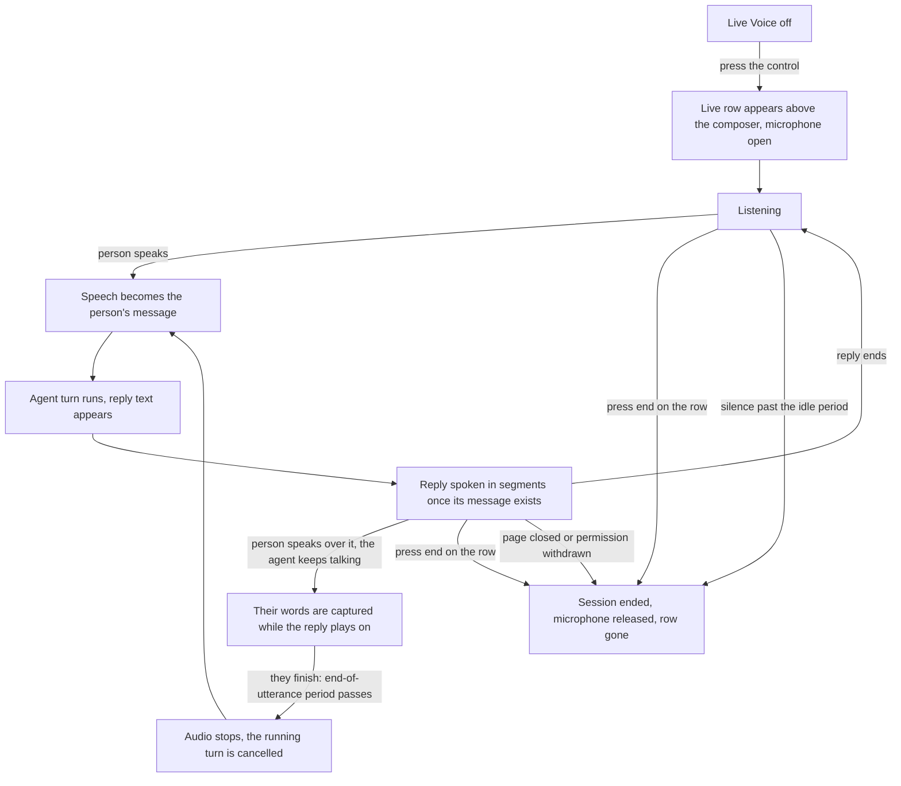

# Feature Specification: Live Voice Conversation

**Feature Branch**: `055-live-voice`

**Created**: 2026-11-08

**Status**: Draft (clarified 2026-11-08)

**Resumed from**: the draft of this same file, written on this branch earlier on 2026-11-08. The delta log at the end of this file lists every change made after resuming it.

**Input**: User description (muruyung, 2026-11-08): "STT and TTS in this project still have to be switched on by hand, and they cannot do live voice — a person and an agent talking directly. I need live voice between the agent and the person, with interruption in two ways: (1) it is interrupted when the person speaks, (2) there is a dedicated interrupt control. The feature is separate from the existing STT and TTS, so it has its own control for turning live voice on. Please produce the plan, diagrams and the other reports, for example additional packages that have to be added."

## Context

Speech in Vizier today works one piece at a time. A person records a clip and one message is transcribed from it; an agent asks for a waveform and receives the whole buffer at the end; a reply is spoken after the fact, when the message is already finished. Every one of those is switched on by hand per agent, and every one is a single round trip. Nobody can speak while the answer is still being produced, and nothing listens between turns.

A conversation does not work like that. A person starts talking without pressing anything, hears the answer while it is still forming, and cuts in the moment the answer goes wrong. That last part is what makes the difference: an answer takes seconds to arrive and much longer to be spoken, so somebody who cannot interrupt has to sit through a wrong answer to find out that it was wrong.

This specification adds that as its own capability: a Live Voice control in a conversation which holds a conversation open with one agent — listening, answering aloud, and stopping the moment the person speaks. It is switched on by the person, per conversation, and is off otherwise. The manual speech tools **leave the surface** in this release and are **left in the code** (C12): live voice takes their place on screen, and nothing about them is deleted.

The two interruptions are both first-class, because they cover different rooms. Speaking over the agent is what a person does naturally where they can be heard. The control is what works in a loud room, on a poor microphone, or for someone who cannot raise their voice over the agent at all.

## Clarifications

### Session 2026-11-08 (resumed draft, three open decisions closed)

The three open questions this specification carried are decided below. Each
names who decided it: a product call belongs to the User; a technical one this specification may
make on its own is marked *in planning*.

| # | Was | Decision | Decided by |
|C1|FR-035 — which surfaces|**The chat interface only**: the WebUI in a browser and the desktop app. Discord and Telegram voice are out of this release, because a bot joining a voice channel is a different audio path, a different permission model and a much larger scope.|in planning, consistent with the User's "separate from the existing STT and TTS" instruction|
|C2|FR-036 — provider strategy|**Cascade, and only cascade, in this release**: voice activity detection on the client, then the agent's existing recogniser on one utterance, then the ordinary agent turn, then the agent's existing voice synthesised in speakable segments. A speech-to-speech realtime pipeline is *not* built now; the seams leave room for one later.|in planning, forced by the code (constraint note below)|
|C3|FR-027 — what an interruption stops|**Both, in this order**: the audio stops at once, and the running turn is cancelled the way the existing stop control cancels it. Text already produced stays in the conversation, marked interrupted. A tool call already finished is not undone.|in planning: a correction that queues behind an answer nobody wants is not an interruption|
|C4|(not asked before) transport|**The existing per-agent WebSocket, JSON frames, base64 PCM16 in 100 ms chunks.** No WebRTC, no second socket, no new endpoint: WebRTC would add signalling, a TURN server and a dependency for a stream that runs between one browser and one server.|in planning. **Reopened as Q11 (2026-11-09 16:07, C13); not overturned.** This row is the implemented candidate and the measurement a media transport has to beat: what it costs, and what it cannot do (packet loss is a hole — no jitter buffer, no PLC, no FEC), are the figures in `plan.md`.|
|C5|(not asked before) where echo is cancelled|**In the browser**, through the capture constraints the recording path already asks the browser for, plus a guard while the reply is audible. No acoustic-echo-cancellation library is added.|in planning|

### Constraint discovered in the code (this changes what FR-013 can promise)

`crates/vizier-core/src/llm/sse.rs:1-3` states that the project reads every provider body whole -
*"no streaming API"*. A turn's frames carry a finished message
(`VizierResponseContent::Message { content, stats }`,
`crates/vizier-core/src/schema/response.rs:129-132`), not token deltas.

So "the reply is spoken while it is still being written" cannot mean token by token. What it can
mean, and what FR-013 now requires: **the reply is spoken segment by segment, starting at the first
speakable segment while the later ones are still being synthesised.** For a single long message the
first words are heard once that message's text exists, not while it is being generated. Token-level
speech needs a streaming turn protocol and is a separate feature.

### Session 2026-11-08 21:19 (the User changed the surface, the trigger and the scope)

Three changes from the User, all binding. One **reduces** scope, one **moves** a cost; neither
loosens a requirement already agreed.

| # | Change | What it replaces | Consequence recorded, not hidden |
|---|---|---|---|
| **C6** | **The session has a screen of its own, in the manner of a call** — not a bar inside the conversation | the bar-in-composer surface (its amendment, \`20d97316\`, stays in the history and is marked archived below) | new FR-043 to FR-047 and User Story 6; the entry point stays a control in the conversation. **Superseded in part by C9 (2026-11-09): the surface floats over the conversation instead of replacing it, and there is no route.** |
| **C7** | **The interrupt control goes to the backlog.** The person interrupts by speaking; there is no button in this release | FR-020, FR-021 and User Story 3, which stay written and are marked deferred | the feature is *less* controllable on purpose: a noisy room, a bad microphone or a quiet voice has no escape hatch until that backlog item lands |
| **C8** | **Barge-in waits for the person to finish speaking.** The start of speech no longer interrupts; the end of the utterance (the ~800 ms hangover firing) does | FR-019's "at once, before their words have been transcribed", and the ~250 ms onset guard | while the person speaks the agent **keeps talking** — overlapping audio is now the intended behaviour, and SC-002's clock moves to the end of the utterance |

**The consequence the plan has to answer (C8), stated plainly.** The session decides the person has
finished by hearing ~800 ms of quiet on the microphone. Under C8 the agent is *still speaking*
during that window, so the microphone also hears the agent. On speakers without headphones that
quiet may never arrive and the interruption may never fire. FR-047 therefore makes "the end of the
person's speech is detected while the reply is audible" a requirement rather than a hope, SC-008
measures it, and \`plan.md\` holds the fallback (ducking the reply's volume once the person is
detected speaking). None of that changes C8 itself.

### Session 2026-11-09 06:52 (the surface floats, and only one session exists)

Two changes from the User. Neither is a preference about pixels: the first removes a navigation
problem, the second removes an entire class of "which conversation is talking?" bugs.

| # | Change | What it replaces | Consequence recorded, not hidden |
|---|---|---|---|
| **C9** | **The call floats.** It is a panel above the conversation that the person can drag, in the manner of a desktop call window — not a full screen, and not a route of its own | C6's *"in place of the conversation view"*, the call-screen layout, and the designer's recommended `/live` route | FR-043 to FR-046 rewritten, **FR-048** and **FR-049** new, US6 rewritten, wireframe replaced. The chat stays behind the panel, readable and scrollable, which is what C6's full screen could not promise. **Superseded by C11 (2026-11-09 16:07): the call is one row in the conversation; FR-048 and Q9 retire with the panel.** |
| **C10** | **One live session in total.** Starting one in another conversation — or with another agent — does not fail and does not open a second: the call **moves** there and the old session closes | FR-005's per-conversation rule, the edge case that allowed two sessions on two conversations, and open question Q4 | FR-005 rewritten, **FR-050**, **FR-051** and **FR-052** new, **SC-011** new. This is the one place where the feature gets *less* permissive on purpose |
| **C11** | **The call is one row inside the conversation** — not a floating panel, not a full screen, not a route | C9's draggable panel, C6's call screen and the composer bar before it (all three archived, none deleted) | **FR-043, FR-044, FR-045, FR-046 and FR-049** rewritten around a row; **FR-048** and **Q9** superseded, because a row has no position to clamp or remember; US6 rewritten. Surviving from the panel work: the state words, the rule that the microphone indicator is never the element that gives way, and the `ended`/`failed` treatment |
| **C12** | **The manual speech-to-text and text-to-speech surfaces are deprecated — the surfaces, not the code.** The record control and the spoken-reply toggle leave the conversation's UI; the providers, tools, configuration and build capability stay, because another surface may use them later | the assumption that both surfaces must be offered side by side in the composer | **FR-053** new. **FR-003 and FR-041 are NOT superseded and get stronger**: two paths live side by side while only one is on screen, so a build without live voice must still leave every existing speech feature working. The "flag off" tests (T014, T015) stay alive for the same reason |
| **C13** | **Audio travels on a path of its own; chat, transcript and control stay on the existing transport** — and *which transport carries the sound is under evaluation* | R1 (audio as base64 PCM16 JSON on the topic socket) *as the final answer* | **FR-054, FR-055, FR-056, FR-057, FR-060** new. The JSON delivery path (per-connection lane, `LIVE_VOICE_SOCKET_BACKLOG = 16`, `stall`) is **provisional, not superseded**: it is the implemented candidate and stays until Q11 is answered on evidence. The latency criteria are scoped to whichever path carries the sound. Choosing the transport is the Lead's call and **Q11** records the question, not the answer |
| **C14** | **The audio capability is standalone**: a documented contract a third party can implement without our client | the assumption that the audio path is a private detail of the WebUI | **FR-058** and **FR-059** new, **SC-012** new, and a public-contract section in the frame contract. Holds whichever transport Q11 picks. It also binds our own WebUI to the same contract, or the contract rots |

**Why C9 is not just a repaint of C6.** C6 put the call in place of the conversation, and then had to
answer what happens to the chat — the full-screen render answered it by growing a transcript panel
beside the call, which is the chat again, in a second layout that must be kept in step forever. A
floating panel does not replace anything: the conversation is where it was, and the call is a window
over it. One surface instead of two, and no navigation to design.

**Why C10 is a real simplification.** Before it, every question about the session — who owns it, what a
second tab sees, what happens to the microphone when two people start one — had a per-conversation
answer that the person had to keep in their head. With one session, the rule is one sentence: *the call
is wherever you last started it*, and starting it somewhere else moves it.

### Session 2026-11-09 16:07 (a row instead of a panel, the old tools retire, the audio becomes a real call)

Four instructions from the owner of the project, relayed by the User. Three change what gets built;
the fourth turns part of it into a **public contract**, which is the larger commitment of the four.

**One row, and the panel is over.** The User chose the single-row surface after seeing both candidates
drawn. The reasoning that decided it is worth keeping: a floating panel has to be positioned, clamped,
remembered and dismissed, and every one of those is a way to lose the call off the edge of a window —
while the row's worst failure is that it takes one line of height. C11 replaces C9, and the consequences
are honest: FR-048 (drag) and Q9 (remembered position) **retire**, because a row has no position.

**The old speech surfaces retire; their code does not.** The record control and the spoken-reply toggle
leave the conversation's UI, because live voice is where a person speaks now. What the User asked for
explicitly is that the **Rust side stay intact** — providers, tools, configuration and build capability
are kept for another surface later, so this is a retirement of *what is offered*, not of *what exists*.
That distinction changes two requirements the other way round from the obvious reading: **FR-003 and
FR-041 are not weakened, they matter more.** Two speech paths now live side by side while only one is on
screen, so "a build without live voice leaves every existing speech feature working" (FR-041) and "the
old tools' switches neither start nor block live voice" (FR-003) are exactly what keeps the overlap
honest. The "flag off" tests stay alive for the same reason.

**Audio gets a path of its own; the decision on *which* path is still open.** The User's instruction was
WebRTC for the sound with the transcript left on the existing WebSocket, and immediately afterwards the
same instruction came with an escape clause worth honouring: if a cheaper way gets the same result, say
so first. So what this document fixes is the **shape**, not the plumbing — the sound travels on its own
path (FR-054), everything a person reads stays on the conversation's transport (FR-055), and the audio
is bound to exactly one session (FR-056). Which transport delivers that is **Q11**, decided on measured
evidence by the Lead. The JSON path already built — 100 ms base64 chunks, the per-connection lane, the
socket backlog, the `stall` frame — is therefore **provisional, not superseded**: it is the candidate
that already works and is the fallback if a media path does not earn its cost. What is already certain
either way: the transcript, the state word and everything a person reads stay on the conversation's
socket, because a second copy of the transcript travelling with the audio is how two histories start
disagreeing.

**Two consequences that are easy to miss, and are requirements now.** Audio on its own path has a
lifetime nothing like a message's: it can begin before the session exists, outlive the session that
opened it, or arrive for a conversation that has since had a *different* call. FR-056 therefore binds it
to exactly one session and refuses it otherwise, rather than letting it join whatever is live now. And
because the sound no longer passes through the conversation's socket, SC-001, SC-002 and SC-003 are
measured **on the path that carries it** — a number taken from the message hop would describe a path
that is not carrying the sound, whichever transport Q11 lands on.

### What "standalone" means here, and what it costs

The User asked for the media part to be able to stand alone so that someone else could implement their
own client against it, and asked what that actually means. In one paragraph — and note this holds
whichever transport Q11 picks, which is why it is written as a requirement (FR-058) rather than as a
property of WebRTC:

> **Standalone means the audio capability is a thing a stranger can use without our client.** A person
> who wants live voice inside *their own* application does not fork this repository, does not import our
> React components, and does not read our state machine. They read one published document: where to
> connect, how to identify the conversation and the call, how to authenticate, what audio to send, what
> they will receive, how a call starts and ends and moves, and what the failures are called. Then they
> write their own client against it, and it works.

**The minimum that has to be public** (each one becomes a requirement in FR-058, and the wire shapes
belong in `contracts/`):

| Surface | Why it cannot be private |
|---|---|
| **How a call is set up** | whatever the audio path needs before sound can move — in WebRTC that is an offer, an answer and candidates; on a socket it is an open and a first frame. A third party must be able to do it on a transport they already have |
| **Session identity** | they must be able to say *this audio belongs to that conversation's call*, and be refused when it does not (FR-056) |
| **Authentication** | they must get in without a second login or a token type invented for this feature |
| **The audio shape** | sample rate, channels, frame duration, and the acceptable codec or format: the thing that makes a non-browser client possible at all (FR-057) |
| **Lifecycle** | start, move, end, and the reconnect window, expressed as steps rather than as one client's behaviour |
| **Failure vocabulary** | the same reason words our own UI shows, so a third-party client can show something truthful |

**What stays internal, deliberately** (FR-059): the segmenter, the generation counter, the session
registry, the provider credentials, and the shape of our own client state. Those are ours to change;
the six surfaces above are not, once this ships.

**The cost, stated plainly.** A public contract is a promise with a support burden attached: every
message in the setup sequence and every reason word becomes something we cannot rename quietly. That is why
FR-058 also binds **our own WebUI to the same contract** — the one client that is always in the
building, so a contract we break shows up as our own breakage first. If the reviewer prefers not to
carry that burden, the honest alternative is to say so and drop C14 explicitly, not to publish a
contract and then drift from it.

## User Scenarios & Testing *(mandatory)*

### User Story 1 — A conversation without typing (Priority: P1)

A person opens a conversation, presses Live Voice, and asks a question out loud. The answer is spoken in segments as soon as the turn's message exists (FR-012, FR-013: this turn protocol delivers a finished message, not token deltas). They ask a follow-up without touching anything, then press the control again to stop; the whole exchange is in the conversation as ordinary messages, ready to be read, searched and continued by typing.

**Why this priority**: This is the request itself. On its own it already replaces typing for a person who would rather talk, and every other story only makes that loop safer or more controllable.

**Independent Test**: In a conversation whose agent has a working recognizer and voice, press the control, ask a short question, hear the answer, ask a follow-up with no further press, and end the session. Both questions and both answers are in the conversation as text.

**Acceptance Scenarios**:

1. **Given** a conversation with Live Voice off, **When** the person presses the control and speaks a question, **Then** the question appears as their message, the reply appears as the agent's message, and the reply is heard.
2. **Given** a spoken question, **When** the person stays silent for a few seconds, **Then** the session is still listening and the microphone is still open.
3. **Given** a live session, **When** the person asks a follow-up without pressing anything, **Then** it is submitted and answered like the first question.
4. **Given** a live session, **When** the person presses the control again, **Then** the session ends, the microphone is released, and every turn remains in the conversation.
5. **Given** a finished session, **When** the conversation is opened later, **Then** the voice turns read exactly like typed ones and typing continues the conversation normally.
6. **Given** Live Voice has never been used, **When** the person uses the conversation as before, **Then** nothing about it changes — the same messages, the same remaining controls, and the speech tools' own settings untouched (FR-040).

---

### User Story 2 — Stopping the agent by speaking (Priority: P1)

The agent is halfway through an answer that has gone the wrong way. The person says "no, the other file" out loud. The agent keeps talking for as long as they are talking — and the moment they stop, it stops. Their correction is now the next message, and the answer that follows picks it up. They never reach for the interface.

**Why this priority**: Talking over someone is the natural way to stop them. Without it, live voice is an announcement that cannot be argued with.

**Independent Test**: Have the agent speak a long answer, speak over it, and confirm that (a) the agent is still audible while the person speaks, (b) the audio stops once the end-of-utterance period passes, before the transcript arrives, (c) those words arrive as the person's message, and (d) the interrupted answer is marked as interrupted.

**Acceptance Scenarios**:

1. **Given** the agent is speaking, **When** the person begins to speak, **Then** the agent keeps speaking (C8) and the session is already capturing their words — no silence is expected yet.
2. **Given** the person has finished speaking, **When** the end-of-utterance period passes (default 800 ms), **Then** the audio stops and the running turn is cancelled (FR-019, FR-027), before the transcript has arrived.
3. **Given** that interruption, **When** transcription finishes, **Then** the words appear as the person's message and are answered, and the interrupted reply stays in the conversation marked as interrupted.
4. **Given** an interrupted reply, **When** the next reply is spoken, **Then** no part of the interrupted one is heard again.
5. **Given** the device's own speakers and no headphones, **When** the agent speaks at high volume, **Then** the session does not treat its own voice as the person, and the end of the person's speech is still detected while the reply is audible (FR-026, FR-047).
6. **Given** the person makes a sound too brief to be a word, **When** the end-of-utterance period passes, **Then** the reply is neither cancelled nor resumed-in-two-pieces, no message is sent, and the session is listening again (FR-024).
7. **Given** the person speaks and the reply happens to finish on its own first, **When** the end-of-utterance period passes, **Then** nothing is cancelled, and their words simply become the next message.

---

### User Story 3 — Stopping the agent with a control (Priority: backlog — deferred 2026-11-08)

> **Deferred to the backlog (User decision, 2026-11-08 21:19, C7).** This release has **no interrupt
> control**: the person interrupts by speaking (FR-019). The story is kept in full so the requirement
> is not lost, and it is **not** part of the gate for this feature — no acceptance scenario below is
> required for this release to be finished, and its task block in `tasks.md` is marked `[BACKLOG]`.
> The stated cost, accepted by the User: where speaking over the agent does not work — a noisy room,
> a poor microphone, a quiet voice — there is no way to stop the reply in this release except ending
> the session.

In a noisy café, on a bad microphone, or with a quiet voice, the person cannot speak over the agent. They press the interrupt control beside the Live Voice control. The voice stops at once, the session stays live, and they can type the correction, or say it once the room is quieter.

**Why this priority**: A person who cannot out-talk the agent would otherwise have no way to stop a wrong answer without ending the whole session — which makes the feature unusable exactly where it is most wanted.

**Independent Test**: With the agent speaking, press interrupt; the audio stops and the session still listens. Then type a message and confirm it is answered **as text** while the session stays live and silent (FR-018 withdrawn, 2026-11-08).

**Acceptance Scenarios**:

1. **Given** the agent is speaking, **When** the person presses interrupt, **Then** the audio stops at once and the session stays live.
2. **Given** an interrupted session, **When** the person types a message, **Then** it is answered as text, the session stays live, and nothing is spoken for that reply.
3. **Given** the agent has not started speaking yet, **When** the person presses interrupt, **Then** the session stays live and needs no restart; what happens to the running turn follows FR-027.
4. **Given** an interrupted but live session, **When** no further speech arrives for the idle period, **Then** the session ends like any other.

---

### User Story 4 — A session never keeps the microphone (Priority: P2)

A person closes the tab in the middle of an answer, or walks away leaving the session live. The voice stops, the microphone indicator goes out, and the conversation keeps the text. When they come back the control is off, and nothing listens until they press it.

**Why this priority**: A live microphone is the risk this feature introduces. Everything else is worth nothing if the microphone stays open when the person believes it is closed.

**Independent Test**: With a live session, close the page; confirm the operating system's microphone indicator goes out and the reply's text is saved. Leave a session silent past the idle period; confirm it ends and says why.

**Acceptance Scenarios**:

1. **Given** a live session, **When** the person leaves the conversation or closes the page, **Then** the audio stops, the microphone is released, and a reply in flight finishes as text without being spoken.
2. **Given** a live session and no speech, **When** the idle period passes, **Then** the session ends with a visible reason and the microphone is released.
3. **Given** a live session, **When** microphone permission is withdrawn in the browser or the operating system, **Then** the session ends at once and does not try the microphone again.
4. **Given** a live session, **When** the agent is deleted or restarted, or the conversation is deleted, **Then** the session ends and an answer in flight is not spoken.
5. **Given** any session that ended, **When** the person looks at the conversation, **Then** its text is intact and the control reads off.
6. **Given** a live session in one tab, **When** another tab or another person opens the same conversation, **Then** they are told a session is active and cannot start a second one.

---

### User Story 5 — A broken session explains itself (Priority: P2)

Recognition comes back empty, the voice provider errors in the middle of an answer, or the network drops. The session says what happened, keeps the text, and either recovers or ends with a reason. It never sits there looking live while doing nothing.

**Why this priority**: Every provider in this path is a network call that can fail. Silence that looks like listening is the failure mode people trust least.

**Independent Test**: Cut the connection mid-answer; the session shows reconnecting and stops the audio. Restore it within the limit and the same conversation continues. Cut it for longer and the session ends with a reason, with the answer's text still in the conversation.

**Acceptance Scenarios**:

1. **Given** a live session, **When** recognition returns nothing intelligible, **Then** the person is told, no message is sent, and the session listens again.
2. **Given** an answer being spoken, **When** the voice provider fails, **Then** the rest of the answer still appears as text, the failure is reported, and the session listens again.
3. **Given** a live session, **When** the connection drops, **Then** the state reads reconnecting within 2 seconds and the audio stops; **When** it returns within 30 seconds, **Then** the same session continues without duplicating the message in flight.
4. **Given** the connection does not return in that time, **When** the wait ends, **Then** the session ends with the reason and the text is kept.

---

### User Story 6 — The call is one row in the conversation (Priority: P1)

A person presses Live Voice and a single row appears in the conversation they are already in: the
agent's name, what it is doing, an open microphone, and one control that ends the call. Nothing
floats over the transcript, nothing has to be dragged out of the way, and no message is ever covered.

**Why this priority**: The User chose the row over the floating panel. It is the cheapest surface that
still answers the two questions a person actually asks — *is it hearing me?* and *is it thinking or
gone?* — which is what FR-006, FR-038 and FR-042 exist for.

**Independent Test**: From a conversation, press Live Voice; one row appears above the composer
carrying the state word, the microphone indicator and one End control; ask something and watch it read
`thinking`; end the call; the row is gone, both turns present, the control off, and no message was
covered at any window width.

**Acceptance Scenarios**:

1. **Given** a conversation with Live Voice off, **When** the person presses the control, **Then** a single row appears in the conversation — above the composer, at the conversation's width — and the session starts (FR-043).
2. **Given** the live row, **When** the person looks at it, **Then** it shows the agent, the state word, the thinking indicator when the agent is working, and that the microphone is open — all without a reload (FR-006, FR-042, FR-038).
3. **Given** the live row, **When** the agent is silent for a long time because its answer is slow, **Then** the row says the agent is thinking and does not read as a disconnected call (FR-042).
4. **Given** the live row in a narrow window, **When** the row runs out of room, **Then** it drops its own detail before it drops the microphone indicator or the state word, and it never covers a message (FR-049, FR-038, FR-042).
5. **Given** the live row, **When** the person ends the call, **Then** the microphone is released, the row disappears, and the conversation keeps every turn (FR-028, FR-034, FR-045).
6. **Given** the live row, **When** the person closes the tab or the window, **Then** the session ends and nothing keeps listening (FR-028).
7. **Given** a call ended by any means, **When** the conversation is opened again, **Then** it is unchanged and the entry control is off (FR-046).
8. **Given** a live call in one conversation, **When** the person starts one in another conversation or with another agent, **Then** the call there starts, the old one closes by itself, and the old conversation says why it closed (FR-050, FR-051).

---

### Interaction Flow (interruption by speech, C8; the control is deferred, C7)

Every path that leaves `listen` or `speak` except the interruption by speech ends the session, and every
ending releases the microphone (FR-028, FR-029). The interrupt control of the earlier drafts is not in
this diagram because it is deferred (C7).

### Edge Cases

- **The person speaks over the agent without headphones**: the device's speakers feed the microphone, and under C8 the agent is *still talking* while the person talks. Two things must hold at once: the session must not treat its own voice as the person at any output volume, and it must still hear the end of the person's speech over that voice (FR-026, FR-047). A session that needs silence to notice the person has finished is a broken session here, not a tuning problem.
- **A second person in the room, or a television**: the session cannot tell one voice from another — the detector is an energy gate on one microphone, with no speaker identity. So background speech above the gate may be transcribed and may interrupt, exactly as it would over any voice assistant; what the session must not do is treat ambient noise below the gate as speech, and what the person must be able to do is correct it by speaking again or by typing. **Real attribution (diarization) is not promised here and would be its own specification.** *(Corrected in the Lead's review, 2026-11-08: the earlier wording promised a capability the chosen detector does not have.)*
- **A very short utterance** ("yes", "no", "stop"): recognised and submitted as a message rather than discarded as noise. A sound too brief to be a word neither cancels the reply nor becomes a message (FR-024, Story 2 scenario 6) — the threshold is the length that makes a barge-in, not a character count.
- **The reply finishes while the person is still talking**: nothing is left to cancel; their words become the next message and the session returns to listening (Story 2 scenario 7).
- **The person talks over the agent for a long time**: the reply plays on underneath until the person stops, which is the cost C8 accepted; nothing queues up afterwards, because the reply is cancelled once, not paused.
- **A long monologue**: an utterance is cut at the maximum length (default 60 seconds) and submitted, so a person speaking for minutes still gets answers.
- **Silence in the middle of a sentence**: a pause shorter than the end-of-utterance period does not split the message.
- **The person speaks while the agent is still thinking**, before any audio: their words become the next message; whether the running turn is also cancelled is the decision in FR-027.
- **The person types while the agent is speaking**: the reply keeps playing and is not cancelled (FR-025 deferred with C7) — the typed turn simply queues and is answered as ordinary chat, in text only, because speech belongs to the session (FR-018 withdrawn). The audio stops when the person stops speaking, never on a keystroke.
- **An answer full of code, a table or a long URL**: the conversation keeps all of it; the spoken form skips what cannot be read aloud and says the rest is in the conversation.
- **The provider is slow**: waiting is visible, the session never appears to be listening while an answer is still pending, and a stalled provider ends in a reported failure rather than an endless wait. Since FR-017 lets the agent think longer, this is the common case rather than the exception, which is what FR-042's indicator is for.
- **The microphone is unplugged mid-session** or the device is switched: the session reports the lost device and does not silently stay "live".
- **The page is reloaded mid-session**: the session ends with the page, the microphone is released, and the conversation is intact; a reloaded page starts with the control off.
- **The person is on a phone browser and the screen locks**: the session must treat the resulting suspension as an end with a reason, not as a live session that stopped hearing.
- **A person speaking another language** than the conversation's configured one: the transcript may be wrong; the session is expected to follow the configured language, and changing it mid-session is out of scope.
- **A call started in a second conversation, or with another agent**: the call moves there and the first one closes by itself, with a reason left behind (FR-050, FR-051, FR-052). There is never a moment with two microphones open, and never a refusal that leaves the person with no call at all (C10).
- **A second tab on the same conversation**: it is the *same* conversation, so the question is whether a press there moves the call to that tab or is refused — open question Q2, default refused. This is the one case C10 does not answer by itself.
- **The row in a narrow window or a long conversation**: the row gives up its own detail in a fixed order — level first, then elapsed time, then the agent's name — and never gives up the microphone indicator (FR-038) or the state word (FR-042). It does not overlap a message, does not push the composer off screen, and does not turn into two lines: a row that grows is a panel again.
- **A dream, a scheduled task or a background report**: no live voice; the capability exists only while a person has a session open.
- **A conversation in a mode that restricts what the agent may do** (a Plan chat): a voice message follows the same rules as a typed one, including any refusal.
- **Vizier restarts mid-session**: the session ends; the conversation and every completed turn survive.
- **A build without the capability**: the control does not appear and every existing speech feature behaves as before.

## Requirements *(mandatory)*

### Functional Requirements

**The control and the session**

- **FR-001**: Every conversation MUST offer a dedicated Live Voice control, visibly separate from the attachment control and from whatever manual speech surfaces remain; pressing it opens the live row (FR-043). It MUST be off by default in every conversation and on every visit, and its state MUST NOT be remembered between visits — except that starting a call **moves** it (FR-050).
- **FR-002**: Pressing the control MUST start a live voice session on that conversation with its agent and show the live row. Ending it MUST be possible from the row for the whole session (FR-045). Where a call is already live elsewhere, pressing it MUST move the call here rather than refuse (FR-050); the control MUST show which of the two a press will do.
- **FR-003**: Live Voice MUST be independent of the existing speech-to-text and text-to-speech tools in both directions: starting it MUST NOT enable, disable or reconfigure those tools, and their switches MUST neither start it nor block it.
- **FR-004**: Starting MUST require both a usable recognizer and a usable voice for that agent. When one is missing, the control MUST name what is missing and how to set it, and MUST NOT start; a session that can only listen, or only speak, MUST NOT be presented as live voice.
- **FR-005**: A session MUST belong to one person, and there MUST be **at most one** live session for that person across every conversation and every agent (C10). Only someone allowed to chat in a conversation may start or end a call there. Starting a call anywhere closes the previous one and says why in the conversation it leaves (FR-050, FR-051); it MUST never fail with "a session is already active" and MUST never leave two of them running.
- **FR-006**: The **live row** MUST show, without a page reload: connecting, listening, waiting for the agent, speaking, interrupted, reconnecting, ended with a reason, failed with a reason. (`off` is the absence of the panel.)
- **FR-007**: A voice message MUST run the same turn as a typed one: same conversation history, same mode rules, same tools, same permissions, same memory, same usage accounting. Live Voice MUST NOT add, remove or alter the agent's tools, memory or permissions.
- **FR-008**: A session MUST use the agent's own model and speech configuration. Live Voice MUST NOT silently change what typed turns use.

**The conversation loop**

- **FR-009**: The session MUST decide on its own when the person starts and stops speaking; the person MUST NOT press anything between turns.
- **FR-010**: When the person stops speaking for a short pause (default 800 ms), or an utterance reaches the maximum length (default 60 seconds), the utterance MUST be transcribed and submitted as a message in that conversation.
- **FR-011**: Each submitted message MUST appear in the conversation as that person's message, marked as spoken, with the transcript as its content. The session MUST NOT add anything else to the conversation on the person's behalf.
- **FR-012**: The agent's reply text MUST appear in the conversation and MUST be spoken aloud in the same session; the spoken words MUST correspond to the text shown. Because a turn delivers a finished message rather than token deltas (constraint note under Clarifications), "appear" means as soon as the turn produces its message, not character by character. *(Reworded in the Lead's review, 2026-11-08: the original said "as it is generated", which this turn protocol cannot do.)*
- **FR-013**: Speaking a reply MUST begin at its first speakable segment, and each further segment MUST be synthesised while the previous one is being heard, so that a long answer is preceded by no long silence and does not wait for its own last sentence. (Token-by-token speech is excluded: the turn protocol delivers a finished message — see the constraint note under Clarifications.)
- **FR-014**: The spoken form MUST NOT read formatting marks aloud (punctuation used as markup, code fences, raw URLs). What cannot be spoken MUST be skipped with a short notice that the conversation holds the rest to read.
- **FR-015**: After a reply ends, or after an interruption, the session MUST return to listening without a press.
- **FR-016**: Raw audio MUST NOT be stored. Only the transcript and the reply text are kept, as for typed turns, under the same access rules and retention as the conversation.
- **FR-017**: With each voice message the agent MUST be told that the message came by speech and that its reply will be spoken, so it can answer in a form that suits listening: **short by default**, because the reply is heard rather than read. That indication MUST apply to that turn only and MUST NOT change what a typed turn sees. **The agent decides how long to take, not the person**: when the question genuinely needs reasoning or a lookup, the agent MAY take longer and answer at length, and there MUST be no user-facing switch, mode or setting that makes that choice. *(Rewritten in the Lead's review, 2026-11-08, on the User's decision of that day: default short answers, longer only when the question needs it, decided by the agent.)*
- ~~**FR-018**: Typing MUST stay available during a session: a message typed while a session is live is answered like any other, and its reply is spoken.~~ **WITHDRAWN on the User's decision, 2026-11-08 17:27: a typed message is answered as text only.** Speech belongs to the live session alone. Typing during a session still works, and its reply comes back as text only. It does **not** stop the audio either: FR-025 is deferred with the interrupt control (C7), so in this release the only way to stop the reply is to stop speaking (FR-019). Nothing in this feature links a typed turn to the session's voice.

- **FR-042**: While the agent is working and nothing is audible — the case FR-017's longer answers make long — the interface MUST show that the agent is thinking, and MUST show it as a different state from `reconnecting` and from `ended`. It MUST appear as soon as the turn is accepted (before the first audio, and before the model's own latency), and MUST clear when the first segment is heard, when the turn ends, or when the session ends. It is a state the session already has (`waiting for the agent`, FR-006); what this requires is that the person can tell "thinking" from "gone", on screen, without waiting for sound. *(Added on the User's decision, 2026-11-08 17:27.)*

**Interruption**

- **FR-019**: While the agent is speaking, the person's speech MUST NOT stop the audio by itself. When the person has **finished** speaking — the end-of-utterance period elapsing, default 800 ms (FR-010) — the audio MUST stop and the running turn MUST be cancelled (FR-027), before their words have been transcribed. Overlap while the person speaks is intended (C8), and the end of their speech MUST still be detected while the reply is audible (FR-047).
- ~~**FR-020**: A dedicated interrupt control MUST be available for the whole of a live session. Pressing it MUST stop the agent's audio at once and MUST NOT end the session.~~ **DEFERRED to the backlog on the User's decision, 2026-11-08 21:19 (C7).** This release has no interrupt control; FR-019 is the only way to interrupt. Kept here so the requirement is not lost, and it is not part of this release's gate.
- ~~**FR-021**: The interrupt control MUST work at any moment of a session; pressed while nothing is being spoken, it MUST leave the session live and unchanged.~~ **DEFERRED with FR-020 (C7).**
- **FR-022**: After an interruption, no part of the interrupted reply MUST be heard later, and the session MUST NOT resume speaking it on its own. The reply's remaining segments are abandoned, not paused: a later reply starts from its own first segment.
- **FR-023**: An interrupted reply MUST remain in the conversation as the agent's message, marked as interrupted, so the person can see what they did not hear. How much text there is depends on when the interruption lands: interrupting while the reply is being spoken keeps the whole message, which was already stored before its first word was heard; interrupting while the model is still producing it ends the turn as an abort (`VizierResponseContent::Abort` is a turn that produced nothing, `crates/vizier-core/src/schema/response.rs:156-163`), so the person sees the interrupted mark and the turn's saved activity trail, not partial prose. *(Clarified in the Lead's review, 2026-11-08: "readable as far as it was produced" promised partial text the abort path does not keep.)*
- **FR-024**: The utterance that caused an interruption MUST become the person's next message, unless it was too short to be one, in which case nothing is sent **and the reply is not cancelled for it** — the threshold is the length that makes a barge-in, not a character count (Story 2 scenario 6).
- ~~**FR-025**: A message typed while the agent is speaking MUST stop the audio and cancel the running turn, on the same path as any other interruption.~~ **DEFERRED with FR-020 (C7), User's decision 2026-11-08 21:19.** This release has no interrupt by typing either: the only way to stop the audio is to stop speaking (FR-019) — not a button, not a keystroke. Typing during a session is ordinary chat (FR-040) and does not stop the audio. Its only carrier, T054, sits in the deferred US3, and the composer surface is frozen until the User picks a panel, so a live requirement would have been a promise with no one to keep it. *(Deferred in the Lead's review, 2026-11-09: a requirement whose only task is in the backlog must not read as a release promise.)*
- **FR-026**: The session MUST NOT interrupt itself: its own audio coming back through the device's speakers MUST NOT be taken as the person speaking, at any output volume and with or without headphones.
- **FR-027**: An interruption MUST stop the audio at once and MUST also cancel the running turn, on the same path as the existing stop control: text produced so far stays in the conversation marked interrupted, nothing further is generated or spoken, and a tool call already completed is not undone. When the agent was working rather than speaking, an interruption MUST behave the same way, so "I interrupted while it was editing files" has exactly one answer. The trigger in this release is the end of the person's utterance (FR-019), never its start. *(Decided in Clarifications C3; trigger moved by C8.)*

**Ending, silence and failure**

- **FR-028**: A session MUST end when the person presses the control again, leaves the conversation or closes the page, microphone permission is withdrawn, the conversation is deleted, the agent is deleted, restarted or reconfigured, or the connection is lost beyond the reconnect limit. In every case the audio MUST stop and the microphone MUST be released.
- **FR-029**: A session MUST end after the person has been silent for the idle period (default 3 minutes), with a visible reason and the microphone released, so a forgotten session cannot listen on.
- **FR-030**: When microphone access is refused or no device is available, the session MUST fail with a clear reason, MUST NOT be left half-started, and MUST be retryable without reloading the page.
- **FR-031**: When recognition yields nothing intelligible, the person MUST be told, no message MUST be sent, and the session MUST return to listening.
- **FR-032**: When the voice provider fails while speaking, the rest of the reply MUST still appear as text, the failure MUST be reported, and the session MUST return to listening.
- **FR-033**: A lost connection MUST show as reconnecting and stop the audio within 2 seconds. If the connection returns within 30 seconds the same session MUST continue without duplicating the message in flight; otherwise the session MUST end with the reason.
- **FR-034**: Ending a session for any reason MUST NOT delete or alter the conversation's text. A reply in flight when the session ends MUST finish as text and MUST NOT be spoken.

**Speech capabilities**

- **FR-035**: Live Voice MUST be offered on the chat interface only — the WebUI in a browser and the desktop app — and MUST NOT be offered on the Discord or Telegram channels in this release. A channel that cannot carry it MUST behave exactly as it does today. *(Decided in Clarifications C1.)*
- **FR-036**: The session MUST obtain recognition and speech in a cascade — the utterance recognised as one clip, the reply produced by the ordinary turn, the reply synthesised in segments — through the recogniser and the voice the agent is already configured with. It MUST NOT require a speech-to-speech or realtime provider, and MUST NOT add a per-minute cost for a session that carries no more audio than its own turns. *(Decided in Clarifications C2.)*
- **FR-036a**: The session and its speech MUST sit behind one seam, so a realtime speech-to-speech pipeline can be added later behind configuration without changing the frames, the controls or this feature's outcomes.
- **FR-037**: Recognition MUST follow the conversation's configured speech language. Where the agent already lets a person choose that language, a session MUST be able to use the chosen one.
- **FR-038**: For the whole of a session the interface MUST show that the microphone is open, including when the window is not focused.
- **FR-039**: Documentation MUST cover starting and ending a session, what audio is sent to which provider, what is stored, the two ways to interrupt, and the limits (idle stop, one session per conversation).

**Unchanged behaviour**

- **FR-040**: With Live Voice never used, every existing behaviour MUST be unchanged: the speech tools, automatic transcription of uploaded audio, requested spoken replies, text chat, and the HTTP and WebSocket surface as existing clients see it.
- **FR-041**: Live Voice MUST NOT be required by any existing capability; a build without it MUST leave every existing speech and chat feature working.

**The row in the conversation (C11)**

- **FR-043**: Starting a session MUST show the call as **one row inside the conversation**, above the composer and at the conversation's own width (C11). It MUST NOT float over the conversation, MUST NOT be a movable panel, MUST NOT be a route of its own, and MUST NOT cover a message or the composer; the entry point MUST stay a control in the conversation (FR-001).
- **FR-044**: The row MUST show, for the whole session: the agent the call is with, the state word of FR-006, the thinking indicator of FR-042 when the agent is working, that the microphone is open (FR-038), and the one action of FR-045. These are the row's minimum; what else it carries is open question Q6.
- **FR-045**: The row MUST offer a way to end the call for the whole session, reachable without leaving the conversation, which stops the audio, releases the microphone and ends the session (FR-028). With the interrupt control deferred (C7), ending the call is the only action the row offers — and the row MUST NOT present a second control whose only effect is the same thing.
- **FR-046**: Showing and ending the row MUST NOT change the conversation: the same messages, the same text, nothing rewritten, reordered or re-timed (FR-034).
- **FR-047**: The session MUST detect the end of the person's speech **while the agent's reply is audible** (C8): the reply continuing MUST NOT prevent the end-of-utterance period from elapsing. Echo cancellation alone MAY be the mechanism; where it is not enough, the reply's audibility to the microphone (not to the person) MUST be reduced once the person is detected speaking, so that the interruption still fires. The measured form of this is SC-008.
- ~~**FR-048**: The panel MUST be draggable by its header with a pointer, MUST keep its whole area inside the window at every position (no edge can be dragged out of reach), MUST remain usable when the window is resized smaller than where it was left, and MUST keep its position while the call lives. Whether the position survives the call is open question Q9. Its size MUST NOT change when it is moved or when the conversation behind it is scrolled.~~ **SUPERSEDED by C11, 2026-11-09 16:07: the call is a row.** A row has no position to clamp, no edge to drag out of reach and nothing to resize, so this requirement and Q9 retire together. Kept because the panel remains the fallback if the row is rejected.
- **FR-049**: The row MUST cost at most one line of the conversation's height and MUST NOT cover, clip or reorder any message: the conversation scrolls to its own end exactly as it does with no session, and the composer stays usable at every width (C11). When space runs short the row gives up its own detail first — never the microphone indicator (FR-038) and never the state word (FR-042).
- **FR-050**: Starting a call while one is live **elsewhere** — another conversation, or another agent — MUST move the call there rather than fail: the new panel opens on the new conversation, the old session ends by itself, and the old panel disappears (C10). The move MUST be one event, not two sessions that briefly overlap; the microphone MUST end up open once, on the new call.
- **FR-051**: The conversation a call is taken *from* MUST say why it stopped — a visible reason, recorded where the session's other endings are, so a person who comes back to it is not left wondering whether it is still listening (FR-029, FR-030). Whether that reason is a message in the conversation or only a notice is open question Q10.
- **FR-052**: A move MUST NOT strand a turn: if the agent was answering when the call was taken, that turn MUST be cancelled and its partial text kept, exactly as any other interruption (FR-027); it MUST NOT keep generating into a conversation nobody is listening to, and its reply MUST NOT be spoken into the new call.

**The manual speech controls leave the UI, the code stays (C12)**

- **FR-053**: The manual speech-to-text and text-to-speech **surfaces** MUST be removed from the conversation's UI in favour of live voice — the record control and the spoken-reply toggle are no longer offered. Their **implementation MUST NOT be removed**: providers, tools, configuration and build capability stay exactly as they are, because another surface may use them later. During the overlap live voice MUST work whether or not those tools are enabled (FR-003), and a build without live voice MUST keep every one of them working (FR-041).

**The audio path (C13 — transport under evaluation)**

- **FR-054**: The person's audio and the agent's audio MUST travel on a path of their own, **separate from the conversation's message transport**, so that a burst of speech cannot queue behind text and a stall in text cannot silence the call. It MUST be two-way and realtime enough that a person can interrupt the agent by speaking (FR-019), and a reply heard through speakers MUST NOT re-enter the microphone as a new utterance (FR-046, FR-047). **Echo cancellation is required of the feature, not of the transport**: it comes from the capture constraints on `getUserMedia` (C5, already in `webui/app/lib/liveVoice/capture.ts:34` — `echoCancellation`, `noiseSuppression`, `autoGainControl`), so it MUST NOT be counted as an argument for any transport. *Which transport delivers this is open question Q11.*
- **FR-060**: Whatever transport is chosen MUST NOT require the person to obtain a third-party service or an account: if it needs a relay, the relay MUST ship with Vizier and be configured by us, not by the person (User, 2026-11-09 16:16). Its configuration MUST be documented well enough that a third-party client can reach it (FR-058).
- **FR-055**: Everything that is not audio MUST stay on the conversation's existing transport — the state word, the transcript, the reply's text, errors and endings. What a person reads in the conversation MUST be the transcript the conversation stores, never a parallel copy carried by the audio path.
- **FR-056**: The audio path MUST be correlated with exactly one session (FR-005) in exactly one conversation. Audio belonging to a session that has ended, or arriving for a conversation where no session is live, MUST be refused rather than adopted by whatever session is live there now.
- **FR-057**: The audio the server accepts MUST be described in terms another client can meet — sample rate, channel count, frame duration, and what codec or format is acceptable — rather than being whatever one client happens to send. A client that meets the description MUST be accepted, whichever browser or library produced it.

**The public contract (C14)**

- **FR-058**: The capability MUST be usable by a client that is **not this WebUI**. Everything such a client needs — how to reach us, what identifies the session, how it authenticates, what audio to send and in what shape, how a call starts, moves and ends, and what the failures are called — MUST be written down as a public contract. **This WebUI MUST itself use that contract**, with no private shortcut, or the contract decays into documentation nobody executes.
- **FR-059**: What a third-party client MUST NOT need: this repository's client code, its state machine, the segmenter, the generation counter, the session registry, or any provider credential. Those stay internal, and their absence from the contract is deliberate rather than an oversight.

### Key Entities

- **Live voice session**: one person, one conversation, one agent. Has a state, a start time, an end reason, and the recognizer and voice it used. Exists only while live.
- **Voice message**: a conversation message that came from speech or was spoken. Carries whether it was voice-originated, whether it was interrupted, and how much of it was spoken. Read, searched and deleted like any other message.
- **Utterance**: one continuous stretch of the person's speech inside a session, from the pause before it to the pause after it. Produces at most one message, or none when it is noise.
- **Interruption**: one event, caused by the person finishing an utterance (FR-019). The interrupt control (FR-020) and the typed message (FR-025) would be two more causes and are both deferred with C7. Records when it happened and how far into the reply, and whether the turn continued (FR-027).
- **Live voice setting**: per agent — which recognizer and which voice a session uses. Separate from the speech tools' own enablement.

## Success Criteria *(mandatory)*

### Measurable Outcomes

*Every latency figure below is measured on the **path that carries the sound** — not on the message hop — with the marks taken in the client. That is settled whatever Q11 chooses: a number taken from a path that is not carrying audio describes nothing.*

- **SC-001**: From the person finishing a short question to the first audible word of the answer, on an ordinary laptop and ordinary broadband, with a hosted recogniser and voice: **p90 <= 3.5 s and p99 <= 5 s is the release gate**; 2.0 s at p50 is the stretch target. The reason for the gate, not the aspiration: the plan's budget floors at 2.57 s before the model has produced anything (800 ms end-of-utterance + 120 ms to the wire + 900 ms hosted recognition + 100 ms turn start + 600 ms first segment + 50 ms to sound), and the turn protocol delivers the model's whole message rather than token deltas, so the model's own latency sits on top of that floor. A local-only recogniser or voice is CPU-bound, is expected to be slower still, and is measured separately (open question Q3). *(Restated in the Lead's review, 2026-11-08: the earlier 2 s p90 could not be met by the architecture the plan itself describes.)*
- **SC-002**: From the **end** of the person's speech (the end-of-utterance period firing) to silence: within 300 ms in at least 95% of attempts, and the next answer addresses the interrupting message in at least 90% of those attempts. The agent being audible *during* the person's speech is not a failure — it is the behaviour C8 asks for, so the clock starts when they stop, not when they start, and it is measured on the client (first audible sample of the reply to silence).
- ~~**SC-003**: The interrupt control silences the agent within 200 ms in every attempt, in 100 of 100 tries.~~ **Not measured in this release: the control is deferred (C7).** Kept so the criterion returns with the backlog item.
- **SC-004**: In a 10-minute session of at least 15 turns, at least 90% of turns need no interaction other than speaking, and every spoken message appears in the conversation — no lost turns in 100%.
- **SC-005**: A person who has never used the feature is talking to the agent within 20 seconds of first seeing the control, permission prompt included, on the first attempt, in at least 90% of tries and without reading documentation.
- **SC-006**: With Live Voice never used, every existing speech behaviour is unchanged, verified by the existing checks for those features.
- **SC-007**: A session left with no speech ends within its idle period in 100% of cases, and the operating system's microphone indicator is off within 2 seconds of any ending.
- **SC-008**: With the device's speakers at 80% volume and no headphones, a 10-minute conversation produces no self-interruption — and, with the reply audible throughout, the end of the person's speech is detected within the end-of-utterance period in 95 of 100 attempts. A session that only notices the person once the reply happens to end fails this criterion.
- **SC-009**: A failed call never leaves the session looking live: in every scenario of FR-030 to FR-033 the person sees a reason within 5 seconds and the microphone is released or the session is ended.
- **SC-010**: Pressing the control shows an interactive row within 500 ms on the first attempt, on a fresh profile, with microphone permission granted at the system prompt — in at least 90% of tries. The clock stops at the row, not at the first answer (SC-005 keeps the wider "talking within 20 seconds").
- **SC-011**: A call taken by another conversation leaves no second session behind: in 100 of 100 tries exactly one microphone is open after the move, the old conversation carries a reason, and no turn keeps generating or is spoken into the new call (FR-050, FR-051, FR-052).A failed call never leaves the session looking live: in every scenario of FR-030 to FR-033 the person sees a reason within 5 seconds and the microphone is released or the session is ended.
- **SC-012**: A client written against the published contract alone — no code from this repository — completes a full session (start, speak, hear the reply, end) in 100 of 100 attempts, on a machine that has never held this repository. This WebUI is one such client: same contract, same test.

## Assumptions

- **Surface**: settled — the chat interface only, the WebUI in a browser and the desktop app (FR-035, Clarifications C1).
- **Provider strategy**: settled — the cascade in FR-036 (Clarifications C2), with the pipeline interchangeable behind one seam.
- **Interruption semantics**: settled — the audio stops and the turn is cancelled (FR-027, Clarifications C3).
- **Defaults chosen here** (800 ms end-of-utterance, 60-second longest utterance, 3-minute idle stop, 30-second reconnect, **one session in total** across conversations and agents, off by default): all are defaults, may be tuned during planning, and do not change the intent.
- **Nothing is stored beyond text**: audio is never written to disk, so a person can read a session but not re-listen to it. Keeping audio would be a separate decision with its own retention and access rules.
- **The device is the one running the interface**: microphone and speakers are on the person's machine, which is also where the desktop app runs. Headphones improve the experience; echo cancellation is expected to make them optional, and a session that interrupts itself is a hard failure (SC-008).
- **Speech quality is the provider's**: recognition mistakes are not corrected by this feature; a person fixes a bad transcript by speaking again or by typing. Editing a sent message is out of scope.
- **Language**: one language per conversation, the agent's configured one. Switching language mid-session, and per-utterance detection, are out of scope.
- **No new agent capability**: voice is another way to send a message, not a new tool. Nothing becomes available to the agent that typing does not already allow, and the mode of the conversation still decides what it may do.
- **Non-goals**: wake words and always-listening sessions; a session with no conversation open; multi-person or conference capture; telephone calls; recording or re-listening to audio; speech on the Discord and Telegram channels beyond the decision in FR-035; on-device-only operation as a guarantee.
- **Cost**: the person's provider account pays. A session costs roughly what its turns cost plus its speech, so the idle stop is the main guard, and FR-036 is where a per-minute provider would change that picture.
- **Optional capability**: per the constitution the feature sits behind an optional build capability, added without changing the shape of the existing API, and a build that leaves it out keeps everything else working (FR-041).
- **Verification**: like every agent-observable change, the checks are scripted against the offline provider for the turn side (message in, history out) with the speech providers faked, plus one live-provider check marked as such for real audio; the plan turns that into concrete steps.

### Superseded surfaces, and the four things that survive them (archived, not deleted)

The call has been drawn three times: as a **bar inside the composer** (amendment `20d97316`), as a
**full screen** (C6), and as a **draggable floating panel** (C9). It is now **one row in the
conversation** (C11). None of the earlier three is a specification for the row, and none is deleted,
because each one recorded a decision worth keeping:

| Retired surface | Why it lost | What it still teaches |
|---|---|---|
| Bar in the composer (`20d97316`) | C6 — a strip of chrome inside the composer is not a call | the state words and their English copy; the narrowing order, which becomes the row's own order of surrender (FR-049) |
| Full screen (C6) | C9 — it hid the conversation, then grew a transcript panel to bring it back | a surface that replaces the conversation has to rebuild it |
| Floating panel (C9) | C11 — the User chose the row: nothing to drag, nothing covered | the drag rules and the remembered position (FR-048, Q9) retire with it; the microphone rule does not |

**Four things survive all four surfaces and must not be re-derived:** the state words and their
English copy (FR-006); the rule that the **microphone indicator is never the element that gives way**
(FR-038); the treatment of `ended`/`failed` — the reason stays, with no five-second timer and no
interrupt control beside it; and the rule that `thinking` is told apart from `reconnecting` by word,
colour **and** marker (FR-042).

**Do not take any retired surface's pixel floor, narrowing order or placement as a requirement for
the row.** The row's own constraints are FR-043, FR-044 and FR-049 and nothing else.

## Open Questions (for the User — five live, each with a default; the closed ones kept as a record)

Nothing here blocks the plan: each has a decision taken in planning that the plan and the contracts
already follow. Changing one is a change of scope, not a rewrite.

| # | Question | Default taken now | What changes if the answer differs |
|---|---|---|---|
| **Q1** | When the person interrupts, should the agent stop **talking only**, or stop talking **and stop working**? | Stop both: the audio stops and the running turn is cancelled on the existing stop path (FR-027, C3). | "Talking only" keeps a long tool-using turn alive in the background; it needs a way to show that the turn is still running while the person speaks, and the reply's text keeps growing after they cut in. |
| **Q2** | A second tab on the **same** conversation: move the call to that tab, or refuse? (Every *other* conversation and agent now moves — C10.) | Refused: the second tab is told the call is already open here, and the row there says so instead of showing state (FR-005). | Moving would need a rule for what happens to audio already captured in the first tab; refusing is one line of state, and the person can end the call in the tab that has it. |
| **Q3** | Is the 2-second target (SC-001) measured only with hosted speech, with local models excluded? | Yes: hosted only, local measured separately. | Requiring it for a local whisper model means either accepting a slower target or dropping local models from the live path. |
| **Q5** | How visible should "this message was spoken" and "this reply was interrupted" be in the conversation? | A small badge with a tooltip, nothing more (FR-011, FR-023). | Hiding the badges makes the conversation read like typing; making them loud makes voice turns look like errors. |
| **Q11** | Which transport carries the audio path (FR-054): a WebRTC media track, the existing socket with base64 PCM16, or something cheaper again? | **Not decided here.** The strongest argument for WebRTC — echo cancellation — is **retired**: it is a capture feature on `getUserMedia`, asked for at `webui/app/lib/liveVoice/capture.ts:34` since the start (bracket C5 said so already). Measured, not estimated — read-only probe by `@mamang-lead-be`, 2026-11-09, source quoted in `plan.md`: **str0m** +**22** crates · probe build **36 s** · `target` **583 MB** · peak RSS **1,25 GB** · needs an **Opus decoder on the server** (the recogniser takes PCM16/WAV) · needs a **relay**; **the socket** +**0** crates · **0** build · **0** RSS · **no relay**, and cannot hide packet loss (no jitter buffer, PLC or FEC). The full-build audit of this crate is separate and **still unfinished** — those figures are not these. | Whichever way it lands, FR-054 to FR-057 and FR-060 stay true as written and nothing else in this document moves: they are phrased as shape rather than plumbing. If the socket wins, the bundled relay disappears from the product entirely; if the media path wins, it ships as a separate process, off by default in a development build. Five open questions is the ceiling this document holds itself to, so the ones below are closed by default and kept as a record. |
| ~~**Q4**~~ | A hard cap on concurrent live sessions? | **Answered by the User, 2026-11-09 06:52: exactly one — per person, across every conversation and agent (C10, FR-005).** | — |
| ~~**Q6**~~ | What else does the live row carry besides the four required things? | **Closed 2026-11-09 as design's call within a stated bound**: the level of the person's voice and the elapsed time, and nothing that survives FR-049's order of surrender. Reopening it means a fourth thing competing for one line, which is why it is not a question but a constraint. | — |
| ~~**Q7**~~ | Can the person reach the conversation (and type in it) while the call is open? | **Closed by C11 (2026-11-09 16:07): yes, structurally.** A row above the composer covers nothing, so the conversation and its input are reachable by construction rather than by an answer (FR-049); typed messages stay text-only (FR-025 deferred). | — |
| ~~**Q8**~~ | Is the call a route of its own, or a view over the conversation? | **Answered by the User, 2026-11-09 06:52: neither — it floats over the conversation and there is no route (C9, FR-043).** Superseded in form by C11: it is a row in the conversation, and there is still no route. | — |
| ~~**Q9**~~ | Does the floating panel remember where it was put, between calls or between visits? | **Closed by C11 (2026-11-09 16:07): there is no floating surface, so there is no position to remember.** It was answered while the panel still existed — remembered within one call, reset on the next — and that answer is archived with FR-048. | — |
| ~~**Q10**~~ | When a call is taken by another conversation, is the reason left in the old conversation as a **message**, or only as a notice? | **Closed 2026-11-09: a notice only — a visible reason that is not written into the history**, then the row disappears (FR-051). A message would make a move look like a turn the person did not take, and the conversation is history, not a system log. | — |

## Delta Log — changes made when this draft was resumed (2026-11-08)

**Found at**: `specs/055-live-voice/spec.md`, branch `055-live-voice`, untracked, 255 lines, written
earlier the same day. The branch had no commits of its own, so this draft existed only in the working
tree.

**Kept unchanged**: the Context, all five user stories with their acceptance scenarios, the
interaction-flow diagram, the edge-case list, FR-001 to FR-012, FR-014 to FR-022, FR-024 to FR-026,
FR-028 to FR-034, FR-037 to FR-041, all key entities, SC-002 to SC-009, and the non-goals.
Nothing was deleted.

**Changed** (in order of appearance):

| Change | Why |
|---|---|
| Header: status clarified, "resumed from" note added | Provenance: this file is a resumed draft, not a new specification |
| New `## Clarifications` section (C1–C5) and the code-constraint note | The three open questions are answered; the transport and echo decisions are recorded where a reviewer will look for them |
| FR-013 rewritten | The turn protocol has no token streaming (`llm/sse.rs:1-3`), so the requirement now promises segment-by-segment speech and says why |
| ~~FR-023: "readable in full" → "readable as far as it was produced"~~ **superseded below** | Cancelling the turn (FR-027) means there is no "full" text to keep; the later review delta replaced this wording again, because an abort keeps no partial prose at all |
| FR-027 decided | Interruption stops the audio and cancels the turn |
| FR-035 decided | Chat interface only; Discord and Telegram excluded |
| FR-036 decided, FR-036a added | Cascade only in this release; one seam so a realtime pipeline can come later |
| Three Assumptions lines replaced | They described the questions as open; they now record the answers |
| SC-001 scoped to hosted speech | A local recogniser cannot meet 2 s; measuring it as if it could would make the criterion meaningless |
| New `## Open Questions` section | Five questions for the User, each with the default the plan already follows |

**Review delta (Lead, 2026-11-08, before `speckit_tasks`)**: three corrections, all in this file.

| Change | Why |
|---|---|
| FR-012 reworded | "appear as it is generated" promised token streaming the turn protocol does not have; it now says "as soon as the turn produces its message" |
| FR-023 clarified | the abort path keeps no partial prose (`response.rs:156-163`); interrupting during speech keeps the whole message, interrupting during generation keeps the interrupted mark and the activity trail |
| SC-001 restated | the plan's own budget floors at 2.57 s before the model answers, so 2 s p90 was a target the architecture cannot meet; the gate is now p90 3.5 s / p99 5 s with 2 s p50 as the stretch target |

**Consistency delta (Lead, 2026-11-08, after `@teteh-qa`'s `speckit-analyze`)**: three internal
contradictions removed; no outcome changed.

| Change | Why |
|---|---|
| FR-027 now defers to FR-023's two cases | as written it promised "text produced so far stays", which FR-023's abort case forbids; two requirements cannot answer the same event differently |
| US1 narrative and the flow node say "spoken in segments once its message exists" | they still said "while it is being written", which the non-streaming turn protocol (constraint note) cannot do |
| FR-023's earlier delta line is marked superseded | the log carried two descriptions of the same requirement |

**Consistency delta (Lead, 2026-11-08, from `@teteh-qa`'s analysis)**: two more
corrections, both about testability rather than outcome.

| Change | Why |
|---|---|
| SC-002 states where its clock starts and stops, and splits "silence" from "the turn is cancelled" | with a 250 ms onset guard, "300 ms" had no start point; the guard delays only the message to the server, so the silence is still inside 50 ms |
| the third-party edge case no longer promises speaker attribution | an energy gate on one microphone has no speaker identity; promising it would make an acceptance test nobody can pass. Diarization, if wanted, is a separate specification |

**User decisions of 2026-11-08 17:27 (`muruyung`, via `@bro-pm`)**: four answers, two of
which change this document.

| Decision | What changed here |
|---|---|
| Scope is the full feature: US1 + US2 + US3 | nothing to change — the stories and their priorities already carry all three as P1; the "MVP is US1 only" framing is gone from the delivery notes |
| A thinking indicator when the agent is slow | **new FR-042**; the `waiting` state of FR-006 now has to be *told apart* from `reconnecting` on screen |
| The **agent** decides whether to think longer — no user toggle | **FR-017 rewritten**: short by default, longer when the question needs it, and explicitly "no user-facing switch" |
| A typed message is **text only**; voice belongs to the live session | **FR-018 withdrawn**; US3's independent test and scenario 2 no longer expect a spoken reply for typing; the typing edge case says so too |

Why FR-017 changed and not a new requirement: the earlier wording already said "answer in a form that
suits listening", which the agent interprets per turn. What was missing is that a long, reasoned answer
is *allowed*, and that the choice is never the person's. Why FR-018 was withdrawn rather than narrowed:
the session speaks only the turns it submitted (`architecture.md` §4), so a typed turn's reply could
only be spoken by widening the session into a second submission path — more surface, for a behaviour the
User does not want.

**Verification**: no open-question marker remains in this file — a `grep -c` for the marker phrase returns `0`, and the only remaining pointer to it is this sentence's description of the delta.

## Delta Log — 2026-11-08 21:19 (surface, scope and trigger changed by the User)

Source: the User's message of 2026-11-08 21:19 in the `vizier-dev` workspace, quoted verbatim in the
job that produced this delta. Three changes, applied here in one pass; nothing else was touched.

| Change | Where | What it says now |
|---|---|---|
| **C6 — the call is a screen of its own** | new `### Session 2026-11-08 21:19` in Clarifications · new **US6** · **FR-043 to FR-047** · FR-001, FR-002, FR-006 · Interaction Flow · Assumptions · the archived-bar note | the session opens its own screen in place of the conversation view; the bar-in-composer surface is archived, not deleted |
| **C7 — the interrupt control is deferred to the backlog** | US3 heading + banner · **FR-020**, **FR-021** struck through as deferred · FR-025 reworded so it no longer refers to a control · Interaction Flow · Non-goals | no button in this release; the cost (no escape hatch in a noisy room) is written down and accepted by the User |
| **C8 — barge-in waits for the person to finish** | **FR-019** rewritten · **FR-024**, **FR-027** follow the new trigger · US2 narrative + scenarios (5 → 7) · edge cases · **SC-002** restated · **SC-008** restated · **FR-047** new | the agent keeps talking while the person talks; the end-of-utterance period (default 800 ms) stops the audio and cancels the turn; the onset guard is no longer the mechanism |

**One rule derived from C8, flagged rather than assumed silently.** Because the trigger moved from the
start of speech to its end, the old "a burst too short to be a message stops the audio and sends
nothing" would now cancel a reply for a cough. FR-024 and Story 2 scenario 6 therefore say the
opposite: a sub-word burst **neither** cancels the reply **nor** becomes a message. That preserves the
intent of the original scenario under the new trigger; if the User wants a cough to stop the reply
after all, that is one sentence to change in FR-024.

**Kept exactly as they were** (checked, not assumed): FR-042's thinking indicator and its difference
from `reconnecting`; FR-017's "short by default, the agent decides, no user-facing switch"; FR-018
withdrawn (a typed message is text only); no total duration cap (C-series D8); audio never on the
session broadcast; no new dependency; FR-035's surface limit to WebUI and desktop.

## Delta Log — 2026-11-09 06:52 (the surface floats, and there is one call)

Source: the User's message of 2026-11-09 06:52 in the `vizier-dev` workspace, quoted verbatim in the
job that produced this delta: *"kaya style desktop whatsapp ini, jadi dia floating ga full screen ...
jangan nambah screen baru juga, dia floating nya di screen yang sama aja, tapi bisa di-drag"* and
*"fitur ini cuma bisa aktif di 1 topic aja, kalo dia nyalain ini di topic lain atau bahkan agent lain
maka voice call nya bakal pindah ke topic yang dipilih dan session voice call yang lama otomatis
ditutup"*. Two changes; nothing else was touched.

| Change | Where | What it says now |
|---|---|---|
| **C9 — the call floats, no route** | new `### Session 2026-11-09 06:52` · **US6 rewritten** (title, narrative, independent test, 6 → 9 scenarios) · **FR-043, FR-044, FR-045, FR-046** rewritten · **FR-048**, **FR-049** new · FR-001, FR-002 · edge cases · **SC-010** reworded · wireframe | a draggable panel over the conversation that is already on screen; the chat behind it stays readable and scrollable |
| **C10 — one call in total, and it moves** | Clarifications **C10** · **FR-005** rewritten · **FR-050**, **FR-051**, **FR-052** new · **Q4** and **Q8** closed · **Q2** narrowed · **SC-011** new · edge cases · Assumptions | starting a call anywhere closes the one that was live, with a reason left behind and the turn cancelled — never a refusal, never two microphones |

**Kept exactly as they were** (checked, not assumed): the thinking indicator and its difference from
`reconnecting` (FR-042); "short by default, the agent decides, no user-facing switch" (FR-017); the
typed message being text only (FR-018 withdrawn); **no interrupt button** (C7 — and FR-045 now says so
in the requirement: one action on the panel, and no second control that does the same thing); the
interruption firing at the end of the utterance (C8, FR-019); no total duration cap; audio never on the
session broadcast; no new dependency; WebUI and desktop only (FR-035).

**Two things the plan must now answer, recorded so they are not discovered in code.** First, the panel
is the second surface over a live conversation in this app, and the earlier one is the side-chat panel:
whether they share a positioning mechanism is @mamang-lead-be's call, not this document's. Second,
`LiveVoiceCall.tsx` was written into the task list as a screen; a floating panel is a different
component with different geometry, and the tasks are corrected below rather than left to be
interpreted.

## Delta Log — 2026-11-09 07:17 (a review round: two requirements stood without a carrier)

Not a decision by the User. This round removed two places where the document promised something no task
would ever build — the same class of defect as FR-018, caught before implementation rather than after.

| Change | Why | Where |
|---|---|---|
| **FR-025 deferred** (struck through, joined to FR-020/021) | Its only carrier, **T054**, sits in the deferred US3 (C7). A live requirement whose one task is in the backlog is a release promise with nobody to keep it: QA cannot test it and nobody will build it. Deferring it also makes the release rule readable in one line — **the only way to stop the audio is to stop speaking** (FR-019), not a button and not a keystroke. | FR-025 itself, the typed-while-speaking edge case, the *Interruption* key entity, and `contracts` §`live_voice_interrupt`, which now says the `typed` reason is not sent by this release's client even though both helpers exist (`Session.onTyped`, `forwardLiveVoiceTyped`) because nothing calls them |
| **T053 rewritten** | It claimed the client interrupt path was still to be implemented. It is not missing: `Session.interrupt(reason)` (`webui/app/lib/liveVoice/session.ts:149`) already stops the audio, sends the frame and moves `speaking`/`waiting` to `listening`, with a passing test. What is missing is the **control on the surface this release ships**, because the only renderer today is the archived bar and FR-045 lets the panel carry one action (End) until this item lands. A plan that says "not built" about shipped code misleads in exactly the way the opposite does. | `tasks.md` T053 |
| **T095 corrected** | It said the registry is "keyed by person, not by (agent, conversation)". The `VizierSession` key is what routes inbound frames; deleting it would break delivery. The task now says: **keep the key, add a second index `owner → Arc<LiveVoiceSession>`**, and assert that a frame for the old conversation resolves to nothing after a move. | `tasks.md` T095 |
| **D17 wording** | It read "T054 deleted" while T054 is alive for the typed-message path. It now reads "T054 reused for the typed-message path", so nobody creates a duplicate ID. | `tasks.md` §Delta |

**Nothing was renumbered**: 53 live FR ids, 11 success criteria, 97 tasks (7 of them `[BACKLOG]`) before
and after. `spec.md` gained no requirement: FR-025 lost its force, and that is the only change to the
requirement set.

## Delta Log — 2026-11-09 16:07 (a row, a retirement, and an audio path under evaluation)

Source: the owner of the project, relayed by the User in `vizier-dev` on 2026-11-09, twice — at 16:07
and a correction at 16:16 — quoted verbatim in the jobs that produced this delta: the row over the
panel; the existing STT/TTS surfaces deprecated *in the UI only*, with the Rust code kept; audio on
WebRTC with the transcript on the existing WebSocket, **but open to a cheaper option if one exists**;
the relay shipped by us rather than by a third party; and the audio part able to stand alone for
someone else's client. Four changes, applied in one pass, with one of them written as a question
rather than as an answer because that is what the owner said it was.

| Change | Where | What it says now |
|---|---|---|
| **C11 — one row in the conversation** | new `### Session 2026-11-09 16:07` · **US6 rewritten** (title, narrative, why, independent test, 8 scenarios) · **FR-043, FR-044, FR-045, FR-046, FR-049** rewritten · **FR-001, FR-002, FR-006, SC-010** reworded · **FR-048** and **Q9** struck as superseded · **Q6** reworded · the panel edge case rewritten · the archived-surface note now covers all three retired surfaces | the call is one row above the composer, at the conversation's width; it covers nothing, floats over nothing and has no position to remember |
| **C12 — the manual speech *surfaces* retire** | **FR-053** new · the record and spoken-reply controls leave the composer UI · **FR-003 and FR-041 left exactly as they were**, deliberately | live voice becomes the only speech surface on screen; the providers, tools, flags and build capability stay in the code for another surface later (User, 2026-11-09 16:16), so a build without live voice still has every speech feature |
| **C13 — audio gets a path of its own (transport *not* decided)** | **FR-054, FR-055, FR-056, FR-057, FR-060** new · **Q11** opened · SC-001/002/003 scoped to the path that carries the sound · the plan's R1 and the contract's delivery path marked **provisional**, not superseded | the sound travels on its own path, everything a person reads stays on the conversation's transport, and the audio is bound to one session; which transport delivers it is measured, not assumed — `str0m`, the existing socket and any cheaper option all stay on the table |
| **C14 — standalone** | **FR-058, FR-059** new · **SC-012** new · `### What "standalone" means here` · a public-contract section in `contracts/live-voice-frames.md` | six surfaces become public (how a call is set up, session identity, authentication, the audio shape, lifecycle, failure vocabulary) and our own WebUI must use the same contract — for whichever transport Q11 picks |

**Kept exactly as they were** (checked, not assumed): the thinking indicator told apart from
`reconnecting` by word, colour and marker (FR-042); the microphone indicator never being the element
that gives way (FR-038); the reason kept on `ended`/`failed`; **no interrupt control** (C7, and
FR-045 still says the row offers one action); the interruption firing at the end of the utterance
(C8, FR-019); one session in total with reason `moved` (C10, FR-050 to FR-052); no total duration cap;
typed messages being text only (FR-018 withdrawn, FR-025 deferred); and **FR-003 and FR-041, bit for
bit**, which a first reading of "deprecated" would have quietly narrowed.

**Correction, 2026-11-09 16:25 — the echo-cancellation argument is retired, and it changes the
default in Q11.** The first version of this delta made a media transport the leading candidate on one
ground: that the browser's own echo cancellation comes with it. That is wrong, and `webui/app/lib/liveVoice/capture.ts:34`
shows why — `echoCancellation`, `noiseSuppression`, `autoGainControl` and `channelCount: 1` are asked of
`getUserMedia` today, so cancellation is a **capture** feature that any transport gets for free, and the
bracket C5 in this document said as much from the start. FR-054 is reworded to require echo cancellation
of the *feature* and to say explicitly that it is not an argument for a transport; Q11 now states what
WebRTC actually buys (jitter buffer, packet-loss concealment, FEC — resilience the socket lacks) at a
cost that includes a server-side decoder and a relay, and what the socket costs (nothing) and cannot do
(a lost chunk is a hole). **No requirement moved except FR-054's sentence about echo**: FR-055 to
FR-057 and FR-060 were already written as shape, which is why this correction costs one paragraph
rather than a rewrite.

**What this delta deliberately does not decide.** The transport, its stack and its dependencies belong
to the Lead; this document states what has to be true of the audio path (FR-054 to FR-057, FR-060) and
of the published contract (FR-058, FR-059), not which plumbing delivers it. That is Q11, and it is
written as a question because the owner's instruction came with the same escape clause the Lead was
already asking about: *if a cheaper way gets the same result, say so first.* The tasks that follow are
written as *decide on evidence, and record why* followed by *implement against the record*, so the
choice is made once, in one place, with its rationale attached rather than implied.

