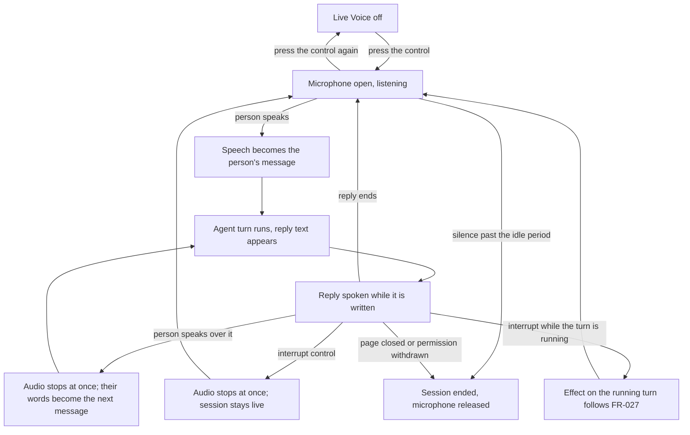

# Feature Specification: Live Voice Conversation

**Feature Branch**: `055-live-voice`

**Created**: 2026-11-08

**Status**: Draft (clarified 2026-11-08)

**Resumed from**: the draft of this same file, written on this branch earlier on 2026-11-08. The delta log at the end of this file lists every change made after resuming it.

**Input**: User description (muruyung, 2026-11-08): "STT and TTS in this project still have to be switched on by hand, and they cannot do live voice — a person and an agent talking directly. I need live voice between the agent and the person, with interruption in two ways: (1) it is interrupted when the person speaks, (2) there is a dedicated interrupt control. The feature is separate from the existing STT and TTS, so it has its own control for turning live voice on. Please produce the plan, diagrams and the other reports, for example additional packages that have to be added."

## Context

Speech in Vizier today works one piece at a time. A person records a clip and one message is transcribed from it; an agent asks for a waveform and receives the whole buffer at the end; a reply is spoken after the fact, when the message is already finished. Every one of those is switched on by hand per agent, and every one is a single round trip. Nobody can speak while the answer is still being produced, and nothing listens between turns.

A conversation does not work like that. A person starts talking without pressing anything, hears the answer while it is still forming, and cuts in the moment the answer goes wrong. That last part is what makes the difference: an answer takes seconds to arrive and much longer to be spoken, so somebody who cannot interrupt has to sit through a wrong answer to find out that it was wrong.

This specification adds that as its own capability: a Live Voice control in a conversation, separate from the speech tools, which holds a conversation open with one agent — listening, answering aloud, and stopping the moment the person speaks or presses interrupt. The existing speech tools are left exactly as they are; this feature is switched on by the person, per conversation, and is off otherwise.

The two interruptions are both first-class, because they cover different rooms. Speaking over the agent is what a person does naturally where they can be heard. The control is what works in a loud room, on a poor microphone, or for someone who cannot raise their voice over the agent at all.

## Clarifications

### Session 2026-11-08 (resumed draft, three open decisions closed)

The three open questions this specification carried are decided below. Each
names who decided it: a product call belongs to the User; a technical one this specification may
make on its own is marked *in planning*.

| # | Was | Decision | Decided by |
|C1|FR-035 — which surfaces|**The chat interface only**: the WebUI in a browser and the desktop app. Discord and Telegram voice are out of this release, because a bot joining a voice channel is a different audio path, a different permission model and a much larger scope.|in planning, consistent with the User's "separate from the existing STT and TTS" instruction|
|C2|FR-036 — provider strategy|**Cascade, and only cascade, in this release**: voice activity detection on the client, then the agent's existing recogniser on one utterance, then the ordinary agent turn, then the agent's existing voice synthesised in speakable segments. A speech-to-speech realtime pipeline is *not* built now; the seams leave room for one later.|in planning, forced by the code (constraint note below)|
|C3|FR-027 — what an interruption stops|**Both, in this order**: the audio stops at once, and the running turn is cancelled the way the existing stop control cancels it. Text already produced stays in the conversation, marked interrupted. A tool call already finished is not undone.|in planning: a correction that queues behind an answer nobody wants is not an interruption|
|C4|(not asked before) transport|**The existing per-agent WebSocket, JSON frames, base64 PCM16 in 100 ms chunks.** No WebRTC, no second socket, no new endpoint: WebRTC would add signalling, a TURN server and a dependency for a stream that runs between one browser and one server.|in planning|
|C5|(not asked before) where echo is cancelled|**In the browser**, through the capture constraints the recording path already asks the browser for, plus a guard while the reply is audible. No acoustic-echo-cancellation library is added.|in planning|

### Constraint discovered in the code (this changes what FR-013 can promise)

`crates/vizier-core/src/llm/sse.rs:1-3` states that the project reads every provider body whole -
*"no streaming API"*. A turn's frames carry a finished message
(`VizierResponseContent::Message { content, stats }`,
`crates/vizier-core/src/schema/response.rs:129-132`), not token deltas.

So "the reply is spoken while it is still being written" cannot mean token by token. What it can
mean, and what FR-013 now requires: **the reply is spoken segment by segment, starting at the first
speakable segment while the later ones are still being synthesised.** For a single long message the
first words are heard once that message's text exists, not while it is being generated. Token-level
speech needs a streaming turn protocol and is a separate feature.

## User Scenarios & Testing *(mandatory)*

### User Story 1 — A conversation without typing (Priority: P1)

A person opens a conversation, presses Live Voice, and asks a question out loud. The answer starts being spoken while it is still being written into the conversation. They ask a follow-up without touching anything, then press the control again to stop; the whole exchange is in the conversation as ordinary messages, ready to be read, searched and continued by typing.

**Why this priority**: This is the request itself. On its own it already replaces typing for a person who would rather talk, and every other story only makes that loop safer or more controllable.

**Independent Test**: In a conversation whose agent has a working recognizer and voice, press the control, ask a short question, hear the answer, ask a follow-up with no further press, and end the session. Both questions and both answers are in the conversation as text.

**Acceptance Scenarios**:

1. **Given** a conversation with Live Voice off, **When** the person presses the control and speaks a question, **Then** the question appears as their message, the reply appears as the agent's message, and the reply is heard.
2. **Given** a spoken question, **When** the person stays silent for a few seconds, **Then** the session is still listening and the microphone is still open.
3. **Given** a live session, **When** the person asks a follow-up without pressing anything, **Then** it is submitted and answered like the first question.
4. **Given** a live session, **When** the person presses the control again, **Then** the session ends, the microphone is released, and every turn remains in the conversation.
5. **Given** a finished session, **When** the conversation is opened later, **Then** the voice turns read exactly like typed ones and typing continues the conversation normally.
6. **Given** Live Voice has never been used, **When** the person uses the existing speech tools, **Then** nothing about them changes.

---

### User Story 2 — Stopping the agent by speaking (Priority: P1)

The agent is halfway through an answer that has gone the wrong way. The person says "no, the other file" out loud, and the voice stops in the middle of the sentence. Their correction is now the next message, and the answer that follows picks it up. They never reach for the interface.

**Why this priority**: Talking over someone is the natural way to stop them. Without it, live voice is an announcement that cannot be argued with.

**Independent Test**: Have the agent speak a long answer, start speaking over it, and confirm the audio stops before the interrupting words are transcribed, that those words arrive as the person's message, and that the interrupted answer is marked as interrupted.

**Acceptance Scenarios**:

1. **Given** the agent is speaking, **When** the person begins to speak, **Then** the audio stops at once, before their first word has been transcribed.
2. **Given** that interruption, **When** transcription finishes, **Then** the words appear as the person's message and are answered, and the interrupted reply stays in the conversation marked as interrupted.
3. **Given** an interrupted reply, **When** the next reply is spoken, **Then** no part of the interrupted one is heard again.
4. **Given** the device's own speakers and no headphones, **When** the agent speaks at high volume, **Then** the session does not stop itself; only the person's voice interrupts it.
5. **Given** the person makes a short sound too brief to be a message, **When** it ends, **Then** the agent's speech has stopped, no message is sent, and the session is listening again.

---

### User Story 3 — Stopping the agent with a control (Priority: P1)

In a noisy café, on a bad microphone, or with a quiet voice, the person cannot speak over the agent. They press the interrupt control beside the Live Voice control. The voice stops at once, the session stays live, and they can type the correction, or say it once the room is quieter.

**Why this priority**: A person who cannot out-talk the agent would otherwise have no way to stop a wrong answer without ending the whole session — which makes the feature unusable exactly where it is most wanted.

**Independent Test**: With the agent speaking, press interrupt; the audio stops and the session still listens. Then type a message and confirm it is answered and spoken.

**Acceptance Scenarios**:

1. **Given** the agent is speaking, **When** the person presses interrupt, **Then** the audio stops at once and the session stays live.
2. **Given** an interrupted session, **When** the person types a message, **Then** it is answered and the reply is spoken.
3. **Given** the agent has not started speaking yet, **When** the person presses interrupt, **Then** the session stays live and needs no restart; what happens to the running turn follows FR-027.
4. **Given** an interrupted but live session, **When** no further speech arrives for the idle period, **Then** the session ends like any other.

---

### User Story 4 — A session never keeps the microphone (Priority: P2)

A person closes the tab in the middle of an answer, or walks away leaving the session live. The voice stops, the microphone indicator goes out, and the conversation keeps the text. When they come back the control is off, and nothing listens until they press it.

**Why this priority**: A live microphone is the risk this feature introduces. Everything else is worth nothing if the microphone stays open when the person believes it is closed.

**Independent Test**: With a live session, close the page; confirm the operating system's microphone indicator goes out and the reply's text is saved. Leave a session silent past the idle period; confirm it ends and says why.

**Acceptance Scenarios**:

1. **Given** a live session, **When** the person leaves the conversation or closes the page, **Then** the audio stops, the microphone is released, and a reply in flight finishes as text without being spoken.
2. **Given** a live session and no speech, **When** the idle period passes, **Then** the session ends with a visible reason and the microphone is released.
3. **Given** a live session, **When** microphone permission is withdrawn in the browser or the operating system, **Then** the session ends at once and does not try the microphone again.
4. **Given** a live session, **When** the agent is deleted or restarted, or the conversation is deleted, **Then** the session ends and an answer in flight is not spoken.
5. **Given** any session that ended, **When** the person looks at the conversation, **Then** its text is intact and the control reads off.
6. **Given** a live session in one tab, **When** another tab or another person opens the same conversation, **Then** they are told a session is active and cannot start a second one.

---

### User Story 5 — A broken session explains itself (Priority: P2)

Recognition comes back empty, the voice provider errors in the middle of an answer, or the network drops. The session says what happened, keeps the text, and either recovers or ends with a reason. It never sits there looking live while doing nothing.

**Why this priority**: Every provider in this path is a network call that can fail. Silence that looks like listening is the failure mode people trust least.

**Independent Test**: Cut the connection mid-answer; the session shows reconnecting and stops the audio. Restore it within the limit and the same conversation continues. Cut it for longer and the session ends with a reason, with the answer's text still in the conversation.

**Acceptance Scenarios**:

1. **Given** a live session, **When** recognition returns nothing intelligible, **Then** the person is told, no message is sent, and the session listens again.
2. **Given** an answer being spoken, **When** the voice provider fails, **Then** the rest of the answer still appears as text, the failure is reported, and the session listens again.
3. **Given** a live session, **When** the connection drops, **Then** the state reads reconnecting within 2 seconds and the audio stops; **When** it returns within 30 seconds, **Then** the same session continues without duplicating the message in flight.
4. **Given** the connection does not return in that time, **When** the wait ends, **Then** the session ends with the reason and the text is kept.

---

### Interaction Flow (both interruption modes)

Every path that leaves `listen` or `speak` except the two interruptions ends the session, and every ending releases the microphone (FR-028, FR-029).

### Edge Cases

- **The person speaks over the agent without headphones**: the device's speakers feed the microphone. The session must not treat its own voice as the person, at any output volume; the person's real voice still interrupts immediately.
- **A second person in the room, or a television**: background speech is not the person using the device. It must not become a message on its own; only speech the session can attribute to the person may be submitted, and noise must not stop the agent mid-answer beyond what a real interruption would.
- **A very short utterance** ("yes", "no", "stop"): recognised and submitted as a message rather than discarded as noise. Anything shorter than a word stops the audio and sends nothing (Story 2, scenario 5).
- **A long monologue**: an utterance is cut at the maximum length (default 60 seconds) and submitted, so a person speaking for minutes still gets answers.
- **Silence in the middle of a sentence**: a pause shorter than the end-of-utterance period does not split the message.
- **The person speaks while the agent is still thinking**, before any audio: their words become the next message; whether the running turn is also cancelled is the decision in FR-027.
- **The person types while the agent is speaking**: the audio stops, as with the interrupt control (FR-025).
- **An answer full of code, a table or a long URL**: the conversation keeps all of it; the spoken form skips what cannot be read aloud and says the rest is in the conversation.
- **The provider is slow**: waiting is visible, the session never appears to be listening while an answer is still pending, and a stalled provider ends in a reported failure rather than an endless wait.
- **The microphone is unplugged mid-session** or the device is switched: the session reports the lost device and does not silently stay "live".
- **The page is reloaded mid-session**: the session ends with the page, the microphone is released, and the conversation is intact; a reloaded page starts with the control off.
- **The person is on a phone browser and the screen locks**: the session must treat the resulting suspension as an end with a reason, not as a live session that stopped hearing.
- **A person speaking another language** than the conversation's configured one: the transcript may be wrong; the session is expected to follow the configured language, and changing it mid-session is out of scope.
- **Two live sessions on two conversations at once**: allowed; each has its own audio, and stopping one does not touch the other.
- **A dream, a scheduled task or a background report**: no live voice; the capability exists only while a person has a session open.
- **A conversation in a mode that restricts what the agent may do** (a Plan chat): a voice message follows the same rules as a typed one, including any refusal.
- **Vizier restarts mid-session**: the session ends; the conversation and every completed turn survive.
- **A build without the capability**: the control does not appear and every existing speech feature behaves as before.

## Requirements *(mandatory)*

### Functional Requirements

**The control and the session**

- **FR-001**: Every conversation MUST offer a dedicated Live Voice control, visibly separate from the existing attachment/recording and spoken-reply controls. It MUST be off by default in every conversation and on every visit, and its state MUST NOT be remembered between visits.
- **FR-002**: Pressing the control MUST start a live voice session on that conversation with its agent; pressing it while a session is live MUST end it. The control MUST show which of the two the next press does.
- **FR-003**: Live Voice MUST be independent of the existing speech-to-text and text-to-speech tools in both directions: starting it MUST NOT enable, disable or reconfigure those tools, and their switches MUST neither start it nor block it.
- **FR-004**: Starting MUST require both a usable recognizer and a usable voice for that agent. When one is missing, the control MUST name what is missing and how to set it, and MUST NOT start; a session that can only listen, or only speak, MUST NOT be presented as live voice.
- **FR-005**: A session MUST belong to one person in one conversation. Only someone allowed to chat there may start or end it. Anyone else opening the conversation MUST be told that a session is active and MUST NOT be able to start a second one on it.
- **FR-006**: The control MUST show, without a page reload: off, connecting, listening, waiting for the agent, speaking, interrupted, reconnecting, ended with a reason, failed with a reason.
- **FR-007**: A voice message MUST run the same turn as a typed one: same conversation history, same mode rules, same tools, same permissions, same memory, same usage accounting. Live Voice MUST NOT add, remove or alter the agent's tools, memory or permissions.
- **FR-008**: A session MUST use the agent's own model and speech configuration. Live Voice MUST NOT silently change what typed turns use.

**The conversation loop**

- **FR-009**: The session MUST decide on its own when the person starts and stops speaking; the person MUST NOT press anything between turns.
- **FR-010**: When the person stops speaking for a short pause (default 800 ms), or an utterance reaches the maximum length (default 60 seconds), the utterance MUST be transcribed and submitted as a message in that conversation.
- **FR-011**: Each submitted message MUST appear in the conversation as that person's message, marked as spoken, with the transcript as its content. The session MUST NOT add anything else to the conversation on the person's behalf.
- **FR-012**: The agent's reply text MUST appear in the conversation as it is generated and MUST be spoken aloud in the same session; the spoken words MUST correspond to the text shown.
- **FR-013**: Speaking a reply MUST begin at its first speakable segment, and each further segment MUST be synthesised while the previous one is being heard, so that a long answer is preceded by no long silence and does not wait for its own last sentence. (Token-by-token speech is excluded: the turn protocol delivers a finished message — see the constraint note under Clarifications.)
- **FR-014**: The spoken form MUST NOT read formatting marks aloud (punctuation used as markup, code fences, raw URLs). What cannot be spoken MUST be skipped with a short notice that the conversation holds the rest to read.
- **FR-015**: After a reply ends, or after an interruption, the session MUST return to listening without a press.
- **FR-016**: Raw audio MUST NOT be stored. Only the transcript and the reply text are kept, as for typed turns, under the same access rules and retention as the conversation.
- **FR-017**: With each voice message the agent MUST be told that the message came by speech and that its reply will be spoken, so it can answer in a form that suits listening. That indication MUST apply to that turn only and MUST NOT change what a typed turn sees.
- **FR-018**: Typing MUST stay available during a session: a message typed while a session is live is answered like any other, and its reply is spoken.

**Interruption**

- **FR-019**: While the agent is speaking, the person beginning to speak MUST stop the audio at once — before their words have been transcribed — and the session MUST move to listening.
- **FR-020**: A dedicated interrupt control MUST be available for the whole of a live session. Pressing it MUST stop the agent's audio at once and MUST NOT end the session.
- **FR-021**: The interrupt control MUST work at any moment of a session; pressed while nothing is being spoken, it MUST leave the session live and unchanged.
- **FR-022**: After an interruption, no part of the interrupted reply MUST be heard later, and the session MUST NOT resume speaking it on its own.
- **FR-023**: An interrupted reply MUST remain in the conversation as the agent's message, marked as interrupted and readable as far as it was produced, so the person can see what they did not hear.
- **FR-024**: The words that caused a barge-in MUST become the person's next message, unless they were too short to be one, in which case no message is sent.
- **FR-025**: A message typed while the agent is speaking MUST stop the audio, exactly as the interrupt control does.
- **FR-026**: The session MUST NOT interrupt itself: its own audio coming back through the device's speakers MUST NOT be taken as the person speaking, at any output volume and with or without headphones.
- **FR-027**: An interruption MUST stop the audio at once and MUST also cancel the running turn, on the same path as the existing stop control: text produced so far stays in the conversation marked interrupted, nothing further is generated or spoken, and a tool call already completed is not undone. When the agent was working rather than speaking, an interruption MUST behave the same way, so "I interrupted while it was editing files" has exactly one answer. *(Decided in Clarifications C3.)*

**Ending, silence and failure**

- **FR-028**: A session MUST end when the person presses the control again, leaves the conversation or closes the page, microphone permission is withdrawn, the conversation is deleted, the agent is deleted, restarted or reconfigured, or the connection is lost beyond the reconnect limit. In every case the audio MUST stop and the microphone MUST be released.
- **FR-029**: A session MUST end after the person has been silent for the idle period (default 3 minutes), with a visible reason and the microphone released, so a forgotten session cannot listen on.
- **FR-030**: When microphone access is refused or no device is available, the session MUST fail with a clear reason, MUST NOT be left half-started, and MUST be retryable without reloading the page.
- **FR-031**: When recognition yields nothing intelligible, the person MUST be told, no message MUST be sent, and the session MUST return to listening.
- **FR-032**: When the voice provider fails while speaking, the rest of the reply MUST still appear as text, the failure MUST be reported, and the session MUST return to listening.
- **FR-033**: A lost connection MUST show as reconnecting and stop the audio within 2 seconds. If the connection returns within 30 seconds the same session MUST continue without duplicating the message in flight; otherwise the session MUST end with the reason.
- **FR-034**: Ending a session for any reason MUST NOT delete or alter the conversation's text. A reply in flight when the session ends MUST finish as text and MUST NOT be spoken.

**Speech capabilities**

- **FR-035**: Live Voice MUST be offered on the chat interface only — the WebUI in a browser and the desktop app — and MUST NOT be offered on the Discord or Telegram channels in this release. A channel that cannot carry it MUST behave exactly as it does today. *(Decided in Clarifications C1.)*
- **FR-036**: The session MUST obtain recognition and speech in a cascade — the utterance recognised as one clip, the reply produced by the ordinary turn, the reply synthesised in segments — through the recogniser and the voice the agent is already configured with. It MUST NOT require a speech-to-speech or realtime provider, and MUST NOT add a per-minute cost for a session that carries no more audio than its own turns. *(Decided in Clarifications C2.)*
- **FR-036a**: The session and its speech MUST sit behind one seam, so a realtime speech-to-speech pipeline can be added later behind configuration without changing the frames, the controls or this feature's outcomes.
- **FR-037**: Recognition MUST follow the conversation's configured speech language. Where the agent already lets a person choose that language, a session MUST be able to use the chosen one.
- **FR-038**: For the whole of a session the interface MUST show that the microphone is open, including when the window is not focused.
- **FR-039**: Documentation MUST cover starting and ending a session, what audio is sent to which provider, what is stored, the two ways to interrupt, and the limits (idle stop, one session per conversation).

**Unchanged behaviour**

- **FR-040**: With Live Voice never used, every existing behaviour MUST be unchanged: the speech tools, automatic transcription of uploaded audio, requested spoken replies, text chat, and the HTTP and WebSocket surface as existing clients see it.
- **FR-041**: Live Voice MUST NOT be required by any existing capability; a build without it MUST leave every existing speech and chat feature working.

### Key Entities

- **Live voice session**: one person, one conversation, one agent. Has a state, a start time, an end reason, and the recognizer and voice it used. Exists only while live.
- **Voice message**: a conversation message that came from speech or was spoken. Carries whether it was voice-originated, whether it was interrupted, and how much of it was spoken. Read, searched and deleted like any other message.
- **Utterance**: one continuous stretch of the person's speech inside a session, from the pause before it to the pause after it. Produces at most one message, or none when it is noise.
- **Interruption**: one event, caused by the person speaking, a typed message, or the interrupt control. Records when it happened and how far into the reply, and whether the turn continued (FR-027).
- **Live voice setting**: per agent — which recognizer and which voice a session uses. Separate from the speech tools' own enablement.

## Success Criteria *(mandatory)*

### Measurable Outcomes

- **SC-001**: From the person finishing a short question to the first audible word of the answer: under 2 seconds in at least 90% of turns and under 3 seconds in at least 99%, on an ordinary laptop and ordinary broadband, with a hosted recogniser and voice. A local-only recogniser or voice is CPU-bound, is expected to be slower, and is measured separately (open question Q3).
- **SC-002**: Speaking over the agent silences it within 300 ms in at least 95% of attempts, and the next answer addresses the interrupting message in at least 90% of those attempts.
- **SC-003**: The interrupt control silences the agent within 200 ms in every attempt, in 100 of 100 tries.
- **SC-004**: In a 10-minute session of at least 15 turns, at least 90% of turns need no interaction other than speaking, and every spoken message appears in the conversation — no lost turns in 100%.
- **SC-005**: A person who has never used the feature is talking to the agent within 20 seconds of first seeing the control, permission prompt included, on the first attempt, in at least 90% of tries and without reading documentation.
- **SC-006**: With Live Voice never used, every existing speech behaviour is unchanged, verified by the existing checks for those features.
- **SC-007**: A session left with no speech ends within its idle period in 100% of cases, and the operating system's microphone indicator is off within 2 seconds of any ending.
- **SC-008**: With the device's speakers at 80% volume and no headphones, a 10-minute conversation produces no self-interruption, and no part of an interrupted reply is ever heard after the interruption, in 100 of 100 tries.
- **SC-009**: A failed call never leaves the session looking live: in every scenario of FR-030 to FR-033 the person sees a reason within 5 seconds and the microphone is released or the session is ended.

## Assumptions

- **Surface**: settled — the chat interface only, the WebUI in a browser and the desktop app (FR-035, Clarifications C1).
- **Provider strategy**: settled — the cascade in FR-036 (Clarifications C2), with the pipeline interchangeable behind one seam.
- **Interruption semantics**: settled — the audio stops and the turn is cancelled (FR-027, Clarifications C3).
- **Defaults chosen here** (800 ms end-of-utterance, 60-second longest utterance, 3-minute idle stop, 30-second reconnect, one session per conversation, off by default): all are defaults, may be tuned during planning, and do not change the intent.
- **Nothing is stored beyond text**: audio is never written to disk, so a person can read a session but not re-listen to it. Keeping audio would be a separate decision with its own retention and access rules.
- **The device is the one running the interface**: microphone and speakers are on the person's machine, which is also where the desktop app runs. Headphones improve the experience; echo cancellation is expected to make them optional, and a session that interrupts itself is a hard failure (SC-008).
- **Speech quality is the provider's**: recognition mistakes are not corrected by this feature; a person fixes a bad transcript by speaking again or by typing. Editing a sent message is out of scope.
- **Language**: one language per conversation, the agent's configured one. Switching language mid-session, and per-utterance detection, are out of scope.
- **No new agent capability**: voice is another way to send a message, not a new tool. Nothing becomes available to the agent that typing does not already allow, and the mode of the conversation still decides what it may do.
- **Non-goals**: wake words and always-listening sessions; a session with no conversation open; multi-person or conference capture; telephone calls; recording or re-listening to audio; speech on the Discord and Telegram channels beyond the decision in FR-035; on-device-only operation as a guarantee.
- **Cost**: the person's provider account pays. A session costs roughly what its turns cost plus its speech, so the idle stop is the main guard, and FR-036 is where a per-minute provider would change that picture.
- **Optional capability**: per the constitution the feature sits behind an optional build capability, added without changing the shape of the existing API, and a build that leaves it out keeps everything else working (FR-041).
- **Verification**: like every agent-observable change, the checks are scripted against the offline provider for the turn side (message in, history out) with the speech providers faked, plus one live-provider check marked as such for real audio; the plan turns that into concrete steps.

## Open Questions (for the User — five, each with a default)

Nothing here blocks the plan: each has a decision taken in planning that the plan and the contracts
already follow. Changing one is a change of scope, not a rewrite.

| # | Question | Default taken now | What changes if the answer differs |
|---|---|---|---|
| **Q1** | When the person interrupts, should the agent stop **talking only**, or stop talking **and stop working**? | Stop both: the audio stops and the running turn is cancelled on the existing stop path (FR-027, C3). | "Talking only" keeps a long tool-using turn alive in the background; it needs a way to show that the turn is still running while the person speaks, and the reply's text keeps growing after they cut in. |
| **Q2** | One live session per conversation, and a second tab refused — or should the second tab take the session over? | Refused, and the second tab is told a session is active (FR-005). | "Take over" needs a hand-off rule (what happens to audio already sent) and is a new failure mode; "refused" is one line of state. |
| **Q3** | Is the 2-second target (SC-001) measured only with hosted speech, with local models excluded? | Yes: hosted only, local measured separately. | Requiring it for a local whisper model means either accepting a slower target or dropping local models from the live path. |
| **Q4** | A hard cap on concurrent live sessions per agent or per server? | No extra cap: the deployment's existing socket limits apply (contract, limits table). | A cap is one config value and one refusal reason, but it is a policy the User should set, not the plan. |
| **Q5** | How visible should "this message was spoken" and "this reply was interrupted" be in the conversation? | A small badge with a tooltip, nothing more (FR-011, FR-023). | Hiding the badges makes the conversation read like typing; making them loud makes voice turns look like errors. |

## Delta Log — changes made when this draft was resumed (2026-11-08)

**Found at**: `specs/055-live-voice/spec.md`, branch `055-live-voice`, untracked, 255 lines, written
earlier the same day. The branch had no commits of its own, so this draft existed only in the working
tree.

**Kept unchanged**: the Context, all five user stories with their acceptance scenarios, the
interaction-flow diagram, the edge-case list, FR-001 to FR-012, FR-014 to FR-022, FR-024 to FR-026,
FR-028 to FR-034, FR-037 to FR-041, all key entities, SC-002 to SC-009, and the non-goals.
Nothing was deleted.

**Changed** (in order of appearance):

| Change | Why |
|---|---|
| Header: status clarified, "resumed from" note added | Provenance: this file is a resumed draft, not a new specification |
| New `## Clarifications` section (C1–C5) and the code-constraint note | The three open questions are answered; the transport and echo decisions are recorded where a reviewer will look for them |
| FR-013 rewritten | The turn protocol has no token streaming (`llm/sse.rs:1-3`), so the requirement now promises segment-by-segment speech and says why |
| FR-023: "readable in full" → "readable as far as it was produced" | Cancelling the turn (FR-027) means there is no "full" text to keep |
| FR-027 decided | Interruption stops the audio and cancels the turn |
| FR-035 decided | Chat interface only; Discord and Telegram excluded |
| FR-036 decided, FR-036a added | Cascade only in this release; one seam so a realtime pipeline can come later |
| Three Assumptions lines replaced | They described the questions as open; they now record the answers |
| SC-001 scoped to hosted speech | A local recogniser cannot meet 2 s; measuring it as if it could would make the criterion meaningless |
| New `## Open Questions` section | Five questions for the User, each with the default the plan already follows |

**Verification**: no open-question marker remains in this file — a `grep -c` for the marker phrase returns `0`, and the only remaining pointer to it is this sentence's description of the delta.
